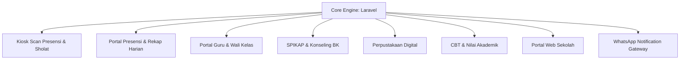

# 🏫 Gambaran Sistem - Smart School ERP & Presensi

## 1. Latar Belakang & Visi
Sistem ini dibangun untuk mendigitalisasi operasional harian sekolah secara terpadu (*unified school management*). Fokus utamanya meliputi pencatatan kehadiran yang akurat, pembinaan siswa oleh wali kelas dan guru BK, digitalisasi perpustakaan sekolah, pelaporan transparan kepada orang tua via WhatsApp, serta integrasi portal web publik dan asesmen akademik.

---

## 2. Ruang Lingkup Sistem

Sistem terdiri dari beberapa pilar utama yang saling terintegrasi:

### Pilar Utama:
1. **Presensi Siswa**:
   - Scan barcode/RFID via kiosk mandiri di gerbang sekolah (pagi & kepulangan).
   - Validasi jam datang, batas toleransi keterlambatan, dan status kehadiran (Hadir, Terlambat, Sakit, Izin, Alpa).
   - Presensi sholat dhuhur & jumat berjamaah.
2. **Komunikasi Orang Tua / Wali Siswa**:
   - Notifikasi otomatis WhatsApp saat siswa hadir, terlambat, tidak hadir (*belum scan*), atau permohonan izin disetujui.
   - Ringkasan harian presensi per kelas ke wali kelas dan kepala sekolah.
3. **Pembinaan Siswa & Bimbingan Konseling**:
   - Modul Guru Wali: Catatan bimbingan karakter, jurnal harian, dan pemantauan perkembangan siswa asuh.
   - Modul SPIKAP (Sistem Pengaduan & Bimbingan Konseling): Penanganan aduan siswa, pemanggilan konseling, dan rujukan kasus.
4. **Perpustakaan Sekolah**:
   - Master buku (termasuk klasifikasi DDC), pencetakan barcode eksemplar, kartu anggota, dan transaksi sirkulasi (peminjaman & pengembalian).
5. **Akademik & CBT**:
   - Manajemen mata pelajaran, KKM, jadwal ujian, dan rekapitulasi nilai ujian.
6. **Portal Web Profil Sekolah**:
   - Profil sekolah, berita, agenda kegiatan, galeri foto/video, fasilitas sarpras, direktori guru/staf, dan layanan publik.

---

## 3. Profil Pengguna Sistem

| Role Pengguna | Platform Akses | Tanggung Jawab Utama |
| :--- | :--- | :--- |
| **Super Admin** | Panel Admin Filament (`/admin`) | Konfigurasi sistem penuh, tahun ajaran, pengaturan sekolah, manajemen role. |
| **Admin Presensi** | Panel Admin & Portal Presensi | Monitoring presensi harian, kelola mesin scan, template WhatsApp, broadcast. |
| **Guru & Wali Kelas** | Portal Guru (`/portal-guru`) | Presensi sholat kelas, input izin/sakit, jurnal guru wali, cek kehadiran kelas. |
| **Guru BK** | Portal SPIKAP (`/spikap`) | Tindak lanjut pengaduan, sesi konseling, pencatatan rujukan siswa. |
| **Petugas Perpustakaan** | Panel Perpustakaan (`/admin/perpustakaan`) | Katalog buku, barcode label, transaksi peminjaman buku, denda & pengembalian. |
| **Siswa & Orang Tua** | Kiosk Scan & WhatsApp | Melakukan scan kehadiran harian dan menerima laporan notifikasi presensi. |
| **Publik / Tamu** | Website Utama (`/`) | Mengakses informasi profil sekolah, pengaduan masyarakat, survei layanan. |
