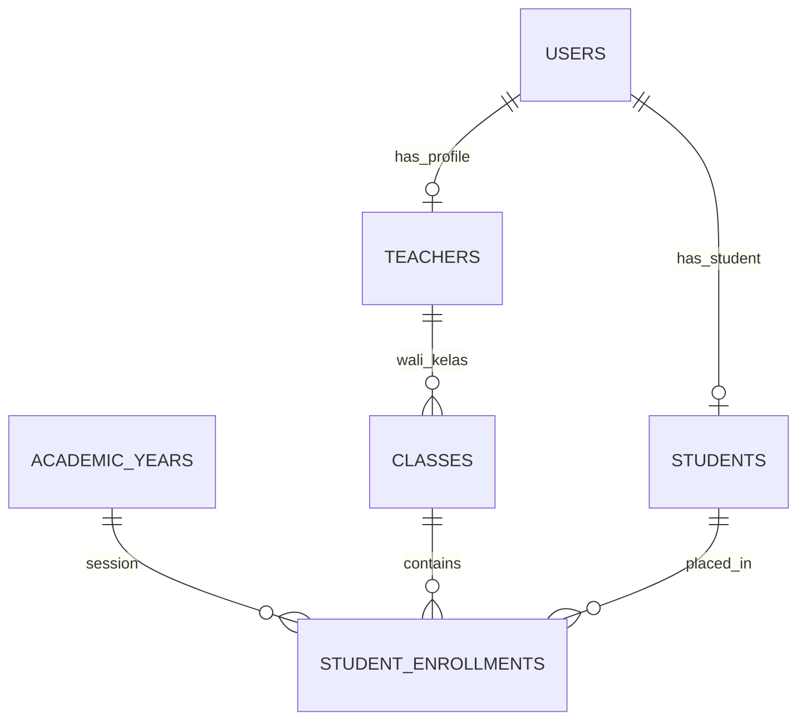

# 🗄️ Klaster 1: Identitas, Pengguna, & Struktur Akademik

Dokumen ini memuat skema tabel yang mengatur akun pengguna, guru, siswa, kelas, tahun ajaran, dan hak akses RBAC.

---

## 1. Daftar Tabel dalam Klaster

| Nama Tabel | Peran Utama | Model Eloquent |
| :--- | :--- | :--- |
| `users` | Kredensial login & otorisasi sistem | [`App\Models\User`](file:///home/sutris-remote/Documents/projek-laravel/projek-absensi-barcode/app/Models/User.php) |
| `teachers` | Data profil guru & staf (GTK) | [`App\Models\Guru`](file:///home/sutris-remote/Documents/projek-laravel/projek-absensi-barcode/app/Models/Guru.php) |
| `students` | Data profil siswa & kontak orang tua | [`App\Models\Siswa`](file:///home/sutris-remote/Documents/projek-laravel/projek-absensi-barcode/app/Models/Siswa.php) |
| `classes` | Master rombongan belajar / kelas | [`App\Models\Kelas`](file:///home/sutris-remote/Documents/projek-laravel/projek-absensi-barcode/app/Models/Kelas.php) |
| `academic_years` | Master tahun ajaran & status aktif | [`App\Models\TahunAjaran`](file:///home/sutris-remote/Documents/projek-laravel/projek-absensi-barcode/app/Models/TahunAjaran.php) |
| `student_enrollments` | Riwayat penempatan kelas siswa per tahun ajaran | [`App\Models\EnrollmentSiswa`](file:///home/sutris-remote/Documents/projek-laravel/projek-absensi-barcode/app/Models/EnrollmentSiswa.php) |
| `class_academic_year` | Penugasan wali kelas per rombel tahunan | [`App\Models\KelasAjaran`](file:///home/sutris-remote/Documents/projek-laravel/projek-absensi-barcode/app/Models/KelasAjaran.php) |
| `pengajarans` | Pemetaan guru pengampu mata pelajaran | [`App\Models\Pengajaran`](file:///home/sutris-remote/Documents/projek-laravel/projek-absensi-barcode/app/Models/Pengajaran.php) |
| `teacher_class_accesses`| Izin akses pantau tambahan guru ke kelas non-wali | [`App\Models\TeacherClassAccess`](file:///home/sutris-remote/Documents/projek-laravel/projek-absensi-barcode/app/Models/TeacherClassAccess.php) |
| `jabatans` & `teacher_jabatan` | Master jabatan struktural guru & riwayat SK | [`App\Models\Jabatan`](file:///home/sutris-remote/Documents/projek-laravel/projek-absensi-barcode/app/Models/Jabatan.php) |
| `riwayat_pindah_kelas` | Audit trail rotasi siswa antarkelas berjalan | [`App\Models\RiwayatPindahKelas`](file:///home/sutris-remote/Documents/projek-laravel/projek-absensi-barcode/app/Models/RiwayatPindahKelas.php) |
| `roles` & `permissions` | RBAC Spatie Permission | Spatie Models |

---

## 2. Definisi Skema Kolom Utama

### A. Tabel `users`
- `id` (char(36), PK): UUID akun login.
- `name` (varchar(255)): Nama tampilan user.
- `email` (varchar(255), Unique): Alamat email untuk login.
- `password` (varchar(255)): Hash password Bcrypt / Argon2id.
- `no_hp` (varchar(20), nullable): Kontak WhatsApp (ternormalisasi `628...`).
- `is_super_admin` (boolean): Flag khusus hak akses tertinggi sistem.
- `must_change_password` (boolean): Flag mewajibkan ganti password pada login pertama.
- `remember_token`, `created_at`, `updated_at`.

### B. Tabel `teachers`
- `id` (char(36), PK): UUID guru.
- `user_id` (char(36), FK, nullable): Relasi 1-to-1 ke `users.id`.
- `name` (varchar(255)): Nama lengkap guru beserta gelar.
- `nip` (varchar(255), nullable, Unique): Nomor Induk Pegawai / NUPTK.
- `jenis_kelamin` (enum('L','P')): Jenis kelamin.
- `no_hp` (varchar(20), nullable): Nomor WhatsApp guru (format `628...`).
- `photo_path` (varchar(255), nullable): Path foto profil di storage publik.
- `microsite_url` (varchar(255), nullable): Tautan web profil / portofolio mandiri.
- `deleted_at`: Soft delete timestamp.

### C. Tabel `students`
- `id` (char(36), PK): UUID siswa.
- `user_id` (char(36), FK, nullable): Relasi 1-to-1 ke `users.id` (akun Portal Siswa).
- `nisn` (varchar(255), Unique): Nomor Induk Siswa Nasional (10 digit).
- `nis` (varchar(255), Unique): Nomor Induk Sekolah (basis barcode kartu pelajar).
- `name` (varchar(255)): Nama lengkap siswa sesuai akta lahir.
- `gender` (enum('L','P')): Jenis kelamin.
- `birth_place` & `birth_date`: Tempat dan tanggal lahir.
- `address` (text): Alamat domisili tempat tinggal.
- `status` (varchar(20)): Status kesiswaan (`aktif`, `lulus`, `mutasi`).
- `no_hp` (varchar(20), nullable): Nomor WhatsApp siswa.
- `no_hp_orang_tua` (varchar(20), nullable): Nomor WhatsApp orang tua untuk broadcast presensi otomatis.
- `photo_path`: Path pas foto kartu siswa di storage publik.
- `deleted_at`: Soft delete timestamp.

### D. Tabel `classes`
- `id` (char(36), PK): UUID kelas fisik.
- `name` (varchar(255)): Nama rombel fisik (contoh: `VII-A`, `VIII-B`, `IX-C`).
- `grade_level` (tinyint): Tingkat jenjang kelas (7, 8, atau 9).
- `deleted_at`: Soft delete timestamp.

### E. Tabel `student_enrollments`
- `id` (char(36), PK): UUID enrollment.
- `student_id` (char(36), FK): Relasi ke `students.id`.
- `class_id` (char(36), FK): Relasi ke `classes.id`.
- `academic_year_id` (char(36), FK): Relasi ke `academic_years.id`.
- `status` (varchar(50)): Status keaktifan rombel (`aktif`, `naik`, `lulus`, `tinggal`).

---

## 3. Diagram Relasi

---

> [!NOTE]
> Untuk penjelasan mendalam mengenai alur bisnis kesiswaan, generator barcode, otomasi akun, dan integrasi lintas portal ERP, silakan rujuk ke dokumentasi modul:
> - [`docs/03-fitur/08-master-data-siswa-dan-guru/01-arsitektur-dan-skema-database-erp.md`](file:///home/sutris-remote/Documents/projek-laravel/projek-absensi-barcode/docs/03-fitur/08-master-data-siswa-dan-guru/01-arsitektur-dan-skema-database-erp.md)

