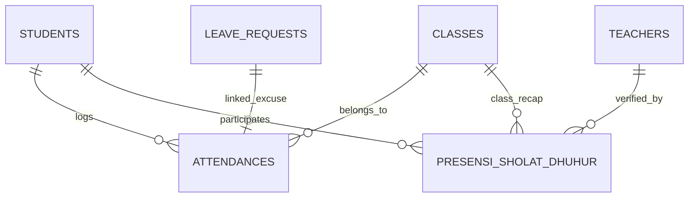

# 🗄️ Klaster 2: Presensi Kiosk, Scan Gerbang, & Ibadah Sholat

Dokumen ini memuat skema tabel pencatatan kehadiran gerbang sekolah, log scan, permohonan izin/sakit, dan ibadah sholat berjamaah.

---

## 1. Daftar Tabel dalam Klaster

| Nama Tabel | Peran Utama | Model Eloquent |
| :--- | :--- | :--- |
| `attendances` | Transaksi presensi harian siswa (masuk & pulang) | `App\Models\Attendance` |
| `scan_logs` | Log mentah semua pemindaian di kiosk gerbang | `App\Models\ScanLog` |
| `leave_requests` | Pengajuan izin / sakit siswa | `App\Models\LeaveRequest` |
| `leave_request_logs` | Audit trail verifikasi dan persetujuan izin | `App\Models\LeaveRequestLog` |
| `presensi_sholat_dhuhur` | Transaksi presensi sholat dhuhur & jumat | `App\Models\PresensiSholatDhuhur` |
| `holidays` | Kalender libur nasional & cuti sekolah | `App\Models\Holiday` |

---

## 2. Definisi Skema Kolom Utama

### A. Tabel `attendances` (Inti Presensi Gerbang)
- `id` (char(36), PK): UUID catatan presensi.
- `student_id` (char(36), FK): Relasi ke `students.id`.
- `enrollment_id` (char(36), FK, nullable): Relasi ke `student_enrollments.id`.
- `class_id` (char(36), FK): Relasi ke `classes.id` (denormalisasi untuk query cepat).
- `academic_year_id` (char(36), FK): Relasi ke `academic_years.id`.
- `date` (date): Tanggal presensi (`YYYY-MM-DD`).
- `scan_time` (time, nullable): Jam scan masuk pagi.
- `scan_out_time` (time, nullable): Jam scan pulang sore.
- `status` (varchar(255)): Status kedatangan (`present`, `late`, `excused`, `sick`, `absent`).
- `status_pulang` (varchar(255), nullable): Status kepulangan (`pulang`, `pulang_cepat`).
- `late_minutes` (int unsigned): Menit keterlambatan dihitung dari `batas_jam_datang`.
- `source` (varchar(255)): Asal pencatatan (`kiosk`, `manual_admin`, `wali_kelas`, `auto_alpa`).
- `leave_request_id` (char(36), FK, nullable): Relasi ke `leave_requests.id` jika bersumber dari izin.
- `is_manual_input` (boolean): Flag apakah diinput manual oleh admin/guru.

### B. Tabel `presensi_sholat_dhuhur` (Inti Presensi Ibadah)
- `id` (char(36), PK): UUID presensi sholat.
- `student_id` (char(36), FK): Relasi ke `students.id`.
- `class_id` (char(36), FK): Relasi ke `classes.id`.
- `academic_year_id` (char(36), FK): Relasi ke `academic_years.id`.
- `enrollment_id` (char(36), FK, nullable): Relasi ke `student_enrollments.id`.
- `date` (date): Tanggal pelaksanaan.
- `status` (enum('hadir','ijin','tidak_hadir','libur')): Status ibadah siswa.
- `keterangan` (varchar(255), nullable): Keterangan opsional (misal: 'haid / berhalangan' bagi siswi).
- `input_by_teacher_id` (char(36), FK, nullable): Guru/wali kelas yang mencatat (jika manual).

### C. Tabel `leave_requests` (Izin & Sakit)
- `id` (char(36), PK): UUID permohonan.
- `student_id` (char(36), FK): Siswa yang mengajukan.
- `type` (enum('izin','sakit')): Jenis permohonan.
- `start_date` & `end_date`: Rentang tanggal izin.
- `reason` (text): Alasan izin/sakit.
- `attachment_path` (varchar(255), nullable): Foto surat dokter/surat orang tua.
- `status` (enum('pending','approved','rejected')): Status persetujuan wali kelas.

---

## 3. Diagram Relasi

