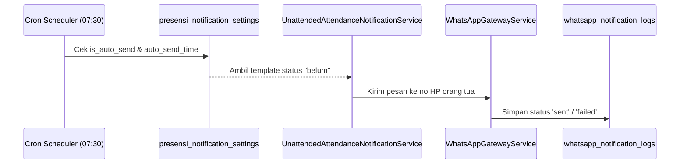

# 🗄️ Klaster 3: WhatsApp Gateway & Notifikasi Presensi

Dokumen ini memuat skema konfigurasi API gateway WhatsApp, template notifikasi pesan, penjadwalan otomatisasi kirim, dan audit log riwayat pengiriman.

---

## 1. Daftar Tabel dalam Klaster

| Nama Tabel | Peran Utama | Model Eloquent |
| :--- | :--- | :--- |
| `whatsapp_settings` | Kredensial API gateway (token, domain, nama sender) | `App\Models\WhatsAppSetting` |
| `presensi_notification_settings` | Template pesan per status & konfigurasi auto-send | `App\Models\PresensiNotificationSetting` |
| `whatsapp_notification_logs` | Histori log setiap pengiriman pesan WhatsApp | `App\Models\WhatsAppNotificationLog` |
| `presensi_daily_report_settings` | Jadwal rekap harian ke wali kelas | `App\Models\PresensiDailyReportSetting` |
| `presensi_school_summary_settings` | Jadwal rekap ringkasan ke kepala sekolah | `App\Models\PresensiSchoolSummarySetting` |

---

## 2. Definisi Skema Kolom Utama

### A. Tabel `presensi_notification_settings`
- `id` (bigint unsigned, PK, Auto Increment).
- `status_presensi` (varchar(255), Unique): Target status (`hadir`, `terlambat`, `belum`, `sholat_dhuhur`, dll).
- `is_active` (boolean): Apakah notifikasi untuk status ini diaktifkan.
- `is_auto_send` (boolean): Mengaktifkan cron pengiriman otomatis.
- `auto_send_time` (time, default '07:30:00'): Jam cron dijalankan (misal jam 07:30 untuk siswa belum presensi).
- `last_auto_send_date` (date, nullable): Tanggal terakhir cron otomatis berjalan sukses.
- `manual_send_date` (date, nullable): Tanggal pengiriman manual terakhir dilakukan.
- `manual_send_count` (int, default 0): Menghitung batas kuota broadcast manual (maksimal 5x/hari).
- `recipients` (json, nullable): Target penerima (contoh: `["ortu"]`, `["wali_kelas"]`).
- `template_pesan` (text): Template string dengan placeholder dinamis:
  - `{nama_siswa}`, `{kelas}`, `{tanggal}`, `{jam}`, `{status_kehadiran}`, `{nama_wali_kelas}`, `{nama_sekolah}`.

### B. Tabel `whatsapp_settings`
- `id` (bigint unsigned, PK).
- `api_key` / `token` (varchar(255), nullable): Kredensial autentikasi API provider WhatsApp.
- `sender_number` / `device_id` (varchar(50)): Nomor pengirim aktif.
- `endpoint_url` (varchar(255), nullable): Base URL gateway vendor.
- `is_active` (boolean): Status aktif integrasi gateway.

### C. Tabel `whatsapp_notification_logs`
- `id` (char(36), PK): UUID log pengiriman.
- `recipient_phone` (varchar(20)): Nomor tujuan penerima.
- `recipient_name` (varchar(255), nullable): Nama penerima (ortu/guru).
- `message` (text): Isi teks pesan yang dikirim.
- `status` (enum('pending','sent','failed')): Status respon API.
- `response_payload` (json, nullable): Respon balasan dari server API gateway.
- `created_at` (timestamp): Waktu pengiriman.

---

## 3. Diagram Alur Data Notifikasi

