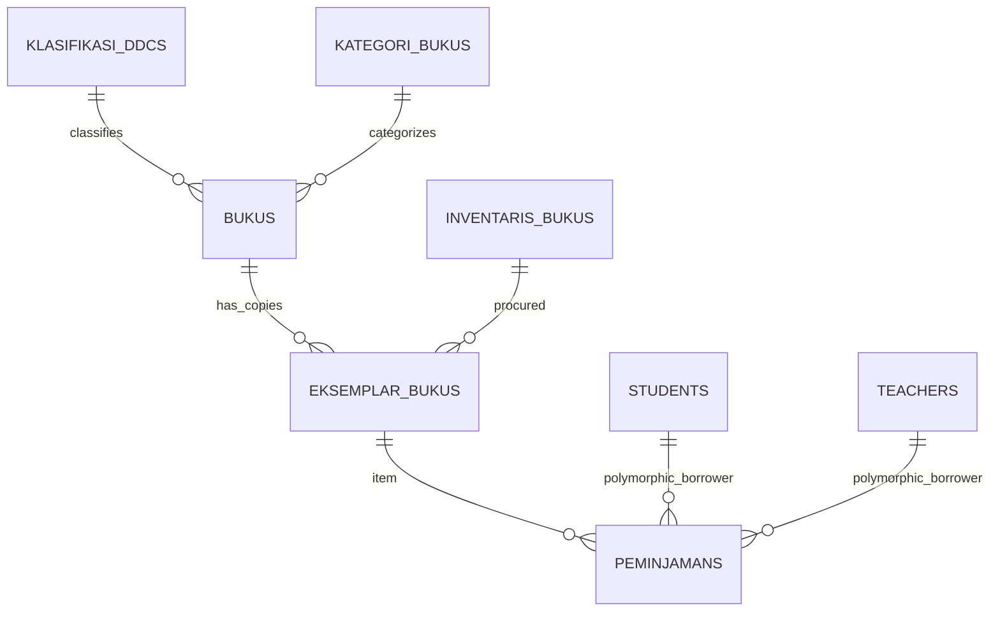

# 🗄️ Klaster 5: Manajemen Perpustakaan Digital (Smart Library)

Dokumen ini memuat skema tabel koleksi buku, eksemplar fisik, klasifikasi DDC, inventaris perolehan, transaksi sirkulasi peminjaman, dan buku tamu.

---

## 1. Daftar Tabel dalam Klaster

| Nama Tabel | Peran Utama | Model Eloquent |
| :--- | :--- | :--- |
| `bukus` | Master data judul buku (katalog) | `App\Models\Buku` |
| `eksemplar_bukus` | Salinan fisik buku dengan barcode unik | `App\Models\EksemplarBuku` |
| `klasifikasi_ddcs` | Klasifikasi Dewey Decimal Classification (000-900) | `App\Models\KlasifikasiDdc` |
| `kategori_bukus` | Kategori jenis buku (fiksi, referensi, paket) | `App\Models\KategoriBuku` |
| `inventaris_bukus` | Data pengadaan / sumber perolehan buku | `App\Models\InventarisBuku` |
| `peminjamans` | Transaksi sirkulasi peminjaman & pengembalian | `App\Models\Peminjaman` |
| `kunjungan_perpustakaans` | Buku tamu kunjungan harian perpus | `App\Models\KunjunganPerpustakaan` |

---

## 2. Definisi Skema Kolom Utama

### A. Tabel `bukus`
- `id` (char(36), PK): UUID judul buku.
- `judul` (varchar(255)): Judul buku.
- `pengarang` & `penerbit`: Identitas kepengarangan.
- `tahun_terbit` (year): Tahun publikasi.
- `isbn` (varchar(50), nullable): Nomor ISBN internasional.
- `klasifikasi_ddc_id` (char(36), FK, nullable): Relasi ke `klasifikasi_ddcs.id`.
- `kategori_buku_id` (char(36), FK, nullable): Relasi ke `kategori_bukus.id`.
- `sampul_buku` (varchar(255), nullable): Path gambar cover buku.
- `file_pdf` (varchar(255), nullable): File e-book digital (jika tersedia).

### B. Tabel `eksemplar_bukus` (Fisik Buku)
- `id` (char(36), PK): UUID eksemplar.
- `buku_id` (char(36), FK): Relasi ke judul induk `bukus.id`.
- `nomor_barcode` (varchar(100), Unique): Kode barcode fisik eksemplar (dicetak di stiker buku).
- `nomor_induk` (varchar(100), nullable): Nomor inventaris buku fisik.
- `status` (enum('tersedia','dipinjam','hilang','rusak')): Ketersediaan buku di rak.
- `inventaris_buku_id` (char(36), FK, nullable): Relasi ke sumber pengadaan.

### C. Tabel `peminjamans` (Relasi Polimorfik)
- `id` (char(36), PK): UUID transaksi peminjaman.
- `eksemplar_id` (char(36), FK): Relasi ke `eksemplar_bukus.id`.
- `peminjam_type` (varchar(255)): Tipe peminjam (`App\Models\Student` atau `App\Models\Teacher`).
- `peminjam_id` (char(36)): ID peminjam (polymorphic relation).
- `tipe_peminjaman` (varchar(20), default 'reguler'): Jenis peminjaman (`reguler`, `paket_kelas`).
- `tanggal_pinjam` (date): Tanggal buku diambil.
- `tanggal_jatuh_tempo` (date): Batas waktu pengembalian buku.
- `tanggal_kembali` (date, nullable): Tanggal riil buku dikembalikan.
- `status` (enum('dipinjam','dikembalikan','terlambat','hilang')).
- `petugas_id` (char(36), FK, nullable): ID petugas perpustakaan yang melayani.
- `catatan` (text, nullable).

---

## 3. Diagram Relasi

