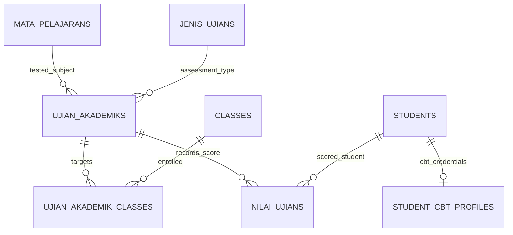

# 🗄️ Klaster 6: Asesmen CBT & Nilai Akademik

Dokumen ini memuat skema tabel manajemen mata pelajaran, profil akun CBT siswa, jadwal ujian akademik, dan rekapitulasi nilai.

---

## 1. Daftar Tabel dalam Klaster

| Nama Tabel | Peran Utama | Model Eloquent |
| :--- | :--- | :--- |
| `mata_pelajarans` | Master mata pelajaran & KKM | `App\Models\MataPelajaran` |
| `pengajarans` | Jadwal pembagian guru mengajar per mapel/kelas | `App\Models\Pengajaran` |
| `jenis_ujians` | Jenis asesmen (STS, SAS, Ujian Sekolah) | `App\Models\JenisUjian` |
| `ujian_akademiks` | Paket asesmen ujian terjadwal | `App\Models\UjianAkademik` |
| `ujian_akademik_classes` | Pivot kelas target yang mengikuti ujian | Pivot Table |
| `student_cbt_profiles` | Kredensial akun ujian CBT siswa (token & sandi) | `App\Models\StudentCbtProfile` |
| `nilai_ujians` | Perolehan skor nilai hasil ujian siswa | `App\Models\NilaiUjian` |

---

## 2. Definisi Skema Kolom Utama

### A. Tabel `mata_pelajarans`
- `id` (char(36), PK): UUID mapel.
- `nama` (varchar(255)): Nama mata pelajaran (contoh: Matematika, Bahasa Indonesia).
- `kode` (varchar(50), nullable): Kode mapel (contoh: `MTK-01`).
- `kategori` (varchar(50)): Kelompok mapel (A, B, Mulok).
- `kkm` (decimal(5,2)): Nilai ambang batas KKM/KKTP.

### B. Tabel `ujian_akademiks`
- `id` (char(36), PK): UUID paket ujian.
- `jenis_ujian_id` (char(36), FK): Relasi ke `jenis_ujians.id`.
- `mata_pelajaran_id` (char(36), FK): Relasi ke `mata_pelajarans.id`.
- `academic_year_id` (char(36), FK): Relasi ke tahun ajaran aktif.
- `judul` (varchar(255)): Nama ujian (contoh: *SAS Semester Ganjil 2026/2027*).
- `tanggal_mulai` & `tanggal_selesai`: Periode pelaksanaan tes.
- `is_published` (boolean): Flag publikasi nilai ke siswa/orang tua.

### C. Tabel `nilai_ujians`
- `id` (char(36), PK): UUID catatan nilai.
- `ujian_akademik_id` (char(36), FK): Relasi ke `ujian_akademiks.id`.
- `student_id` (char(36), FK): Relasi ke `students.id`.
- `nilai` (decimal(5,2)): Skor nilai riil yang diperoleh siswa (skala 0 - 100).
- `catatan` (text, nullable): Evaluasi guru penguji.

---

## 3. Diagram Relasi

