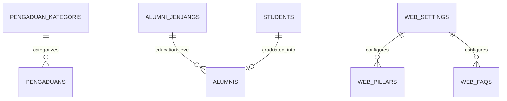

# 🗄️ Klaster 7: Portal Web Publik, Pengaduan Masyarakat, & Alumni

Dokumen ini memuat skema tabel modul portal website profil sekolah, sarana prasarana, pengaduan masyarakat umum, dan tracer study alumni.

---

## 1. Daftar Tabel dalam Klaster

| Nama Tabel | Peran Utama | Model Eloquent |
| :--- | :--- | :--- |
| `web_settings` | Konfigurasi tampilan web, hero, kontak, sambutan | `App\Models\WebSetting` |
| `web_artikels` | Berita, opini, & pengumuman sekolah | `App\Models\WebArtikel` |
| `web_sarpras` | Fasilitas sarana dan prasarana sekolah | `App\Models\WebSarpra` |
| `web_galeris` | Galeri dokumentasi foto & video kegiatan | `App\Models\WebGaleri` |
| `web_faqs` | Frequently Asked Questions (Tanya Jawab Publik) | `App\Models\WebFaq` |
| `web_pillars` | Pilar keunggulan / branding sekolah | `App\Models\WebPillar` |
| `web_halaman_layanans` | Halaman info layanan publik sekolah | `App\Models\WebHalamanLayanan` |
| `pengaduans` | Tiket pengaduan & aspirasi masyarakat/wali | `App\Models\Pengaduan` |
| `pengaduan_kategoris` | Kategori aduan publik (fasilitas, kurikulum, dll) | `App\Models\PengaduanKategori` |
| `alumnis` | Database pelacakan alumni (*Tracer Study*) | `App\Models\Alumni` |
| `alumni_jenjangs` | Jenjang studi lanjutan alumni (SMA, SMK, MA) | `App\Models\AlumniJenjang` |

---

## 2. Definisi Skema Kolom Utama

### A. Tabel `pengaduans` (Pengaduan Publik)
- `id` (char(36), PK): UUID tiket aduan.
- `kategori_id` (char(36), FK): Relasi ke `pengaduan_kategoris.id`.
- `nama_pelapor` (varchar(255)): Nama pengirim aduan.
- `nomor_kontak` (varchar(50)): Nomor WhatsApp pelapor untuk balasan.
- `judul_aduan` & `isi_aduan` (text): Uraian keluhan atau masukan.
- `status` (enum('baru','diproses','selesai','ditolak')).
- `tanggapan` (text, nullable): Respon tindak lanjut dari pihak sekolah.

### B. Tabel `alumnis` (Tracer Study)
- `id` (char(36), PK): UUID data alumni.
- `student_id` (char(36), FK, nullable): Relasi ke data historis `students.id`.
- `tahun_lulus` (year): Tahun kelulusan dari sekolah.
- `jenjang_lanjutan` (varchar(100)): Nama sekolah lanjutan atas (SMA/SMK).
- `pekerjaan` / `status_saat_ini` (varchar(255), nullable).

---

## 3. Diagram Relasi

