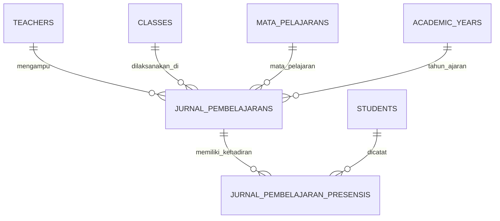

# 🗄️ Klaster 8: Jurnal Pembelajaran Guru & Presensi Sesi KBM

Dokumen ini memuat skema tabel yang mengatur pencatatan agenda harian kegiatan belajar mengajar (KBM) guru dan snapshot presensi sesi kelas.

---

## 1. Daftar Tabel dalam Klaster

| Nama Tabel | Peran Utama | Model Eloquent |
| :--- | :--- | :--- |
| `jurnal_pembelajarans` | Transaksi sesi jurnal KBM harian guru | [`App\Models\JurnalPembelajaran`](file:///home/sutris-remote/Documents/projek-laravel/projek-absensi-barcode/app/Models/JurnalPembelajaran.php) |
| `jurnal_pembelajaran_presensis` | Detail snapshot presensi siswa per sesi jurnal | [`App\Models\JurnalPembelajaranPresensi`](file:///home/sutris-remote/Documents/projek-laravel/projek-absensi-barcode/app/Models/JurnalPembelajaranPresensi.php) |

---

## 2. Definisi Skema Kolom

### A. Tabel `jurnal_pembelajarans` (Master Jurnal)
- `id` (char(36), PK): UUID unik jurnal.
- `academic_year_id` (char(36), FK): Relasi ke `academic_years.id`.
- `teacher_id` (char(36), FK): Relasi ke `teachers.id` (guru pengampu).
- `class_id` (char(36), FK): Relasi ke `classes.id` (rombel yang diajar).
- `mata_pelajaran_id` (bigint unsigned, FK): Relasi ke `mata_pelajarans.id`.
- `tanggal` (date): Tanggal pelaksanaan KBM.
- `jam_mulai` (tinyint unsigned): Jam pelajaran awal (misal: 3).
- `durasi_jp` (tinyint unsigned): Durasi jam pelajaran (misal: 2 JP).
- `jam_selesai` (tinyint unsigned): Jam pelajaran akhir terhitung otomatis (`jam_mulai + durasi_jp - 1`).
- `jam_ke_label` (varchar(50)): Label teks ringkas (contoh: `"Jam ke 3 - 4 (2 JP)"`).
- `materi` (varchar(255)): Judul materi / bab / topik pokok.
- `uraian_materi` (text): Ringkasan aktivitas KBM, metode pengajaran, latihan siswa.
- `refleksi` (text, nullable): Refleksi guru, tindak lanjut, evaluasi pemahaman siswa.
- `total_siswa` (smallint unsigned, default 0): Total siswa terdaftar di rombel saat sesi KBM.
- `total_hadir` (smallint unsigned, default 0): Jumlah siswa yang hadir mengikuti KBM.
- `total_tidak_mengikuti` (smallint unsigned, default 0): Jumlah siswa tidak hadir / meninggalkan kelas.
- `created_by` (char(36), FK, nullable): User penginput jurnal (relasi ke `users.id`).
- `timestamps`: `created_at` & `updated_at`.

### B. Tabel `jurnal_pembelajaran_presensis` (Detail Presensi Sesi)
- `id` (char(36), PK): UUID unik presensi sesi.
- `jurnal_pembelajaran_id` (char(36), FK): Relasi cascade ke `jurnal_pembelajarans.id`.
- `student_id` (char(36), FK): Relasi ke `students.id`.
- `status_jurnal` (enum('hadir', 'tidak_mengikuti')): Status siswa di jam pelajaran tersebut.
- `status_gerbang_snapshot` (varchar(50)): Status di tabel `attendances` saat jurnal dibuat (`hadir`, `telat`, `izin`, `sakit`, `alpa`, `belum_absen`).
- `keterangan` (varchar(255), nullable): Keterangan opsional jika siswa tidak mengikuti KBM (contoh: "Izin ke UKS jam ke-2", "Meninggalkan kelas").
- `diabsenkan_telat_di_gerbang` (boolean, default false): Menandakan siswa ini sebelumnya belum absen gerbang lalu diabsenkan telat via form jurnal.
- `timestamps`: `created_at` & `updated_at`.

---

## 3. Diagram Relasi

