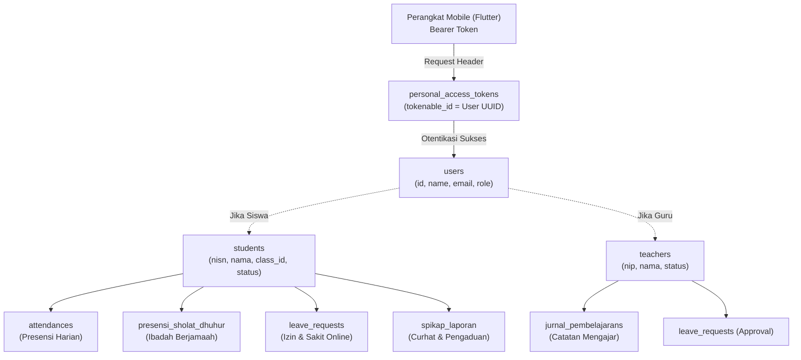

# 🔐 Klaster Basis Data: Autentikasi API & Personal Access Tokens (Sanctum)

Dokumen ini menjelaskan struktur data dan mekanisme persistensi token autentikasi yang digunakan oleh **Aplikasi Mobile (Flutter)** untuk mengakses endpoint REST API Laravel.

---

## 💡 Filosofi Basis Data untuk Aplikasi Mobile

### ❓ Apakah Perlu Membuat Database Baru untuk Mobile?
**TIDAK.** Aplikasi mobile tidak memerlukan database server baru ataupun database lokal yang terpisah dari sistem utama.
1. **Satu Database Terpadu**: Aplikasi mobile membaca dan menulis langsung ke database MySQL yang sama dengan web Filament (`absensi_barcode`).
   - Saat siswa melakukan izin online lewat HP, data masuk ke tabel `leave_requests`.
   - Saat guru mencatat presensi sholat dari HP, data masuk ke tabel `presensi_sholat_dhuhur`.
   - Saat siswa memindai barcode kartu di gerbang, data dibaca dari tabel `students`.
2. **Hanya Menambah 1 Tabel Bawaan (Sanctum)**:
   Backend Laravel hanya membutuhkan 1 tabel tambahan, yaitu `personal_access_tokens`, untuk melacak sesi login aktif perangkat HP siswa dan guru.
3. **Penyimpanan di Perangkat HP (Client-Side)**:
   Di sisi HP, aplikasi Flutter hanya menggunakan penyimpanan lokal ringan:
   - `flutter_secure_storage`: Menyimpan Bearer Token terenkripsi (Android Keystore).
   - `shared_preferences`: Menyimpan konfigurasi dasar seperti URL Server Sekolah terpilih (`BASE_URL`), Nama Sekolah, dan NISN/NIP terakhir (*Remember Me*).

---

## 🗄️ Struktur Tabel: `personal_access_tokens`

Tabel ini diterbitkan oleh package resmi **Laravel Sanctum** dan telah disesuaikan agar mendukung primary key **UUID (`char(36)`)** yang digunakan oleh model `User` sistem ini.

```text
┌────────────────────────────────────────────────────────┐
│               personal_access_tokens                   │
├───────────────────────┬──────────────┬─────────────────┤
│ Field                 │ Tipe Data    │ Keterangan      │
├───────────────────────┼──────────────┼─────────────────┤
│ id                    │ BIGINT UNSIGNED (PK, Auto Inc) │ ID unik token   │
│ tokenable_type        │ VARCHAR(255) │ Model (App\Models\User) │
│ tokenable_id          │ VARCHAR(64)  │ UUID User (char(36))    │
│ name                  │ TEXT         │ Info Device/HP Pengguna │
│ token                 │ VARCHAR(64)  │ SHA-256 Hash Token (Unique) │
│ abilities             │ TEXT         │ Scope Hak Akses (JSON)  │
│ last_used_at          │ TIMESTAMP    │ Waktu Terakhir Request  │
│ expires_at            │ TIMESTAMP    │ Waktu Token Kedaluwarsa │
│ created_at            │ TIMESTAMP    │ Waktu Login Dibuat      │
│ updated_at            │ TIMESTAMP    │ Waktu Pembaruan Sesi    │
└───────────────────────┴──────────────┴─────────────────┤
```

### Penjelasan Field Kunci:
- **`tokenable_type` & `tokenable_id`**:
  Relasi polimorfik ke tabel `users`. Karena `users.id` menggunakan UUID (`HasUuids`), `tokenable_id` menggunakan tipe `VARCHAR(64)` dengan indeks komposit `['tokenable_type', 'tokenable_id']`.
- **`name`**:
  Menyimpan identitas perangkat saat login, contoh:
  `"Samsung Galaxy A53 (Portal Siswa)"` atau `"Xiaomi Redmi Note 12 (Guru)"`.
- **`token`**:
  Nilai hash SHA-256 dari plain token yang diberikan ke HP pengguna. Token mentah hanya ditampilkan sekali saat login (`POST /api/v1/auth/login`) dan tidak pernah disimpan secara teks polos di database demi keamanan.
- **`expires_at`**:
  Waktu kedaluwarsa sesi token. Secara berkala, token yang sudah usang dapat dibersihkan dengan perintah:
  ```bash
  php artisan sanctum:prune-expired
  ```

---

## 🔄 Alur Relasi Pengguna Mobile ke Data Akademik



---

## 🧹 Kebijakan Keamanan & Pencabutan Sesi (Revocation)

1. **Logout Tunggal (`POST /api/v1/auth/logout`)**:
   Hanya menghapus token sesi pada perangkat yang sedang logout (`$user->currentAccessToken()->delete()`). Sesi login pengguna di perangkat lain atau browser web tetap aktif.
2. **Logout Semua Perangkat**:
   Jika pengguna mengganti password atau kehilangan HP, semua token aktif dapat dicabut sekaligus:
   ```php
   $user->tokens()->delete();
   ```

