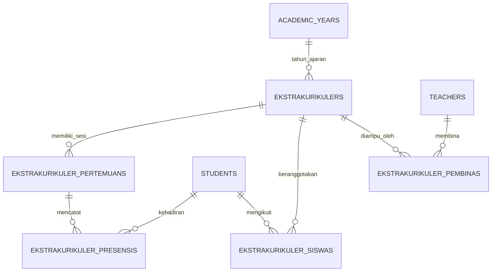

# 🗄️ Klaster 10: Ekstrakurikuler, Pertemuan, & Presensi Barcode

Dokumen ini memuat skema basis data untuk modul **Ekstrakurikuler** lintas portal (Portal Akademik, Kiosk Scanner Barcode, Portal Guru Pembina, dan Portal Siswa).

---

## 1. Daftar Tabel dalam Klaster

| Nama Tabel | Peran Utama | Model Eloquent |
| :--- | :--- | :--- |
| `ekstrakurikulers` | Master data kegiatan ekstrakurikuler per tahun ajaran & slug URL kiosk | [`App\Models\Ekstrakurikuler`](file:///home/sutris-remote/Documents/projek-laravel/projek-absensi-barcode/app/Models/Ekstrakurikuler.php) |
| `ekstrakurikuler_pembinas` | Pivot multi-guru pembina yang ditugaskan mengampu ekstrakurikuler | Relasi `BelongsToMany` pada `Ekstrakurikuler` & `Guru` |
| `ekstrakurikuler_siswas` | Daftar anggota siswa aktif/nonaktif dalam suatu ekstrakurikuler | [`App\Models\EkstrakurikulerSiswa`](file:///home/sutris-remote/Documents/projek-laravel/projek-absensi-barcode/app/Models/EkstrakurikulerSiswa.php) |
| `ekstrakurikuler_pertemuans` | Sesi pertemuan / latihan per tanggal beserta jurnal materi & status sesi | [`App\Models\EkstrakurikulerPertemuan`](file:///home/sutris-remote/Documents/projek-laravel/projek-absensi-barcode/app/Models/EkstrakurikulerPertemuan.php) |
| `ekstrakurikuler_presensis` | Catatan kehadiran anggota per pertemuan (`hadir`, `izin`, `sakit`, `alpa`) dari scan kiosk atau input manual | [`App\Models\EkstrakurikulerPresensi`](file:///home/sutris-remote/Documents/projek-laravel/projek-absensi-barcode/app/Models/EkstrakurikulerPresensi.php) |

---

## 2. Definisi Skema Kolom & Constraint

### A. Tabel `ekstrakurikulers`
Migrasi: [`2026_11_16_140000_create_ekstrakurikuler_tables.php`](file:///home/sutris-remote/Documents/projek-laravel/projek-absensi-barcode/database/migrations/2026_11_16_140000_create_ekstrakurikuler_tables.php), [`2026_11_16_150000_add_slug_and_pertemuan_presensi_to_ekstrakurikuler.php`](file:///home/sutris-remote/Documents/projek-laravel/projek-absensi-barcode/database/migrations/2026_11_16_150000_add_slug_and_pertemuan_presensi_to_ekstrakurikuler.php)

- `id` (`char(36)`, PK): UUID ekstrakurikuler.
- `academic_year_id` (`char(36)`, FK -> `academic_years.id`, `restrictOnDelete`): Tahun ajaran penyelenggaraan.
- `nama_ekskul` (`varchar(120)`): Nama ekstrakurikuler (misal: `PRAMUKA`, `Sepak Bola`).
- `slug` (`varchar(160)`, `nullable`, `unique`): Slug unik otomatis (misal: `pramuka-20262027`) untuk URL Kiosk Scanner (`/portal-presensi/scan-ekstrakurikuler/{slug}`), Portal Guru, dan Portal Siswa.
- `keterangan` (`text`, `nullable`): Deskripsi/jadwal singkat ekstrakurikuler.
- `status_aktif` (`boolean`, default `true`): Penanda aktif/tidaknya ekstrakurikuler dan kiosk scanner-nya.
- `created_at`, `updated_at`, `deleted_at` (Soft Deletes).
- **Index**:
  - `ekskul_year_active_idx` (`academic_year_id`, `status_aktif`)
  - `ekskul_year_nama_idx` (`academic_year_id`, `nama_ekskul`)

### B. Tabel `ekstrakurikuler_pembinas`
- `ekstrakurikuler_id` (`char(36)`, FK -> `ekstrakurikulers.id`, `cascadeOnDelete`).
- `teacher_id` (`char(36)`, FK -> `teachers.id`, `restrictOnDelete`).
- `created_at`, `updated_at`.
- **Primary Key**: Composite (`ekstrakurikuler_id`, `teacher_id` — `ekskul_pembina_pk`).
- **Index**: `ekskul_pembina_teacher_idx` (`teacher_id`).

### C. Tabel `ekstrakurikuler_siswas`
- `id` (`char(36)`, PK): UUID keanggotaan siswa.
- `ekstrakurikuler_id` (`char(36)`, FK -> `ekstrakurikulers.id`, `cascadeOnDelete`).
- `student_id` (`char(36)`, FK -> `students.id`, `restrictOnDelete`).
- `tanggal_gabung` (`date`, `nullable`): Tanggal bergabung ke ekstrakurikuler.
- `status_aktif` (`boolean`, default `true`): Status keaktifan anggota di ekstrakurikuler ini.
- `created_at`, `updated_at`.
- **Unique & Index**:
  - `ekskul_siswa_unique` (`ekstrakurikuler_id`, `student_id`) — satu siswa hanya memiliki satu baris keanggotaan per ekstrakurikuler.
  - `ekskul_siswa_active_idx` (`ekstrakurikuler_id`, `status_aktif`).

### D. Tabel `ekstrakurikuler_pertemuans`
- `id` (`char(36)`, PK): UUID sesi pertemuan.
- `ekstrakurikuler_id` (`char(36)`, FK -> `ekstrakurikulers.id`, `cascadeOnDelete`).
- `pertemuan_ke` (`int unsigned`): Nomor urut pertemuan per ekstrakurikuler (otomatis `max(pertemuan_ke) + 1`).
- `tanggal` (`date`): Tanggal pertemuan dilaksanakan (WIB).
- `judul_kegiatan` (`varchar(200)`, `nullable`): Judul/materi latihan (misal: `PBB Dasar`, `Semaphore`).
- `catatan_pembina` (`text`, `nullable`): Evaluasi atau catatan khusus pembina.
- `created_by_teacher_id` (`char(36)`, `nullable`, FK -> `teachers.id`, `nullOnDelete`).
- `created_by_user_id` (`char(36)`, `nullable`, FK -> `users.id`, `nullOnDelete`).
- `status_sesi` (`enum('aktif', 'selesai')`, default `'aktif'`): Status jurnal sesi pertemuan.
- `created_at`, `updated_at`.
- **Unique & Index**:
  - `ekskul_pertemuan_date_unique` (`ekstrakurikuler_id`, `tanggal`) — maksimal 1 sesi pertemuan per tanggal per ekstrakurikuler; dibuat otomatis saat scan kiosk pertama pada tanggal tersebut via `EkstrakurikulerPertemuan::findOrCreateForDate()` atau manual oleh Pembina.
  - `ekskul_pertemuan_ke_idx` (`ekstrakurikuler_id`, `pertemuan_ke`).

### E. Tabel `ekstrakurikuler_presensis`
- `id` (`char(36)`, PK): UUID presensi anggota.
- `pertemuan_id` (`char(36)`, FK -> `ekstrakurikuler_pertemuans.id`, `cascadeOnDelete`).
- `ekstrakurikuler_id` (`char(36)`, FK -> `ekstrakurikulers.id`, `cascadeOnDelete`): Denormalisasi untuk mempercepat query rekap per ekskul & per siswa.
- `student_id` (`char(36)`, FK -> `students.id`, `cascadeOnDelete`).
- `status` (`enum('hadir', 'izin', 'sakit', 'alpa')`, default `'hadir'`).
- `scan_time` (`time`, `nullable`): Waktu scan barcode (WIB) jika hadir lewat kiosk atau waktu input manual Hadir.
- `is_manual_input` (`boolean`, default `false`): `false` untuk hasil scan kiosk, `true` untuk input/perubahan manual pembina.
- `manual_input_by_id` (`char(36)`, `nullable`): ID aktor polimorfik penginput manual (`teachers.id` atau `users.id`).
- `manual_input_by_type` (`varchar(255)`, `nullable`): Class model aktor polimorfik (`App\Models\Guru` atau `App\Models\User`).
- `manual_input_at` (`timestamp`, `nullable`): Waktu input/koreksi manual.
- `manual_input_user_id` (`char(36)`, `nullable`, FK -> `users.id`, `nullOnDelete`).
- `scanned_by` (`char(36)`, `nullable`, FK -> `users.id`, `nullOnDelete`): Petugas/pembina yang membuka kiosk scanner saat scan berlangsung.
- `keterangan` (`varchar(255)`, `nullable`): Catatan izin/sakit/alasan manual.
- `created_at`, `updated_at`.
- **Unique & Index**:
  - `ekskul_presensi_unique` (`pertemuan_id`, `student_id`) — mencegah record presensi ganda pada pertemuan yang sama.
  - `ekskul_presensi_student_idx` (`ekstrakurikuler_id`, `student_id`).

---

## 3. Diagram Relasi (ERD)

