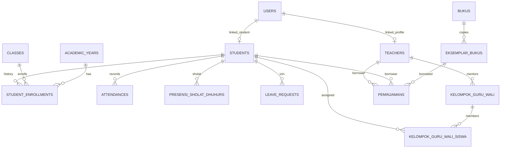

# 🗄️ Master Index Arsitektur & Relasi Database

Dokumen ini adalah **peta panduan utama** arsitektur database untuk Developer dan AI Agent. Dengan pemisahan modular per klaster, AI Agent hanya perlu membaca dokumen klaster yang relevan dengan tugas yang sedang dikerjakan untuk menghemat konteks dan mempercepat eksekusi.

---

## 📌 Peta Rujukan Cepat untuk AI Agent (File Locator)

Jika Anda (AI / Developer) sedang mengerjakan fitur tertentu, **langsung buka dokumen yang sesuai di bawah ini**:

| Modul / Fitur yang Dikerjakan | Tabel Terkait | File Rujukan Detail |
| :--- | :--- | :--- |
| **Identitas, User, Siswa, Guru, Kelas, Rombel** | `users`, `students`, `teachers`, `classes`, `academic_years`, `student_enrollments`, `roles`, `permissions` | [`01-akademik-dan-users.md`](file:///home/sutris-remote/Documents/projek-laravel/projek-absensi-barcode/docs/02-database/01-akademik-dan-users.md) & [Fitur 08: Master Data Siswa & Guru](file:///home/sutris-remote/Documents/projek-laravel/projek-absensi-barcode/docs/03-fitur/08-master-data-siswa-dan-guru/README.md) |
| **Presensi Kiosk, Scan Gerbang, Izin, Sholat** | `attendances`, `scan_logs`, `leave_requests`, `presensi_sholat_dhuhur`, `holidays` | [`02-presensi-dan-kiosk.md`](file:///home/sutris-remote/Documents/projek-laravel/projek-absensi-barcode/docs/02-database/02-presensi-dan-kiosk.md) |
| **Notifikasi WhatsApp, Gateway, Jadwal Cron** | `whatsapp_settings`, `presensi_notification_settings`, `whatsapp_notification_logs`, `presensi_daily_report_settings` | [`03-whatsapp-gateway.md`](file:///home/sutris-remote/Documents/projek-laravel/projek-absensi-barcode/docs/02-database/03-whatsapp-gateway.md) |
| **Bimbingan Guru Wali, Karakter, SPIKAP, BK** | `kelompok_guru_wali`, `kelompok_guru_wali_siswa`, `jurnal_guru_wali`, `badge_karakter_siswa`, `spikap_laporan`, `konseling_bk` | [`04-guru-wali-dan-bk.md`](file:///home/sutris-remote/Documents/projek-laravel/projek-absensi-barcode/docs/02-database/04-guru-wali-dan-bk.md) |
| **Perpustakaan Digital, Buku, Sirkulasi** | `bukus`, `eksemplar_bukus`, `peminjamans`, `klasifikasi_ddcs`, `kategori_bukus`, `kunjungan_perpustakaans` | [`05-perpustakaan.md`](file:///home/sutris-remote/Documents/projek-laravel/projek-absensi-barcode/docs/02-database/05-perpustakaan.md) |
| **CBT, Nilai, Mata Pelajaran, Asesmen** | `mata_pelajarans`, `jenis_ujians`, `ujian_akademiks`, `student_cbt_profiles`, `nilai_ujians` | [`06-cbt-dan-akademik.md`](file:///home/sutris-remote/Documents/projek-laravel/projek-absensi-barcode/docs/02-database/06-cbt-dan-akademik.md) |
| **Portal Web Sekolah, Profil, Pengaduan, Alumni** | `web_settings`, `web_artikels`, `web_sarpras`, `pengaduans`, `alumnis` | [`07-portal-web-dan-pengaduan.md`](file:///home/sutris-remote/Documents/projek-laravel/projek-absensi-barcode/docs/02-database/07-portal-web-dan-pengaduan.md) |
| **Panduan Reset & Seeder** | Eksekusi migrasi, urutan seeder, akun default | [`panduan-migrasi-seeder.md`](file:///home/sutris-remote/Documents/projek-laravel/projek-absensi-barcode/docs/02-database/panduan-migrasi-seeder.md) |

---

## 🏛️ Prinsip Arsitektural Basis Data

### 1. Primary Key Menggunakan UUID / ULID (`char(36)`)
- Tabel-tabel utama (`users`, `students`, `teachers`, `classes`, `attendances`, `presensi_sholat_dhuhur`, `bukus`, `peminjamans`, dll.) tidak menggunakan auto-increment integer, melainkan string UUID 36 karakter.
- **Tujuan**: Mencegah serangan enumerasi ID, aman disinkronkan dari perangkat Kiosk lokal, dan memudahkan integrasi lintas portal.

### 2. Denormalisasi untuk Kecepatan Kiosk (Presensi & Sholat)
- Pada tabel performa tinggi seperti `attendances` dan `presensi_sholat_dhuhur`, foreign key penting disimpan langsung:
  - `student_id` &rarr; foreign key ke `students.id`
  - `class_id` &rarr; foreign key ke `classes.id`
  - `academic_year_id` &rarr; foreign key ke `academic_years.id`
  - `enrollment_id` &rarr; foreign key ke `student_enrollments.id`
- **Tujuan**: Rekapitulasi presensi harian per kelas di dashboard dapat diagregasikan langsung dengan query `WHERE class_id = ? AND date = ?` tanpa memerlukan 4 tahap `JOIN` tabel.

### 3. Database-Level Constraint Cerdas
- Menggunakan **Virtual Generated Column** unik di MySQL.
  Contoh pada `kelompok_guru_wali_siswa.active_student_id` yang memastikan bahwa seorang siswa **hanya boleh terdaftar pada 1 kelompok guru wali aktif** dalam satu waktu langsung di level constraint database engine.

### 4. Relasi Polimorfik
- Modul peminjaman perpustakaan (`peminjamans`) menggunakan `peminjam_type` dan `peminjam_id` sehingga peminjam buku bisa berupa model `App\Models\Student` maupun `App\Models\Teacher`.

---

## 🌐 Diagram Relasi Lintas Klaster Global

