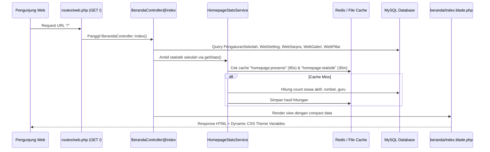

# 🌐 Fitur 01: Tampilan Web Awal (Beranda & Profil Sekolah)

Dokumen ini memuat panduan komprehensif mengenai **halaman publik utama (`/`)** sistem sekolah, mulai dari siklus request HTTP, controller, integrasi service caching, struktur section view Blade, hingga relasi ke tabel-tabel database terkait.

---

## 📌 Peta Navigasi Dokumen Fitur Web Awal

Untuk kemudahan rujukan AI Agent dan Developer:

| Dokumen | Topik Pembahasan |
| :--- | :--- |
| [`01-anatomi-section-blade.md`](file:///home/sutris-remote/Documents/projek-laravel/projek-absensi-barcode/docs/03-fitur/01-tampilan-web-awal/01-anatomi-section-blade.md) | Penjelasan detail 11 sub-view section (`hero`, `sambutan`, `profil`, `widget`, `statistik`, `fasilitas`, `guru`, `prestasi`, `berita`, `galeri`, `footer`). |
| [`02-tabel-dan-query-cache.md`](file:///home/sutris-remote/Documents/projek-laravel/projek-absensi-barcode/docs/03-fitur/01-tampilan-web-awal/02-tabel-dan-query-cache.md) | Spesifikasi kolom tabel yang dibaca (`web_settings`, `school_settings`, `web_artikels`, dll.), query Eloquent, serta TTL caching. |
| [`03-panduan-kelola-cms.md`](file:///home/sutris-remote/Documents/projek-laravel/projek-absensi-barcode/docs/03-fitur/01-tampilan-web-awal/03-panduan-kelola-cms.md) | Panduan bagi admin untuk mengubah banner hero, teks running text, video YouTube, artikel berita, dan fasilitas via `/portal-web`. |

---

## 🏛️ Arsitektur Request Lifecycle

---

## ⚙️ Berkas-Berkas Inti Fitur

1. **Routing**:
   - `routes/web.php` &rarr; `Route::get('/', [BerandaController::class, 'index'])->name('beranda');`
2. **Controller**:
   - [`app/Http/Controllers/BerandaController.php`](file:///home/sutris-remote/Documents/projek-laravel/projek-absensi-barcode/app/Http/Controllers/BerandaController.php)
3. **Dedicated Service**:
   - [`app/Services/HomepageStatsService.php`](file:///home/sutris-remote/Documents/projek-laravel/projek-absensi-barcode/app/Services/HomepageStatsService.php)
4. **Main View Template**:
   - [`resources/views/beranda/index.blade.php`](file:///home/sutris-remote/Documents/projek-laravel/projek-absensi-barcode/resources/views/beranda/index.blade.php)
5. **Section Components**:
   - Folder: `resources/views/beranda/sections/` (11 file section modular)
