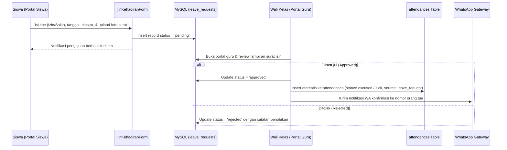
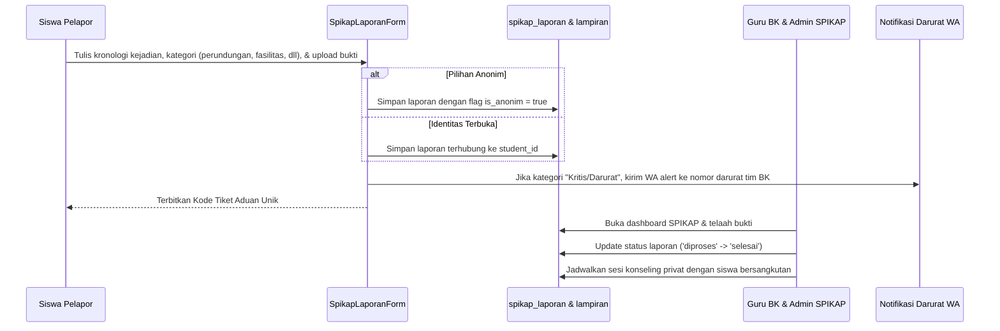

# 🔄 Alur Interaktif: Pengajuan Izin & Aduan SPIKAP

Dokumen ini memetakan alur kerja interaktif ketika siswa mengajukan permohonan izin ketidakhadiran atau mengirimkan tiket laporan aduan via Portal Siswa.

---

## 1. Alur Pengajuan Izin / Sakit Mandiri

### Tahapan Kritis Pengajuan Izin:
1. **Pencegahan Tanggal Kedaluwarsa**: Siswa tidak dapat mengajukan izin untuk tanggal yang sudah lewat melampaui batas toleransi yang diatur sekolah.
2. **Sinkronisasi Presensi**: Begitu wali kelas menekan tombol **Setujui**, sistem otomatis membuat record kehadiran di tabel `attendances` sehingga status siswa pada hari tersebut otomatis berubah dari *Belum Hadir* menjadi *Izin* atau *Sakit*.
3. **Pemberitahuan Orang Tua**: Memicu pengiriman pesan WhatsApp ke nomor HP orang tua bahwa surat izin ananda telah disetujui pihak sekolah.

---

## 2. Alur Pelaporan Aduan & Kasus SPIKAP

### Jaminan Keamanan & Privasi Siswa:
1. **Opsi Laporan Anonim**: Siswa yang takut melaporkan tindak perundungan (*bullying*) dapat menyamarkan identitasnya.
2. **Akses Terisolasi**: Guru mata pelajaran biasa tidak dapat membaca laporan SPIKAP. Data hanya dapat diakses oleh Guru BK yang memiliki permission `spikap_guru_bk` dan Kepala Sekolah.
3. **Audit Log Perubahan Status**: Setiap tahapan investigasi dicatat pada tabel `spikap_log_status` untuk menjaga akuntabilitas penanganan kasus.
