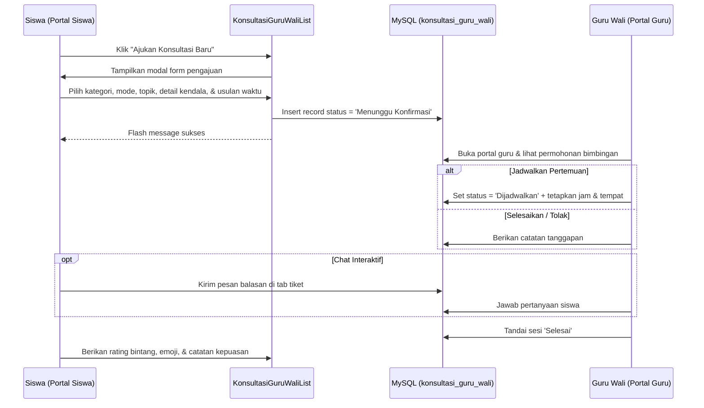

# 👨‍🏫 Fitur Guru Wali di Portal Siswa

Dokumen ini mendokumentasikan modul pembinaan karakter dan bimbingan guru wali dari sisi siswa di Portal Siswa, berdasarkan implementasi Permendikdasmen No. 11/2025.

---

## 1. Hubungan Siswa & Guru Wali Asuh

Setiap siswa yang berstatus aktif dipetakan ke dalam satu kelompok asuh guru wali melalui tabel `kelompok_guru_wali_siswa`. 
- Seorang guru wali membina sekelompok siswa (lintas kelas atau satu rombel) selama masa pendidikan.
- Di Portal Siswa, identitas guru wali (foto, nama, dan NIP) otomatis muncul di dashboard utama siswa.

---

## 2. Rute & Komponen Terkait

| Item | Keterangan |
| :--- | :--- |
| **URL Rute** | `/portal-siswa/konsultasi-guru-wali` (Nama rute: `portal-siswa.guru-wali`) |
| **Livewire Component** | [`App\Livewire\PortalSiswa\KonsultasiGuruWaliList`](file:///home/sutris-remote/Documents/projek-laravel/projek-absensi-barcode/app/Livewire/PortalSiswa/KonsultasiGuruWaliList.php) |
| **View Template** | [`resources/views/livewire/portal-siswa/konsultasi-guru-wali-list.blade.php`](file:///home/sutris-remote/Documents/projek-laravel/projek-absensi-barcode/resources/views/livewire/portal-siswa/konsultasi-guru-wali-list.blade.php) |

---

## 3. Alur Konsultasi & Bimbingan

---

## 4. 4 Kategori Pendampingan Siswa

Siswa dapat mengajukan konsultasi sesuai bidang permasalahan:
1. **Akademik**: Kesulitan memahami materi pelajaran, kiat belajar efektif, persiapan ujian asesmen.
2. **Karakter & Kedisiplinan**: Pembiasaan ibadah, manajemen waktu, kepatuhan tata tertib sekolah.
3. **Minat & Bakat / Ekskul**: Pemilihan kegiatan ekstrakurikuler, hobi, dan persiapan lomba.
4. **Sosial & Psikologis**: Hubungan pertemanan, adaptasi lingkungan kelas, motivasi diri.

---

## 5. Mode Konsultasi

- **Tatap Muka**: Sesi tatap muka langsung di ruang guru / ruang konsultasi sekolah pada jadwal yang disepakati.
- **Pesan Portal**: Bimbingan fleksibel melalui percakapan teks di portal (`pesan_konsultasi_guru_wali`) untuk kendala ringan.

---

## 6. Ulasan Balik Siswa (Feedback & Rating)

Setelah sesi bimbingan selesai, siswa diberikan ruang evaluasi:
- `feedback_rating`: Skor 1 sampai 5 bintang.
- `feedback_emoji`: Reaksi kepuasan (Sangat Puas, Cukup, Kurang Puas).
- `feedback_note`: Catatan kesan dari siswa atas bimbingan yang diterima.
