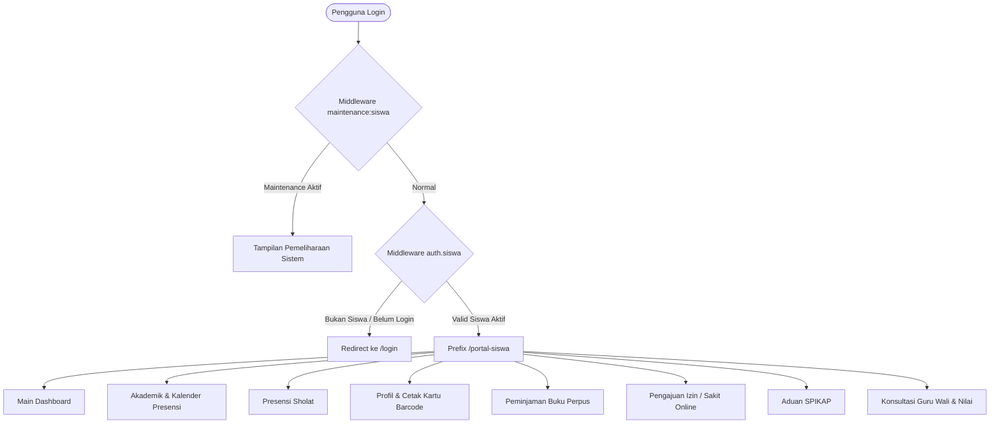

# 🎒 Fitur 02: Portal Siswa (Student Dashboard)

Dokumen ini memuat panduan arsitektur, rute, otorisasi, dan kapabilitas fitur mandiri untuk siswa aktif di **Portal Siswa (`/portal-siswa`)**.

---

## 📌 Peta Navigasi Dokumen Portal Siswa

| Dokumen | Topik Pembahasan |
| :--- | :--- |
| [`01-halaman-dan-fitur-utama.md`](file:///home/sutris-remote/Documents/projek-laravel/projek-absensi-barcode/docs/03-fitur/02-portal-siswa/01-halaman-dan-fitur-utama.md) | Penjelasan 8 modul mandiri siswa: Dashboard, Rekap Kehadiran, Sholat, Kartu Barcode, Perpustakaan, Izin/Sakit, SPIKAP, dan Guru Wali. |
| [`02-tabel-dan-relasi-data.md`](file:///home/sutris-remote/Documents/projek-laravel/projek-absensi-barcode/docs/03-fitur/02-portal-siswa/02-tabel-dan-relasi-data.md) | Tabel database yang diakses oleh akun siswa (`students`, `attendances`, `leave_requests`, `peminjamans`, dll) dan query scope-nya. |
| [`03-alur-izin-dan-aduan.md`](file:///home/sutris-remote/Documents/projek-laravel/projek-absensi-barcode/docs/03-fitur/02-portal-siswa/03-alur-izin-dan-aduan.md) | Alur interaktif pengajuan izin ketidakhadiran dan pelaporan aduan perundungan (SPIKAP). |
| [`04-fitur-guru-wali-siswa.md`](file:///home/sutris-remote/Documents/projek-laravel/projek-absensi-barcode/docs/03-fitur/02-portal-siswa/04-fitur-guru-wali-siswa.md) | Panduan modul bimbingan karakter Guru Wali, 4 kategori bimbingan, chat interaktif, dan feedback siswa. |

---

## 🏛️ Arsitektur & Otorisasi Portal Siswa

### Aturan Otorisasi (`auth.siswa`):
1. Pengguna harus terautentikasi melalui guard `web`.
2. Akun pengguna harus memiliki role `siswa` atau memiliki relasi valid `Auth::user()->student`.
3. Siswa hanya dapat melihat dan memodifikasi data miliknya sendiri (`WHERE student_id = auth()->user()->student->id`).
4. Jika status siswa adalah `lulus`, dashboard akan otomatis menampilkan form **Tracer Study Alumni**. Jika berstatus `mutasi`, akan menampilkan form **Konfirmasi Mutasi**.

---

## ⚙️ Berkas-Berkas Inti Fitur

1. **Routing**: `routes/web.php` (group `prefix('portal-siswa')`).
2. **Main Livewire Components**:
   - [`App\Livewire\SiswaMainDashboard`](file:///home/sutris-remote/Documents/projek-laravel/projek-absensi-barcode/app/Livewire/SiswaMainDashboard.php)
   - `App\Livewire\SiswaDashboard` (Kalender presensi)
   - `App\Livewire\SiswaProfil`
   - `App\Livewire\SiswaPerpustakaan`
   - `App\Livewire\PortalSiswa\IjinKehadiranForm` & `IjinKehadiranList`
   - `App\Livewire\PortalSiswa\SpikapLaporanForm` & `SpikapLaporanList`
   - `App\Livewire\PortalSiswa\KonsultasiGuruWaliList`
   - `App\Livewire\PortalSiswa\SiswaNilai`
3. **Controller Khusus**:
   - [`App\Http\Controllers\SiswaCetakController`](file:///home/sutris-remote/Documents/projek-laravel/projek-absensi-barcode/app/Http/Controllers/SiswaCetakController.php) (Cetak kartu mandiri format PDF)
