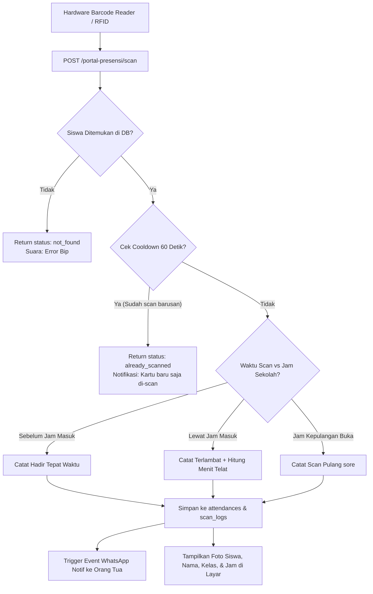

# 📟 Kiosk Scanner Barcode Gerbang & Sholat

Kiosk Scanner adalah modul pemindaian layar penuh (*fullscreen interactive kiosk*) yang ditempatkan pada pos satpam / gerbang masuk dan mushola sekolah untuk mencatat kehadiran siswa secara mandiri.

---

## 1. Varian Mode Pemindaian Kiosk

Sistem menyediakan 3 antarmuka kiosk terspesialisasi:

| Mode Kiosk | URL Rute | Komponen Livewire | Identifier Scan |
| :--- | :--- | :--- | :--- |
| **Kiosk Scan Standar** | `/portal-presensi/scan` | `AttendanceKiosk` | Berbasis **NISN** siswa |
| **Kiosk Scan NIS** | `/portal-presensi/scan-nis` | `AttendanceKioskNis` | Berbasis **NIS** (Nomor Induk Sekolah) |
| **Kiosk Sholat Dhuhur** | `/portal-presensi/scan-sholat-dhuhur` | `AttendanceKioskSholatDhuhur` | Scan ibadah sholat dhuhur/jumat |

---

## 2. Alur Eksekusi Pemindaian (`ProcessScanAction`)

Setiap pembacaan barcode dari scanner USB/kamera diproses melalui endpoint API:
- `POST /portal-presensi/scan`
- Dilindungi middleware rate limiting: `throttle:60,1` (maksimal 60 request/menit per client IP untuk mencegah DoS/spam).

---

## 3. Fitur Keandalan Mesin Kiosk (*High Reliability*)

1. **Cooldown Anti-Duplikat**:
   - Jika siswa menempelkan kartu dua kali berturut-turut dalam rentang waktu < 60 detik, scan kedua tidak akan membuat record ganda, melainkan memunculkan peringatan *"Siswa sudah tercatat hadir"*.
2. **Audio & Visual Feedback**:
   - Berhasil Hadir &rarr; Bunyi *ding* sukses + bingkai hijau + nama & foto siswa muncul.
   - Terlambat &rarr; Bunyi peringatan + bingkai kuning/oranye + keterangan waktu terlambat.
   - Gagal / Tidak Ditemukan &rarr; Bunyi *buzzer* error + bingkai merah.
3. **Pencatatan Audit Trail (`scan_logs`)**:
   - Setiap scan (baik yang berhasil maupun yang gagal) dicatat ke tabel `scan_logs` bersama alamat IP client dan waktu pemindaian untuk mencegah kecurangan titip kartu.
4. **Auto Focus Listener**:
   - Script Alpine.js memastikan input kursor teks selalu terkunci (*auto-refocus*) ke field barcode scanner bahkan jika layar disentuh secara tidak sengaja oleh siswa.
