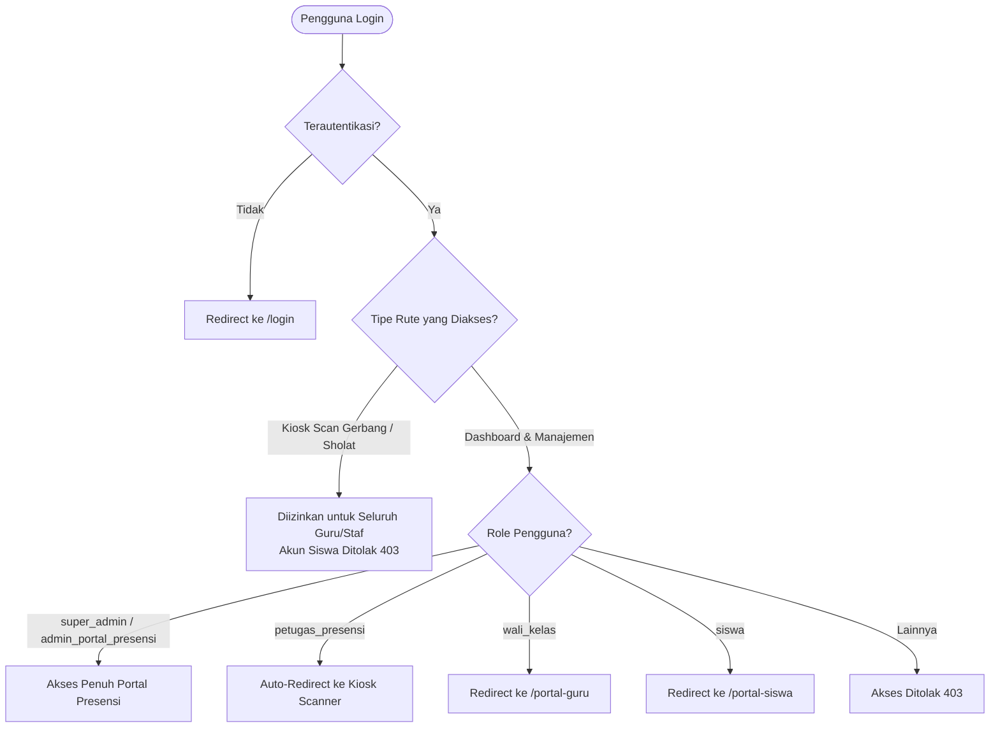

# 📟 Fitur 03: Portal Presensi & Kiosk Monitoring

Dokumen ini memuat panduan komprehensif mengenai **Portal Presensi (`/portal-presensi`)**, pusat kendali pemantauan kehadiran real-time, mesin scan kiosk gerbang, rekapitulasi laporan, dan otomasi broadcast WhatsApp orang tua.

---

## 📌 Peta Navigasi Dokumen Portal Presensi

| Dokumen | Topik Pembahasan |
| :--- | :--- |
| [`01-dashboard-monitoring-realtime.md`](file:///home/sutris-remote/Documents/projek-laravel/projek-absensi-barcode/docs/03-fitur/03-portal-presensi/01-dashboard-monitoring-realtime.md) | Arsitektur hub **Dashboard Utama** (`/portal-presensi`), **Dashboard Presensi Kehadiran** (`/portal-presensi/kehadiran`) beserta opsi absen pulang & paginasi, dan **Dashboard Presensi Sholat Dhuhur** (`/portal-presensi/sholat-dhuhur`). |
| [`02-kiosk-scanner-barcode.md`](file:///home/sutris-remote/Documents/projek-laravel/projek-absensi-barcode/docs/03-fitur/03-portal-presensi/02-kiosk-scanner-barcode.md) | Mesin scan mandiri gerbang sekolah (`/portal-presensi/scan` & `/scan-nis`), action `ProcessScanAction`, throttling, cooldown anti-duplikat, dan audio feedback. |
| [`03-manajemen-dan-rekapitulasi.md`](file:///home/sutris-remote/Documents/projek-laravel/projek-absensi-barcode/docs/03-fitur/03-portal-presensi/03-manajemen-dan-rekapitulasi.md) | Input manual, **Rekap dan Cetak Laporan** terpadu (Bulanan, Semester, Tahunan, Sekolah + opsi Absen Pulang), submodul **Sholat Dhuhur**, **Pengaturan & Hari Libur**, serta Cetak Kartu. |
| [`04-pengaturan-whatsapp-broadcast.md`](file:///home/sutris-remote/Documents/projek-laravel/projek-absensi-barcode/docs/03-fitur/03-portal-presensi/04-pengaturan-whatsapp-broadcast.md) | Konfigurasi template pesan WA (dipusatkan di Portal Sistem), cron pengiriman otomatis cut-off pagi, kuota batas manual kirim (5x/hari), dan audit log. |

---

## 🏛️ Arsitektur Otorisasi Middleware (`auth.presensi`)

Akses ke rute `portal-presensi` diproteksi oleh middleware [`EnsureIsPetugasPresensi`](file:///home/sutris-remote/Documents/projek-laravel/projek-absensi-barcode/app/Http/Middleware/EnsureIsPetugasPresensi.php):

### Hak Akses Pengguna:
- **`super_admin` & `admin_portal_presensi`**: Memiliki hak penuh membuka dashboard analitik, rekapitulasi sekolah, export laporan, input manual, dan setting template notifikasi WhatsApp.
- **`petugas_presensi`**: Dikhususkan untuk operator perangkat scan di pos gerbang sekolah (otomatis dialihkan ke mode kiosk layar penuh).
- **`siswa`**: Diblokir penuh dari membuka kiosk scan maupun dashboard presensi untuk mencegah manipulasi kehadiran.

---

## ⚙️ Berkas-Berkas Inti Fitur

1. **Routing & Layout Sidebar**:
   - [`routes/web.php`](file:///home/sutris-remote/Documents/projek-laravel/projek-absensi-barcode/routes/web.php#L107-L135) (`prefix('portal-presensi')`).
   - [`portal.blade.php`](file:///home/sutris-remote/Documents/projek-laravel/projek-absensi-barcode/resources/views/components/layouts/portal.blade.php#L549-L660) — sidebar modular dengan *single-open accordion* untuk **Presensi Kehadiran** dan **Presensi Sholat Dhuhur** (menu *Rekap Kelas*, *Rekap Sekolah*, dan *Setting Notifikasi WA* lama disembunyikan tanpa menghapus rutenya).
2. **Komponen Livewire**:
   - **Dashboard Utama (Hub)**: [`App\Livewire\PortalPresensi\PortalPresensiHome`](file:///home/sutris-remote/Documents/projek-laravel/projek-absensi-barcode/app/Livewire/PortalPresensi/PortalPresensiHome.php) (`/portal-presensi`)
   - **Submodul Presensi Kehadiran**:
     - [`App\Livewire\PortalPresensiDashboard`](file:///home/sutris-remote/Documents/projek-laravel/projek-absensi-barcode/app/Livewire/PortalPresensiDashboard.php) (`/portal-presensi/kehadiran`)
     - [`App\Livewire\PortalPresensi\InputPresensiManual`](file:///home/sutris-remote/Documents/projek-laravel/projek-absensi-barcode/app/Livewire/PortalPresensi/InputPresensiManual.php) (`/portal-presensi/input-manual`)
     - [`App\Livewire\PortalPresensi\CetakLaporanPresensi`](file:///home/sutris-remote/Documents/projek-laravel/projek-absensi-barcode/app/Livewire/PortalPresensi/CetakLaporanPresensi.php) (`/portal-presensi/cetak-laporan`)
   - **Submodul Presensi Sholat Dhuhur** *(tampil bila `enable_sholat_dhuhur` aktif)*:
     - [`DashboardSholatDhuhur`](file:///home/sutris-remote/Documents/projek-laravel/projek-absensi-barcode/app/Livewire/PortalPresensi/SholatDhuhur/DashboardSholatDhuhur.php) (`/portal-presensi/sholat-dhuhur`)
     - [`InputManualSholatDhuhur`](file:///home/sutris-remote/Documents/projek-laravel/projek-absensi-barcode/app/Livewire/PortalPresensi/SholatDhuhur/InputManualSholatDhuhur.php) (`/portal-presensi/sholat-dhuhur/input-manual`)
     - [`LaporanSholatDhuhur`](file:///home/sutris-remote/Documents/projek-laravel/projek-absensi-barcode/app/Livewire/PortalPresensi/SholatDhuhur/LaporanSholatDhuhur.php) (`/portal-presensi/sholat-dhuhur/laporan`)
   - **Utilitas & Kiosk**:
     - [`App\Livewire\PortalPresensi\CetakKartuSiswa`](file:///home/sutris-remote/Documents/projek-laravel/projek-absensi-barcode/app/Livewire/PortalPresensi/CetakKartuSiswa.php) (`/portal-presensi/cetak-kartu`)
     - [`App\Livewire\PortalPresensi\PengaturanPresensi`](file:///home/sutris-remote/Documents/projek-laravel/projek-absensi-barcode/app/Livewire/PortalPresensi/PengaturanPresensi.php) (`/portal-presensi/pengaturan`)
     - `App\Livewire\AttendanceKiosk`, `AttendanceKioskNis`, `AttendanceKioskSholatDhuhur`
     - Komponen UI lokal: [`date-indo.blade.php`](file:///home/sutris-remote/Documents/projek-laravel/projek-absensi-barcode/resources/views/components/portal-presensi/date-indo.blade.php) & [`time-24-wib.blade.php`](file:///home/sutris-remote/Documents/projek-laravel/projek-absensi-barcode/resources/views/components/portal-presensi/time-24-wib.blade.php)
3. **Action & Service Classes**:
   - `App\Actions\ProcessScanAction`, `App\Actions\ProcessScanSholatDhuhurAction`
   - [`PresensiRekapService`](file:///home/sutris-remote/Documents/projek-laravel/projek-absensi-barcode/app/Services/PresensiRekapService.php), [`PresensiSholatDhuhurService`](file:///home/sutris-remote/Documents/projek-laravel/projek-absensi-barcode/app/Services/PresensiSholatDhuhurService.php)
