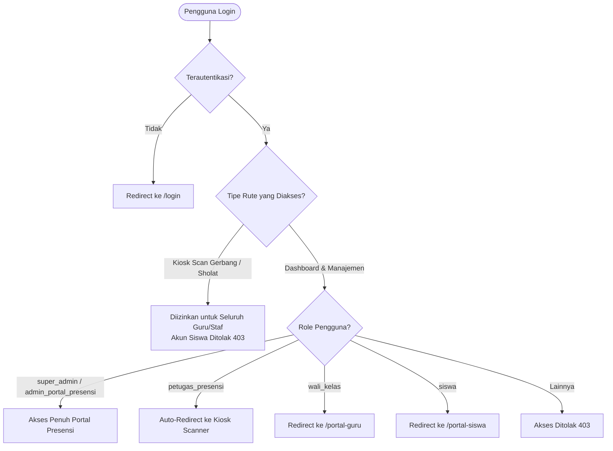

# 📟 Fitur 03: Portal Presensi & Kiosk Monitoring

Dokumen ini memuat panduan komprehensif mengenai **Portal Presensi (`/portal-presensi`)**, pusat kendali pemantauan kehadiran real-time, mesin scan kiosk gerbang, rekapitulasi laporan, dan otomasi broadcast WhatsApp orang tua.

---

## 📌 Peta Navigasi Dokumen Portal Presensi

| Dokumen | Topik Pembahasan |
| :--- | :--- |
| [`01-dashboard-monitoring-realtime.md`](file:///home/sutris-remote/Documents/projek-laravel/projek-absensi-barcode/docs/03-fitur/03-portal-presensi/01-dashboard-monitoring-realtime.md) | Dashboard analitik: counter kehadiran live hari ini, tabs filtering (*per kelas*, *belum presensi*, *terlambat*), export PDF/Excel, dan broadcast instan. |
| [`02-kiosk-scanner-barcode.md`](file:///home/sutris-remote/Documents/projek-laravel/projek-absensi-barcode/docs/03-fitur/03-portal-presensi/02-kiosk-scanner-barcode.md) | Mesin scan mandiri gerbang sekolah (`/portal-presensi/scan` & `/scan-nis`), action `ProcessScanAction`, throttling, cooldown anti-duplikat, dan audio feedback. |
| [`03-manajemen-dan-rekapitulasi.md`](file:///home/sutris-remote/Documents/projek-laravel/projek-absensi-barcode/docs/03-fitur/03-portal-presensi/03-manajemen-dan-rekapitulasi.md) | Input presensi manual kelas, rekap kehadiran per kelas, rekapitulasi tingkat sekolah, dan cetak kartu barcode massal. |
| [`04-pengaturan-whatsapp-broadcast.md`](file:///home/sutris-remote/Documents/projek-laravel/projek-absensi-barcode/docs/03-fitur/03-portal-presensi/04-pengaturan-whatsapp-broadcast.md) | Konfigurasi template pesan WA, cron pengiriman otomatis cut-off pagi (07:30 WIB), kuota batas manual kirim (5x/hari), dan audit log. |

---

## 🏛️ Arsitektur Otorisasi Middleware (`auth.presensi`)

Akses ke rute `portal-presensi` diproteksi oleh middleware [`EnsureIsPetugasPresensi`](file:///home/sutris-remote/Documents/projek-laravel/projek-absensi-barcode/app/Http/Middleware/EnsureIsPetugasPresensi.php):

### Hak Akses Pengguna:
- **`super_admin` & `admin_portal_presensi`**: Memiliki hak penuh membuka dashboard analitik, rekapitulasi sekolah, export laporan, input manual, dan setting template notifikasi WhatsApp.
- **`petugas_presensi`**: Dikhususkan untuk operator perangkat scan di pos gerbang sekolah (otomatis dialihkan ke mode kiosk layar penuh).
- **`siswa`**: Diblokir penuh dari membuka kiosk scan maupun dashboard presensi untuk mencegah manipulasi kehadiran.

---

## ⚙️ Berkas-Berkas Inti Fitur

1. **Routing**: `routes/web.php` (group `prefix('portal-presensi')`).
2. **Komponen Livewire**:
   - [`App\Livewire\PortalPresensiDashboard`](file:///home/sutris-remote/Documents/projek-laravel/projek-absensi-barcode/app/Livewire/PortalPresensiDashboard.php)
   - `App\Livewire\AttendanceKiosk` & `AttendanceKioskNis`
   - `App\Livewire\AttendanceKioskSholatDhuhur`
   - `App\Livewire\PortalPresensi\InputPresensiManual`
   - `App\Livewire\PortalPresensi\RekapAbsensiKelas`
   - `App\Livewire\PortalPresensi\RekapAbsensiSekolah`
   - `App\Livewire\PortalPresensi\CetakLaporanPresensi`
   - `App\Livewire\PortalPresensi\CetakKartuSiswa`
   - `App\Livewire\PortalPresensi\SettingNotifikasi`
3. **Action Classes**:
   - `App\Actions\ProcessScanAction`
   - `App\Actions\ProcessScanSholatDhuhurAction`
