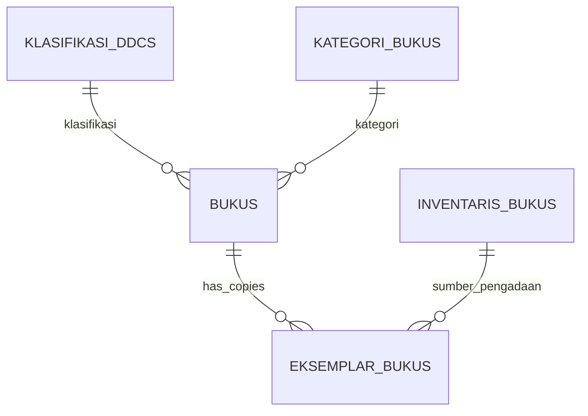

# 📖 Manajemen Katalog, Klasifikasi DDC, & Eksemplar Buku

Dokumen ini mendokumentasikan master katalog judul buku, sistem klasifikasi DDC, manajemen eksemplar fisik, dan pencetakan stiker barcode buku.

---

## 1. Master Buku & Hubungan Eksemplar

Dalam sistem perpustakaan ini, terdapat pemisahan tegas antara **Judul Buku (`bukus`)** dan **Fisik Buku (`eksemplar_bukus`)**:
- Satu judul buku (misal: *Laskar Pelangi*) hanya diinput **satu kali** ke tabel `bukus`.
- Jika perpustakaan memiliki 10 eksemplar fisik dari buku tersebut, sistem akan membuat 10 baris terpisah di tabel `eksemplar_bukus`, masing-masing memiliki `nomor_barcode` dan `nomor_induk` unik.

---

## 2. Fitur Input & Kelola Buku (`PetugasPerpusBuku`)

Komponen Livewire [`App\Livewire\PetugasPerpusBuku`](file:///home/sutris-remote/Documents/projek-laravel/projek-absensi-barcode/app/Livewire/PetugasPerpusBuku.php) menyediakan:

1. **Informasi Bibliografi Lengkap**:
   - Judul, Penulis, Penerbit, Tahun Terbit, ISBN.
   - Lokasi Rak Buku (misal: `Rak A-02`, `Lemari Referensi`).
   - Tingkat Jenjang / Grade Level (Kelas 7, 8, 9, atau Umum).
2. **Media Digital**:
   - Upload file **Sampul Buku** (PNG/JPG) untuk etalase katalog publik.
   - Upload berkas **File PDF** e-book digital.
3. **Pencatatan Pengadaan Awal**:
   - Mengisi jumlah eksemplar awal yang langsung di-generate otomatis menjadi nomor barcode unik berurutan.
   - Asal perolehan buku (BOS, Hibah Alumni, Sumbangan Pemerintah) via tabel `inventaris_bukus`.

---

## 3. Klasifikasi Standar DDC (`/portal-perpustakaan/klasifikasi-ddc`)

Komponen Livewire `App\Livewire\PortalPerpustakaan\KlasifikasiDdc` mengelola klasifikasi internasional Dewey Decimal Classification (DDC):
- **000**: Karya Umum, Komputer & Informasi
- **100**: Filsafat & Psikologi
- **200**: Agama
- **300**: Ilmu-ilmu Sosial
- **400**: Bahasa
- **500**: Sains & Matematika
- **600**: Teknologi & Terapan
- **700**: Kesenian & Rekreasi
- **800**: Kesusastraan
- **900**: Sejarah & Geografi

Setiap nomor klasifikasi DDC mempermudah penyusunan nomor panggil (*call number*) pada punggung buku.

---

## 4. Pencetakan Stiker Label Barcode Buku

Petugas dapat mencetak stiker label barcode eksemplar:
- **Format Cetak**: Lembar stiker label Tom & Jerry atau printer thermal barcode.
- **Elemen Label**:
  - Logo perpustakaan sekolah.
  - Kode DDC & Call Number.
  - Gambar barcode Code 128 dari nomor eksemplar.
  - Nama instansi sekolah.
