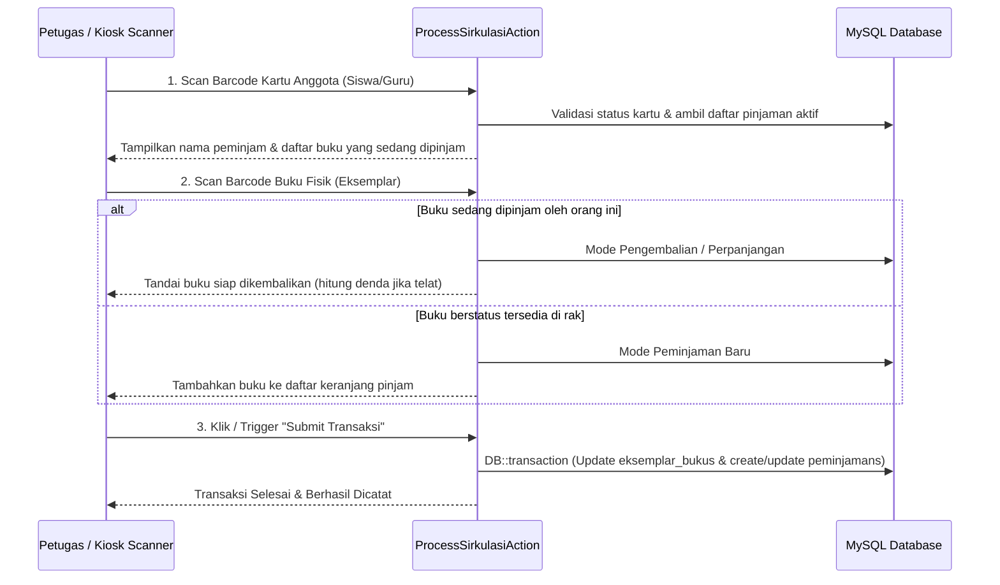

# 🔄 Sirkulasi Reguler, Kiosk Mandiri, & Peminjaman Paket Kelas

Dokumen ini menjelaskan arsitektur transaksi sirkulasi peminjaman dan pengembalian buku di perpustakaan sekolah.

---

## 1. Alur Transaksi Sirkulasi Reguler (`ProcessSirkulasiAction`)

Transaksi sirkulasi didesain berbasis pemindaian cepat (*scan-first workflow*) tanpa perlu banyak mengetik:

### Fleksibilitas Polimorfik:
- Peminjam dapat berupa model `App\Models\Student` atau `App\Models\Teacher`.
- Batas maksimal jumlah buku dan durasi peminjaman dapat dibedakan antara siswa (misal 3 buku, 7 hari) dan guru (misal 10 buku, 30 hari).

---

## 2. Mode Kiosk Sirkulasi Layar Penuh (`/portal-perpustakaan/sirkulasi-kiosk`)

Komponen Livewire [`App\Livewire\SirkulasiKiosk`](file:///home/sutris-remote/Documents/projek-laravel/projek-absensi-barcode/app/Livewire/SirkulasiKiosk.php):
- **Antarmuka Layar Sentuh / Layar Kiosk**:
  - Didesain minimalis dan bersih untuk diletakkan pada komputer meja sirkulasi mandiri (*self-service kiosk*).
  - Dilengkapi animasi indikator scan kartu dan pemindaian buku.
  - Memanfaatkan audio feedback untuk memberi konfirmasi saat scan berhasil atau terdeteksi masalah (misal: denda belum lunas / kartu tidak aktif).

---

## 3. Peminjaman Buku Paket Kelas (`ProcessSirkulasiPaketAction`)

Untuk kebutuhan buku paket kurikulum semesteran:
- **Rute**: `/portal-perpustakaan/peminjaman-paket` & `/tambah`
- **Karakteristik**:
  - Peminjaman dalam jumlah besar sekaligus per rombongan belajar (misal: satu kelas VII-A meminjam buku IPA, IPS, Matematika).
  - Durasi peminjaman berjangka panjang (1 semester / 1 tahun ajaran).
  - Pengembalian massal saat akhir semester tanpa dikenakan denda harian standar.
