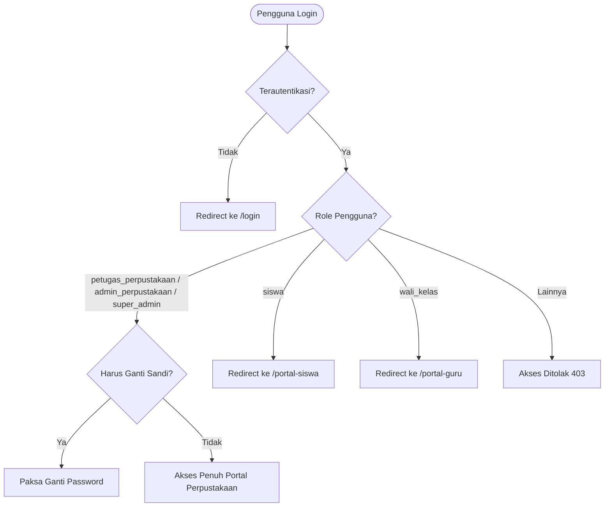

# 📚 Fitur 04: Portal Perpustakaan (Smart Library Management)

Dokumen ini memuat panduan komprehensif mengenai **Portal Perpustakaan (`/portal-perpustakaan`)**, platform otomasi pengelolaan sirkulasi buku, katalog digital, barcode eksemplar, peminjaman buku paket kelas, dan buku tamu kunjungan.

---

## 📌 Peta Navigasi Dokumen Portal Perpustakaan

| Dokumen | Topik Pembahasan |
| :--- | :--- |
| [`01-dashboard-dan-kunjungan.md`](file:///home/sutris-remote/Documents/projek-laravel/projek-absensi-barcode/docs/03-fitur/04-portal-perpustakaan/01-dashboard-dan-kunjungan.md) | Dashboard analitik: total judul buku, eksemplar tersedia/dipinjam, daftar pinjaman jatuh tempo (*overdue*), dan buku tamu kunjungan perpus. |
| [`02-katalog-dan-eksemplar-buku.md`](file:///home/sutris-remote/Documents/projek-laravel/projek-absensi-barcode/docs/03-fitur/04-portal-perpustakaan/02-katalog-dan-eksemplar-buku.md) | Master katalog buku, klasifikasi DDC (000-900), nomor induk inventaris, upload sampul/e-book PDF, dan pencetakan stiker label barcode eksemplar. |
| [`03-sirkulasi-mandiri-dan-kiosk.md`](file:///home/sutris-remote/Documents/projek-laravel/projek-absensi-barcode/docs/03-fitur/04-portal-perpustakaan/03-sirkulasi-mandiri-dan-kiosk.md) | Alur transaksi peminjaman & pengembalian reguler (`ProcessSirkulasiAction`), mode Kiosk Sirkulasi mandiri, dan peminjaman buku paket rombel (`ProcessSirkulasiPaketAction`). |
| [`04-denda-jatuh-tempo-dan-kartu.md`](file:///home/sutris-remote/Documents/projek-laravel/projek-absensi-barcode/docs/03-fitur/04-portal-perpustakaan/04-denda-jatuh-tempo-dan-kartu.md) | Perhitungan batas waktu pinjam & denda keterlambatan, riwayat penghapusan buku (*soft delete audit*), dan cetak kartu anggota barcode. |

---

## 🏛️ Arsitektur Otorisasi Middleware (`auth.perpus`)

Akses ke rute `portal-perpustakaan` diproteksi oleh middleware [`EnsureIsPetugasPerpustakaan`](file:///home/sutris-remote/Documents/projek-laravel/projek-absensi-barcode/app/Http/Middleware/EnsureIsPetugasPerpustakaan.php):

### Hak Akses Pengguna:
- **`petugas_perpustakaan`**: Pengelola operasional harian sirkulasi buku, pencatatan kunjungan tamu, dan input katalog.
- **`admin_perpustakaan` & `super_admin`**: Hak penuh konfigurasi sistem perpus, laporan tahunan, dan audit riwayat buku.
- **`siswa` & `guru`**: Mengakses layanan perpus sebagai peminjam (*borrower*) melalui antarmuka Kiosk Sirkulasi atau portal siswa masing-masing.

---

## ⚙️ Berkas-Berkas Inti Fitur

1. **Routing**: `routes/web.php` (group `prefix('portal-perpustakaan')`).
2. **Komponen Livewire**:
   - [`App\Livewire\PetugasPerpusDashboard`](file:///home/sutris-remote/Documents/projek-laravel/projek-absensi-barcode/app/Livewire/PetugasPerpusDashboard.php)
   - `App\Livewire\PetugasPerpusBuku`
   - `App\Livewire\PetugasPerpusInventaris`
   - `App\Livewire\PetugasPerpusSirkulasi` & `SirkulasiKiosk`
   - `App\Livewire\PetugasPerpusPeminjaman`
   - `App\Livewire\PetugasPerpusPeminjamanPaket` & `PetugasPerpusSirkulasiPaket`
   - `App\Livewire\PetugasPerpusKunjungan`
   - `App\Livewire\PortalPerpustakaan\KlasifikasiDdc`
   - `App\Livewire\PortalPerpustakaan\RiwayatHapusBuku`
3. **Action Classes**:
   - [`App\Actions\ProcessSirkulasiAction`](file:///home/sutris-remote/Documents/projek-laravel/projek-absensi-barcode/app/Actions/ProcessSirkulasiAction.php) (Sirkulasi Reguler)
   - [`App\Actions\ProcessSirkulasiPaketAction`](file:///home/sutris-remote/Documents/projek-laravel/projek-absensi-barcode/app/Actions/ProcessSirkulasiPaketAction.php) (Sirkulasi Buku Paket Rombel)
