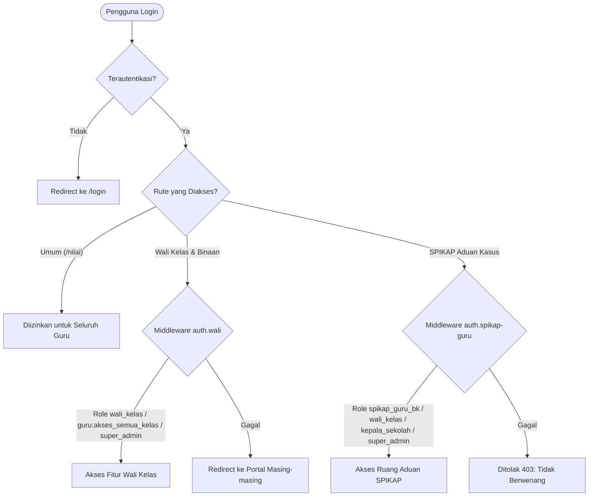

# 👨‍🏫 Fitur 05: Portal Guru & Wali Kelas (Teacher Command Center)

Dokumen ini memuat panduan komprehensif mengenai **Portal Guru (`/portal-guru`)**, pusat operasional guru pengajar, wali kelas, guru wali asuh karakter, dan guru Bimbingan Konseling (BK).

---

## 📌 Peta Navigasi Dokumen Portal Guru

| Dokumen | Topik Pembahasan |
| :--- | :--- |
| [`01-dashboard-utama-dan-profil.md`](file:///home/sutris-remote/Documents/projek-laravel/projek-absensi-barcode/docs/03-fitur/05-portal-guru/01-dashboard-utama-dan-profil.md) | Command center guru: ringkasan kelas binaan, statistik kehadiran rombel live, izin pending, alert aduan SPIKAP, dan profil guru. |
| [`02-presensi-kelas-dan-detail-siswa.md`](file:///home/sutris-remote/Documents/projek-laravel/projek-absensi-barcode/docs/03-fitur/05-portal-guru/02-presensi-kelas-dan-detail-siswa.md) | Manajemen kehadiran kelas: kalender presensi bulanan, daftar siswa rombel, detail riwayat absensi siswa, dan catatan wali kelas. |
| [`03-presensi-sholat-dhuhur-dan-jumat.md`](file:///home/sutris-remote/Documents/projek-laravel/projek-absensi-barcode/docs/03-fitur/05-portal-guru/03-presensi-sholat-dhuhur-dan-jumat.md) | Pencatatan ibadah sholat dhuhur & jumat massal kelas (status: jamaah, masbuk, berhalangan/haid, tidak sholat), rekap matriks, & export PDF/Excel. |
| [`04-verifikasi-izin-kehadiran.md`](file:///home/sutris-remote/Documents/projek-laravel/projek-absensi-barcode/docs/03-fitur/05-portal-guru/04-verifikasi-izin-kehadiran.md) | Alur persetujuan surat izin/sakit siswa dari orang tua, preview berkas surat dokter, auto-sync ke tabel `attendances`, dan notifikasi WA. |
| [`05-bimbingan-karakter-guru-wali.md`](file:///home/sutris-remote/Documents/projek-laravel/projek-absensi-barcode/docs/03-fitur/05-portal-guru/05-bimbingan-karakter-guru-wali.md) | Modul Guru Wali (Permendikdasmen No. 11/2025): kelompok asuh, jurnal pembinaan harian, chat konsultasi, pemantauan bulanan, dan cetak laporan resmi. |
| [`06-bimbingan-konseling-dan-spikap.md`](file:///home/sutris-remote/Documents/projek-laravel/projek-absensi-barcode/docs/03-fitur/05-portal-guru/06-bimbingan-konseling-dan-spikap.md) | Modul BK & SPIKAP: penanganan rujukan kasus dari guru wali, catatan sesi konseling formal privat, dan penanganan tiket aduan perundungan. |
| [`07-nilai-akademik-dan-perpustakaan.md`](file:///home/sutris-remote/Documents/projek-laravel/projek-absensi-barcode/docs/03-fitur/05-portal-guru/07-nilai-akademik-dan-perpustakaan.md) | Input dan monitoring nilai asesmen mata pelajaran serta akses bahan ajar dan sirkulasi buku perpustakaan guru. |

---

## 🏛️ Arsitektur Otorisasi & Dual Middleware

Akses rute di Portal Guru memiliki beberapa lapisan pengamanan:

### Klasifikasi Hak Akses:
1. **Guru Pengajar (`guru`)**: Dapat menginput dan memantau nilai mata pelajaran yang diampunya (`/portal-guru/nilai`) serta meminjam buku di perpustakaan.
2. **Wali Kelas (`wali_kelas`)**: Memiliki wewenang mengelola rombel yang dibinanya (kalender absensi harian, verifikasi surat izin/sakit, dan input presensi sholat dhuhur).
3. **Guru Wali Asuh Karakter**: Guru yang ditugaskan membina kelompok asuh karakter siswa berdasarkan Permendikdasmen No. 11/2025 (`/portal-guru/guru-wali/*`).
4. **Guru Bimbingan Konseling (`spikap_guru_bk` / `guru_bk`)**: Menangani penanganan rujukan kasus intensif, konseling privat, dan pembinaan siswa binaan.
5. **Satgas SPIKAP / Anti-Bullying**: Tim pencegahan kekerasan sekolah (Kepsek, Waka Kesiswaan, Guru BK, Wali Kelas) untuk investigasi tiket aduan siswa.
6. **Super Admin**: Memiliki hak override untuk membuka seluruh data kelas, rombel, dan seluruh modul bimbingan.

---

## 🧭 Matriks Struktur Menu Navigasi Sidebar Portal Guru

Menu pada bilah sisi (*sidebar*) Portal Guru di-render secara dinamis di [`resources/views/components/layouts/portal.blade.php`](file:///home/sutris-remote/Documents/projek-laravel/projek-absensi-barcode/resources/views/components/layouts/portal.blade.php) menyesuaikan penugasan aktif guru:

| No | Kelompok Menu | Label Menu UI | Rute URL | Komponen Pengelola | Kondisi Visibilitas / Hak Akses | Badge Notifikasi |
| :---: | :--- | :--- | :--- | :--- | :--- | :---: |
| **1** | **Utama** | **Dashboard Utama** | `/portal-guru` | [`GuruMainDashboard`](file:///home/sutris-remote/Documents/projek-laravel/projek-absensi-barcode/app/Livewire/GuruMainDashboard.php) | Seluruh Guru Terautentikasi | - |
| **2** | **Utama** | **Daftar Nilai** | `/portal-guru/nilai` | [`DaftarNilai`](file:///home/sutris-remote/Documents/projek-laravel/projek-absensi-barcode/app/Livewire/PortalGuru/DaftarNilai.php) | Seluruh Guru Terautentikasi | - |
| **3** | **Akademik & Kelas** | Presensi & Jurnal | `/portal-guru/akademik` | [`WaliKelasDashboard`](file:///home/sutris-remote/Documents/projek-laravel/projek-absensi-barcode/app/Livewire/WaliKelasDashboard.php) | Wali Kelas Aktif / Super Admin | - |
| | | Presensi Sholat Dhuhur | `/portal-guru/sholat-dhuhur` | [`WaliKelasSholatDhuhur`](file:///home/sutris-remote/Documents/projek-laravel/projek-absensi-barcode/app/Livewire/PortalGuru/SholatDhuhur/WaliKelasSholatDhuhur.php) | Wali Kelas Aktif & `enable_sholat_dhuhur = true` | - |
| | | Data Siswa | `/portal-guru/data-siswa` | [`DataSiswaList`](file:///home/sutris-remote/Documents/projek-laravel/projek-absensi-barcode/app/Livewire/PortalGuru/DataSiswaList.php) | Wali Kelas Aktif / Super Admin | - |
| | | Persetujuan Izin | `/portal-guru/ijin-kehadiran` | [`IjinKehadiranList`](file:///home/sutris-remote/Documents/projek-laravel/projek-absensi-barcode/app/Livewire/PortalGuru/IjinKehadiranList.php) | Wali Kelas Murni / Guru BK kelas pantau | Pending Counter |
| **4** | **SI-WALI** *(Permen 11/2025)* | Kelompok Binaan | `/portal-guru/guru-wali/kelompok` | [`KelompokSaya`](file:///home/sutris-remote/Documents/projek-laravel/projek-absensi-barcode/app/Livewire/PortalGuru/GuruWali/KelompokSaya.php) | Guru dengan Kelompok Asuh Aktif | - |
| | | Jurnal Pendampingan | `/portal-guru/guru-wali/jurnal` | [`JurnalList`](file:///home/sutris-remote/Documents/projek-laravel/projek-absensi-barcode/app/Livewire/PortalGuru/GuruWali/JurnalList.php) | Guru dengan Kelompok Asuh Aktif | - |
| | | Ruang Aman Cerita | `/portal-guru/guru-wali/konsultasi` | [`KonsultasiList`](file:///home/sutris-remote/Documents/projek-laravel/projek-absensi-barcode/app/Livewire/PortalGuru/GuruWali/KonsultasiList.php) | Guru dengan Kelompok Asuh Aktif | `pendingKonsultasiCount` |
| | | Pemantauan Bulanan | `/portal-guru/guru-wali/pemantauan` | [`PemantauanBulanan`](file:///home/sutris-remote/Documents/projek-laravel/projek-absensi-barcode/app/Livewire/PortalGuru/GuruWali/PemantauanBulanan.php) | Guru dengan Kelompok Asuh Aktif | - |
| | | Cetak Laporan | `/portal-guru/guru-wali/cetak` | [`CetakLaporanGuruWali`](file:///home/sutris-remote/Documents/projek-laravel/projek-absensi-barcode/app/Livewire/PortalGuru/GuruWali/CetakLaporanGuruWali.php) | Guru dengan Kelompok Asuh Aktif | - |
| | | Command Center | `/portal-guru/guru-wali/analitik` | [`DashboardAnalitik`](file:///home/sutris-remote/Documents/projek-laravel/projek-absensi-barcode/app/Livewire/PortalGuru/GuruWali/DashboardAnalitik.php) | Guru BK, Kepsek, atau Waka Kesiswaan | Pulse Indicator |
| **5** | **Bimbingan Konseling** | Rujukan Guru Wali | `/portal-guru/bk/rujukan` | [`RujukanKasusList`](file:///home/sutris-remote/Documents/projek-laravel/projek-absensi-barcode/app/Livewire/PortalGuru/Bk/RujukanKasusList.php) | Guru BK / Pemantau Kasus BK | `pendingBkRujukanCount` |
| | | Catatan Konseling | `/portal-guru/bk/konseling` | [`KonselingList`](file:///home/sutris-remote/Documents/projek-laravel/projek-absensi-barcode/app/Livewire/PortalGuru/Bk/KonselingList.php) | Guru BK / Pemantau Kasus BK | - |
| | | Siswa Binaan (Kelas) | `/portal-guru/bk/siswa-binaan` | [`SiswaBinaanList`](file:///home/sutris-remote/Documents/projek-laravel/projek-absensi-barcode/app/Livewire/PortalGuru/Bk/SiswaBinaanList.php) | Guru BK / Pemantau Kasus BK | - |
| **6** | **SPIKAP (Aduan)** | Kotak Masuk Aduan | `/portal-guru/{spikapSlug}` | [`SpikapInbox`](file:///home/sutris-remote/Documents/projek-laravel/projek-absensi-barcode/app/Livewire/PortalGuru/SpikapInbox.php) | Satgas TPPK / Guru BK / Wali Kelas / Kepsek | - |
| | | Analitik & Statistik | `/portal-guru/{spikapSlug}/analitik` | [`SpikapAnalitik`](file:///home/sutris-remote/Documents/projek-laravel/projek-absensi-barcode/app/Livewire/PortalGuru/SpikapAnalitik.php) | Satgas TPPK / Guru BK / Wali Kelas / Kepsek | - |
| **7** | **Layanan Guru** | Perpustakaan | `/portal-guru/perpustakaan` | [`GuruPerpustakaan`](file:///home/sutris-remote/Documents/projek-laravel/projek-absensi-barcode/app/Livewire/GuruPerpustakaan.php) | Seluruh Guru Terautentikasi | - |
| **8** | **Layanan Guru** | Profil Saya | `/portal-guru/profil` | [`GuruProfil`](file:///home/sutris-remote/Documents/projek-laravel/projek-absensi-barcode/app/Livewire/GuruProfil.php) | Seluruh Guru Terautentikasi | - |
| **9** | **Pintasan Antar Portal** | Hub Pemilih Portal | `/pilih-portal` | Hub Pemilih Portal ERP | Pengguna dengan $\ge 2$ Peran Aktif | - |
| | | Portal Presensi | `/portal-presensi` | Portal Presensi | Guru merangkap Petugas Presensi | - |
| | | Portal Perpustakaan | `/portal-perpustakaan` | Portal Perpustakaan | Guru merangkap Petugas Perpustakaan | - |
| | | Portal Web | `/portal-web` | Portal CMS Web Profil | Guru merangkap Admin Web Profil | - |
| | | Panel Admin | `/admin` | Panel Admin Filament | Guru merangkap Super Admin | - |
| | | Lihat Web Publik | `/` | Web Profil Utama | Seluruh Guru (Buka Tab Baru) | - |
