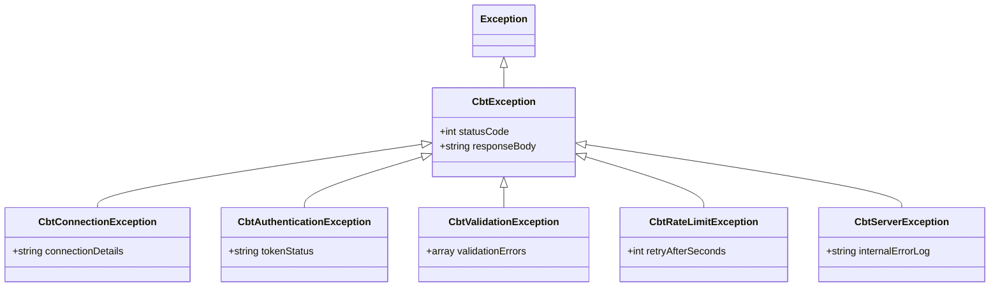

# 🔌 Arsitektur & Service Layer Integrasi ZenCBT

Dokumen ini mendokumentasikan implementasi teknis lapisan service integrasi antara ERP sekolah dan engine ujian berbasis komputer (CBT) melalui [`App\Services\Cbt\ZenCbtService`](file:///home/sutris-remote/Documents/projek-laravel/projek-absensi-barcode/app/Services/Cbt/ZenCbtService.php) yang mengimplementasikan [`App\Services\Cbt\CbtServiceInterface`](file:///home/sutris-remote/Documents/projek-laravel/projek-absensi-barcode/app/Services/Cbt/CbtServiceInterface.php).

---

## 1. Resolusi Konfigurasi Multi-Tier & Autentikasi

Integrasi dirancang dinamis agar operator sekolah dapat mengubah URL dan token API engine CBT langsung dari antarmuka web tanpa harus mengedit file `.env` di server.

### A. Hierarki Resolusi Konfigurasi
Sistem mengevaluasi konfigurasi dengan urutan prioritas:
1. **Tier 1 (Database Singleton)**: [`App\Models\PengaturanSekolah::current()`](file:///home/sutris-remote/Documents/projek-laravel/projek-absensi-barcode/app/Models/PengaturanSekolah.php) &rarr; kolom `cbt_api_url` dan `cbt_api_key`.
2. **Tier 2 (Config Fallback)**: `config('cbt.api_url')` dan `config('cbt.api_key')` yang merujuk ke variabel lingkungan `.env` (`CBT_API_URL`, `CBT_API_KEY`).
3. **Timeout Protections**:
   - `timeout`: Standar 15 detik (dapat ditingkatkan untuk payload siswa massal).
   - `connect_timeout`: 5 detik untuk mendeteksi *dead connection* lebih cepat.

### B. Client Factory Pattern
```php
protected function client(): PendingRequest
{
    $config = $this->resolveConfig();

    return Http::baseUrl($config['url'])
        ->withToken($config['key'])
        ->timeout($config['timeout'])
        ->connectTimeout($config['connect_timeout'])
        ->acceptJson();
}
```

---

## 2. Hirarki Penanganan Error & Exception Terstruktur

Seluruh panggilan API ke engine CBT dibungkus dalam blok `try-catch` terstandarisasi untuk mencegah kegagalan sistem dan memberikan pesan kesalahan yang informatif kepada pengguna:



| Exception Class | Pemicu (Trigger) | Tindakan Sistem |
| :--- | :--- | :--- |
| `CbtConnectionException` | Server CBT mati, down, atau DNS/IP tidak dapat dijangkau. | Memberikan notifikasi kegagalan koneksi; job masuk retry queue. |
| `CbtAuthenticationException` | HTTP Status 401 / 403 (API Key salah / expired). | Alert ke admin untuk memperbarui API Key di pengaturan sekolah. |
| `CbtValidationException` | HTTP Status 422 (Format data NISN/Kelas tidak sesuai spesifikasi). | Melempar daftar kolom yang ditolak oleh engine CBT. |
| `CbtRateLimitException` | HTTP Status 429 (Terlalu banyak request dalam 1 menit). | Menghentikan request sementara dan menunda eksekusi job berikutnya. |
| `CbtServerException` | HTTP Status 500 / 502 / 503 dari server engine CBT. | Mencatat log response body ke `storage/logs/laravel.log`. |

---

## 3. Sinkronisasi Data Master (`syncMasterData`)

Mengirim data struktural kurikulum sekolah ke engine CBT agar ruang lingkup ujian sinkron:
- **Tahun Ajaran Aktif**: Nama T.A, semester ganjil/genap, dan tanggal aktif.
- **Rombongan Belajar (Kelas)**: Tingkat (7, 8, 9), nama kelas (contoh: *VII-A*), dan ID unik rombel.
- **Mata Pelajaran**: Nama mata pelajaran, kode mapel, kelompok/kategori, dan nilai KKM standar.

Method:
```php
public function syncMasterData(): array
```
Mengembalikan payload status jumlah kelas dan mapel yang berhasil dibuat atau diperbarui di server CBT.

---

## 4. Sinkronisasi Peserta Didik & Profil CBT Siswa (`syncStudents`)

Mengirim seluruh siswa yang berstatus **aktif** pada tahun ajaran berjalan:

### A. Format Kredensial Siswa Standar
Untuk menjamin keamanan dan kemudahan bagi siswa saat ujian di lab komputer, kredensial diatur dengan formula:
- **Username**: Nomor Induk Siswa Nasional (NISN) &rarr; contoh: `0081234567`.
- **Password Ujian**: Formula `{NamaKelas}{NISN}` &rarr; contoh: siswa kelas 7A dengan NISN `1000000001` memiliki password `7A1000000001`.

### B. Otomatisasi Tabel `student_cbt_profiles`
Setiap kali proses sinkronisasi dijalankan:
1. Data akun diperbarui di tabel internal `student_cbt_profiles`:
   - `student_id`: UUID siswa di ERP.
   - `cbt_username`: NISN siswa.
   - `cbt_password`: Password berformula yang baru.
   - `cbt_nomor_peserta`: Nomor kartu ujian resmi.
   - `cbt_sesi`: Sesi ujian bawaan (Sesi 1 / Sesi 2).
2. **Kenaikan Kelas Dinamis**: Jika siswa naik dari kelas 7A ke 8A, sinkronisasi ulang akan otomatis merotasi password siswa menjadi `8A...` sehingga kredensial lama tidak dapat digunakan untuk mengakses paket ujian tingkat sebelumnya.

---

## 5. Manajemen Sesi Ujian & Reset Kendala Siswa

Saat ujian berlangsung di laboratorium komputer, sering terjadi insiden teknis (komputer hang, browser tertutup tidak sengaja, atau mati listrik mendadak). Engine CBT menerapkan penguncian sesi tunggal (*single session lock*).

Service menyediakan antarmuka reset instan:
- **`setStudentSession(string $nisn, string $session)`**: Mengalokasikan siswa ke sesi ruang tertentu.
- **`resetStudentSession(string $nisn)`**: Menghapus token sesi aktif siswa di engine CBT. Siswa dapat langsung login kembali di komputer lain tanpa kehilangan jawaban yang telah tersimpan.

---

## 6. Sinkronisasi Akun Guru & Pengawas (`syncTeachers`)

Guru pengajar dan tim proktor/pengawas disinkronkan ke server CBT:
- `syncTeachers(?array $guruIds = null)`: Mendaftarkan akun guru pembuat soal dan pengawas ruang.
- `resetTeacherPassword(string $guruId)`: Mereset kata sandi proktor ke default sekolah.
- `updateTeacherPassword(string $guruId, string $password)`: Mengubah kata sandi akses pengawas.
