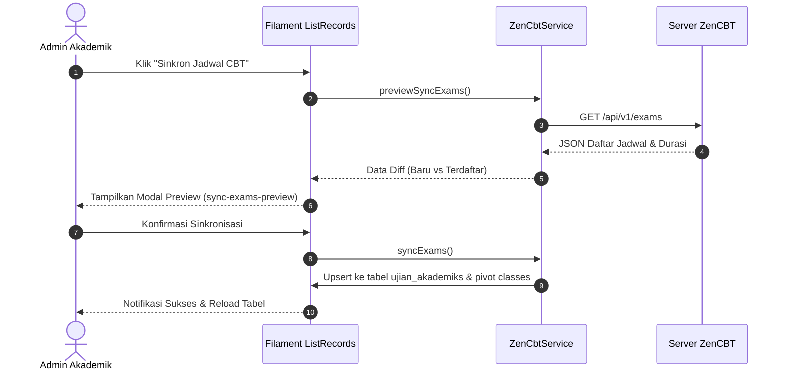

# 📇 Manajemen Ujian Akademik & Generator Kartu Peserta Massal

Dokumen ini mendokumentasikan pengelolaan paket ujian akademik di panel administrasi ([`App\Filament\Akademik\Resources\UjianAkademik\UjianAkademikResource`](file:///home/sutris-remote/Documents/projek-laravel/projek-absensi-barcode/app/Filament/Akademik/Resources/UjianAkademik/UjianAkademikResource.php)) serta generator pencetakan kartu peserta ujian resmi ber-barcode massal ([`App\Http\Controllers\UjianCetakController`](file:///home/sutris-remote/Documents/projek-laravel/projek-absensi-barcode/app/Http/Controllers/UjianCetakController.php)).

---

## 1. Antarmuka Panel Admin Filament (`/admin/ujian-akademik`)

Dikelola melalui modul *Sinkron Nilai CBT* dengan dukungan hak akses multi-role:
- **Super Admin & Admin Akademik**: Memiliki akses ke seluruh data ujian semua mata pelajaran.
- **Guru Pengajar**: Dibatasi secara otomatis hanya dapat melihat paket ujian untuk mata pelajaran yang ditugaskan kepada guru yang bersangkutan (melalui relasi `pengajarans`).

### A. Tabel Manajemen Ujian (`UjianAkademikTable`)
Kolom-kolom informasi operasional:
- **Nama Ujian & Event CBT**: Judul ujian beserta nama payung kegiatan (contoh: *Sumatif Akhir Semester (SAS) Gasal 2026/2027*).
- **Mata Pelajaran & KKM**: Nama mapel dan batas kelulusan minimal (contoh: `75.00`).
- **T.A & Semester**: Tahun ajaran berjalan dan semester aktif (*Ganjil / Genap*).
- **Rombel Sasaran**: Badge daftar kelas yang menjadi target peserta (contoh: *VII-A, VII-B, VII-C*).
- **Guru Pengampu**: Nama guru penanggung jawab nilai.
- **Peserta Terdata**: Jumlah siswa yang telah memiliki record nilai tersimpan.
- **Status Ujian**:
  - ⚪ `Draft`: Ujian baru disiapkan.
  - 🟢 `Aktif`: Sedang dalam masa pelaksanaan tes di lab.
  - 🔵 `Selesai`: Ujian berakhir dan seluruh nilai telah ditarik.
  - 🔴 `Arsip`: Data diarsipkan untuk kebutuhan pelaporan tahunan.

---

## 2. Alur Sinkronisasi Jadwal CBT (`sync_exams_zencbt`)

Operator tidak perlu mengetik ulang jadwal ujian yang telah dibuat di engine CBT. Sistem menyediakan tombol otomatis:

---

## 3. Generator Cetak Kartu Peserta Ujian Massal

Pencetakan kartu peserta ujian terintegrasi langsung dengan database kesiswaan dan foto profil melalui rute:
`GET /admin/ujian-akademik/{ujian}/cetak-kartu`

### A. Alur Kerja Kontroller (`UjianCetakController::cetakKartu`)
1. **Filter Fleksibel**: Admin dapat mencetak kartu untuk seluruh kelas rombel sasaran sekaligus, atau memilih satu rombel tertentu via query parameter `?class_id={uuid}`.
2. **Kueri Data Siswa**:
   - Memilih siswa berstatus **aktif** pada kelas dan tahun ajaran bersangkutan.
   - Melakukan *eager loading* relasi profil CBT (`with(['cbtProfile'])`).
3. **Penyusunan Kredensial & Barcode**:
   - **Barcode Generator PNG**: Menghasilkan barcode 1D standar industri **Code 128** dari NISN siswa, dikonversi menjadi data stream Base64 langsung agar dapat dirender cepat saat cetak/PDF tanpa ketergantungan file storage sementara.
   - **Foto Siswa Base64**: Mengambil file foto dari `storage/` dan mengenkripsi ke Base64 untuk memastikan gambar tidak *broken* saat dicetak.
   - **Password & Sesi**: Mengambil password dinamis dari `student_cbt_profiles.cbt_password` dan nomor sesi ruang lab.

### B. Anatomi Kartu Peserta Ujian Cetak
Setiap kartu memuat elemen resmi:
- **Header**: Logo sekolah, nama instansi resmi, dan nama kegiatan ujian.
- **Foto Siswa**: Foto resmi siswa berseragam.
- **Data Peserta**: Nama Lengkap, NISN, Kelas Rombel.
- **Kredensial Login Lab CBT**:
  - **Username**: NISN (dilengkapi barcode scanner untuk mempermudah login otomatis jika proktor menggunakan barcode scanner USB di lab).
  - **Password**: Password ujian siswa yang terenkripsi di server CBT.
- **Lokasi Ujian**: Ruang Lab Komputer & Alokasi Sesi Ujian (Sesi 1 / Sesi 2).
- **Tanda Tangan**: Kolom stempel dan tanda tangan Kepala Sekolah / Ketua Panitia Ujian.
