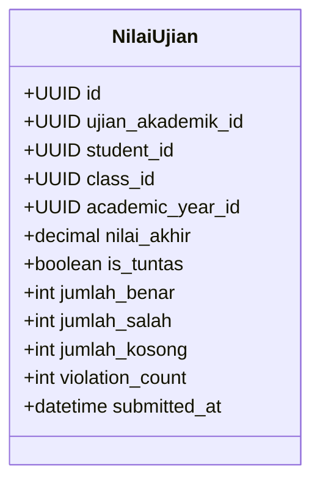

# 📥 Penarikan Nilai, Analisis Butir, & Rekonsiliasi Asesmen

Dokumen ini menjelaskan alur penarikan hasil ujian dari engine ZenCBT, pencatatan skor asesmen, kalkulasi ketuntasan otomatis, deteksi pelanggaran ujian (*proctoring violations*), serta eksekusi antrean di latar belakang (*background jobs*).

---

## 1. Metrik Hasil Ujian yang Disinkronkan

Saat ujian selesai, engine ZenCBT memproses lembar jawaban siswa dan menghasilkan data terstruktur yang ditarik oleh method `pullExamResults(cbtExamId, ujianAkademik)` ke tabel `nilai_ujians`:



### Penjelasan Parameter Kunci:
1. **`nilai_akhir`**: Skor akhir skala 0 - 100 yang dihitung berdasarkan formula pembobotan soal di CBT.
2. **Kalkulasi Ketuntasan KKM (`is_tuntas`)**:
   - Dihitung secara komparatif otomatis:
     $$\text{is\_tuntas} = (\text{nilai\_akhir} \ge \text{ujian\_akademik.kkm})$$
   - Memberikan sinyal visual langsung bagi guru (badge hijau untuk tuntas KKM, badge merah untuk remidi).
3. **Analisis Butir Jawaban**:
   - `jumlah_benar`: Jumlah butir soal pilihan ganda/kompleks yang dijawab benar.
   - `jumlah_salah`: Jumlah butir soal yang dijawab salah.
   - `jumlah_kosong`: Soal yang tidak sempat dikerjakan oleh siswa.
4. **Indikator Kecurangan (*Anti-Cheat Violation Count*)**:
   - `violation_count`: Menghitung berapa kali siswa mencoba berpindah tab browser, membuka jendela aplikasi lain, membagi layar (*split screen*), atau keluar dari mode layar penuh selama tes berlangsung.
   - Memudahkan panitia pengawas mendeteksi anomali integritas akademik tanpa perlu memeriksa riwayat rekaman lab satu per satu.
5. **`submitted_at`**: Waktu presisi siswa menekan tombol selesai ujian.

---

## 2. Saluran Penarikan Nilai (4 Antarmuka Eksekusi)

Sistem dirancang modular sehingga nilai dapat ditarik melalui beberapa jalur sesuai kenyamanan pengguna:

```text
┌────────────────────────────────────────────────────────┐
│               4 Jalur Penarikan Nilai                  │
├──────────────────────────┬─────────────────────────────┤
│ 1. Filament Table Action │ 2. Filament Relation View   │
│    Tombol "Tarik Nilai"  │    Tombol "Tarik Sekarang"  │
│    di tabel daftar ujian │    di lembar nilai per kelas│
├──────────────────────────┼─────────────────────────────┤
│ 3. Portal Guru Livewire  │ 4. Artisan CLI / Terminal   │
│    Tombol "Tarik Nilai"  │    Command cbt:pull-results │
│    di /portal-guru/nilai │    untuk scheduler/crontab  │
└──────────────────────────┴─────────────────────────────┘
```

### A. Idempotensi & Upsert Pattern
Proses penarikan nilai menerapkan prinsip **idempotent**:
```php
NilaiUjian::updateOrCreate(
    [
        'ujian_akademik_id' => $ujianAkademik->id,
        'student_id'        => $student->id,
    ],
    [
        'class_id'         => $classId,
        'academic_year_id' => $ujianAkademik->academic_year_id,
        'nilai_akhir'      => $score,
        'is_tuntas'        => $score >= $ujianAkademik->kkm,
        'jumlah_benar'     => $correct,
        'jumlah_salah'     => $wrong,
        'jumlah_kosong'    => $empty,
        'violation_count'  => $violations,
        'submitted_at'     => $submittedAt,
    ]
);
```
Jika guru atau operator menekan tombol penarikan berulang kali, tidak akan terjadi duplikasi data. Nilai terbaru akan otomatis menimpa record lama.

---

## 3. Eksekusi Antrean Latar Belakang & Artisan CLI

Untuk agenda ujian skala besar (misal: 600+ siswa ujian serentak), penarikan langsung via antarmuka web berisiko menyebabkan *request timeout*. Sistem menyediakan dukungan Queue Worker dan CLI:

### A. Background Queue Job: [`PullExamResultsJob`](file:///home/sutris-remote/Documents/projek-laravel/projek-absensi-barcode/app/Jobs/Cbt/PullExamResultsJob.php)
- Dijalankan secara asinkron di antrean database / Redis.
- Dilengkapi mekanisme *retry* otomatis jika server CBT sibuk (*rate-limited*).

### B. Artisan Command Terminal
Operator server atau DevOps dapat mengeksekusi penarikan langsung melalui terminal:

```bash
# Uji koneksi ke API ZenCBT
php artisan cbt:ping

# Sinkronisasi master data (Mapel, Kelas, TA)
php artisan cbt:sync-master

# Sinkronisasi siswa seluruhnya atau per kelas
php artisan cbt:sync-students
php artisan cbt:sync-students --class="VII-A"

# Tarik hasil ujian tertentu secara spesifik
php artisan cbt:pull-results {cbt_exam_id} {ujian_akademik_id}
```
