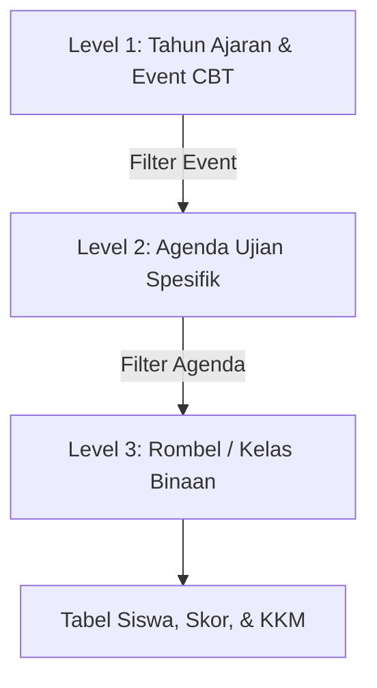
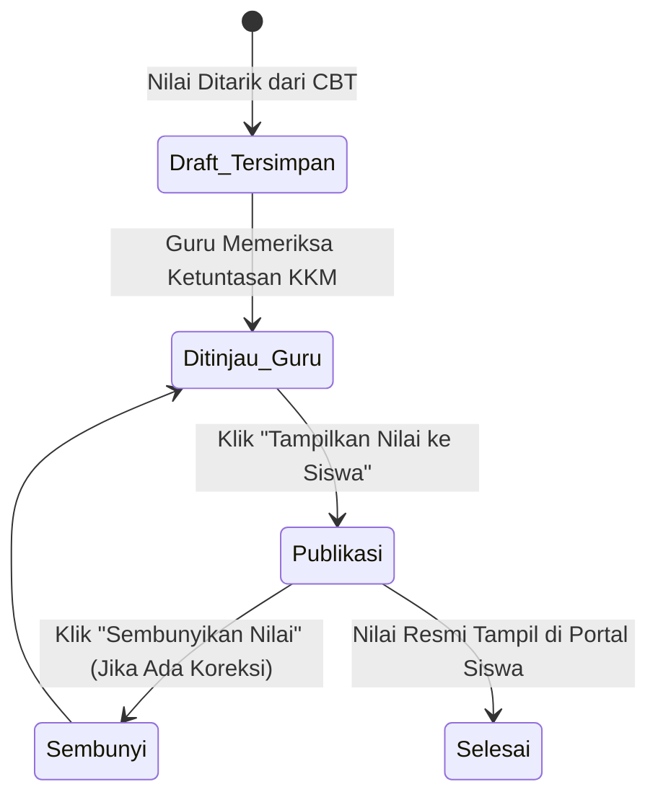

# 👨‍🏫 Rekapitulasi Nilai & Kontrol Publikasi Guru Pengajar

Dokumen ini mendokumentasikan antarmuka kerja mandiri bagi guru pengajar mata pelajaran di bawah rute `/portal-guru/nilai` yang dikelola oleh komponen Livewire [`App\Livewire\PortalGuru\DaftarNilai`](file:///home/sutris-remote/Documents/projek-laravel/projek-absensi-barcode/app/Livewire/PortalGuru/DaftarNilai.php).

---

## 1. Otorisasi & Scope Akses Guru Mata Pelajaran

Berbeda dengan modul wali kelas yang terikat pada satu rombongan belajar tertentu, modul nilai dapat diakses oleh **seluruh guru pengajar mata pelajaran** (cukup memiliki role `guru`):

### Prinsip Pembatasan Data (*Data Scoping*):
```php
$teacherId = Auth::user()->teacher->id;
$mapelIds = \App\Models\Pengajaran::where('teacher_id', $teacherId)
    ->pluck('mata_pelajaran_id')
    ->toArray();

// Guru hanya melihat ujian dari mapel yang diampunya atau ditugaskan padanya
$query = UjianAkademik::where(function ($q) use ($teacherId, $mapelIds) {
    $q->where('teacher_id', $teacherId)
      ->orWhereIn('mata_pelajaran_id', $mapelIds);
});
```
Guru mata pelajaran Matematika tidak dapat mengintip lembar nilai mata pelajaran Bahasa Indonesia, menjaga independensi dan privasi penilaian masing-masing pengajar.

---

## 2. Navigasi Filter Bertingkat 3-Level (*Cascading Filters*)

Untuk memudahkan penelusuran dari puluhan agenda ujian, antarmuka dilengkapi filter hierarkis:



1. **Level 1 (Tahun Ajaran & Event CBT)**: Memilih kalender tahun ajaran aktif dan payung agenda (misal: *Sumatif Tengah Semester (STS) Gasal 2026/2027*).
2. **Level 2 (Agenda Ujian Spesifik)**: Memilih paket mata pelajaran ujian (misal: *Informatika Kelas VII*).
3. **Level 3 (Rombel / Kelas)**: Memilih kelas siswa yang diajar (misal: *VII-A*).

---

## 3. Fitur Penarikan Nilai Mandiri (`pullNilaiDariZenCBT`)

Guru pengajar tidak perlu bergantung pada admin sekolah untuk mengunggah nilai hasil ujian lab:
- Setelah jam tes siswa berakhir, guru cukup membuka halaman kelasnya dan menekan tombol **"Tarik Nilai dari ZenCBT"**.
- Komponen Livewire langsung menghubungi service `ZenCbtService` untuk mengambil skor terkini.
- Indikator feedback instan muncul di layar: *"Penarikan nilai selesai. 32 disinkronkan, 0 dilewati."*

---

## 4. Mekanisme Penguncian & Publikasi Nilai (`published_classes`)

Guru memiliki kendali penuh atas kapan siswa dan wali murid diizinkan melihat skor hasil ujian:



### A. Penyimpanan Status di Basis Data
- Status publikasi disimpan dalam kolom berformat JSON `published_classes` pada tabel `ujian_akademiks`:
  ```json
  ["uuid-kelas-7a", "uuid-kelas-7b"]
  ```
- **Tingkat Granularitas**: Publikasi dilakukan **per kelas**. Jika kelas 7A sudah selesai dievaluasi namun kelas 7B masih ada siswa yang ujian susulan, guru dapat merilis nilai khusus untuk kelas 7A terlebih dahulu tanpa membocorkan nilai kelas 7B.

### B. Toggle Action (`togglePublishClass`)
- Tombol aksi interaktif satu klik:
  - Jika kelas belum rilis: Tombol berwarna hijau bertuliskan **"Publikasikan Nilai ke Siswa"**.
  - Jika kelas sudah rilis: Tombol berubah menjadi kuning bertuliskan **"Sembunyikan Nilai dari Siswa"**.

---

## 5. Ekspor Rekapitulasi Nilai ke Excel (`exportExcel`)

Untuk kebutuhan pengarsipan buku nilai kurikulum merdeka dan lampiran rapor semester:
- Menggunakan engine [`App\Exports\DaftarNilaiExport`](file:///home/sutris-remote/Documents/projek-laravel/projek-absensi-barcode/app/Exports/DaftarNilaiExport.php) berbasis library `Maatwebsite/Laravel-Excel`.
- **Format Penamaan File Standar**:
  `Rekap_Nilai_{NamaUjian}_{Kelas}.xlsx` &rarr; contoh: `Rekap_Nilai_SAS_Gasal_Informatika_VII-A.xlsx`.
- **Tata Letak Lembar Kerja Excel**:
  - Judul Kop Resmi Sekolah & Nama Ujian.
  - Nama Guru Pengampu, Mata Pelajaran, dan Batas KKM/KKTP.
  - Tabel Rekap: No, NISN, Nama Siswa, Skor Nilai Akhir, Keterangan (*TUNTAS / BELUM TUNTAS*), Jumlah Benar, Jumlah Salah.
  - Kolom Rekapitulasi Rata-rata Kelas, Nilai Tertinggi, Nilai Terendah, dan Persentase Ketuntasan Klasikal.
  - Kolom Tanda Tangan Guru Pengampu di bagian bawah halaman.
