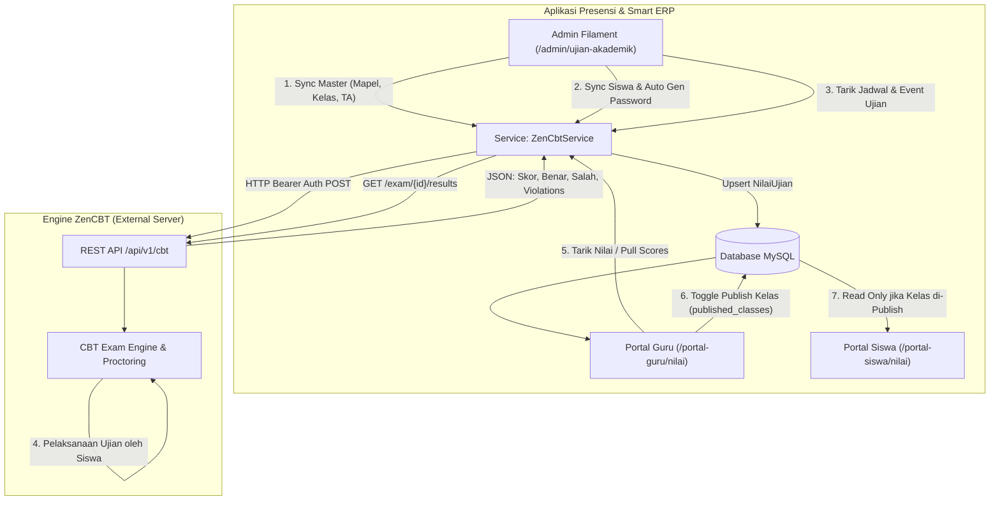

# 📝 Fitur 06: Asesmen Akademik & Integrasi ZenCBT

Dokumen ini memuat arsitektur, panduan teknis, dan alur operasional **Asesmen Akademik & Integrasi Engine CBT (ZenCBT)**. Sistem ini menghubungkan database ERP sekolah dengan mesin ujian berbasis komputer pihak luar secara *real-time* dan *bi-directional* (dua arah).

---

## 📌 Peta Navigasi Dokumen CBT & Akademik

| Dokumen | Topik Pembahasan |
| :--- | :--- |
| [`01-arsitektur-dan-integrasi-zencbt.md`](file:///home/sutris-remote/Documents/projek-laravel/projek-absensi-barcode/docs/03-fitur/06-cbt-dan-akademik/01-arsitektur-dan-integrasi-zencbt.md) | Service layer [`ZenCbtService`](file:///home/sutris-remote/Documents/projek-laravel/projek-absensi-barcode/app/Services/Cbt/ZenCbtService.php), konfigurasi multi-tier, exception handling, sinkronisasi master data, akun guru/siswa, dan manajemen sesi ujian. |
| [`02-manajemen-ujian-dan-kartu-peserta.md`](file:///home/sutris-remote/Documents/projek-laravel/projek-absensi-barcode/docs/03-fitur/06-cbt-dan-akademik/02-manajemen-ujian-dan-kartu-peserta.md) | Panel Admin Filament ([`UjianAkademikResource`](file:///home/sutris-remote/Documents/projek-laravel/projek-absensi-barcode/app/Filament/Akademik/Resources/UjianAkademik/UjianAkademikResource.php)), sinkronisasi jadwal ujian, dan cetak massal kartu peserta ujian ber-barcode Code 128 ([`UjianCetakController`](file:///home/sutris-remote/Documents/projek-laravel/projek-absensi-barcode/app/Http/Controllers/UjianCetakController.php)). |
| [`03-penarikan-nilai-dan-sinkronisasi.md`](file:///home/sutris-remote/Documents/projek-laravel/projek-absensi-barcode/docs/03-fitur/06-cbt-dan-akademik/03-penarikan-nilai-dan-sinkronisasi.md) | Alur penarikan nilai dari ZenCBT (`pullExamResults`), pencatatan skor, analisis butir (benar/salah/kosong), pelacakan pelanggaran (*anti-cheat violation count*), background queue jobs, dan artisan commands. |
| [`04-portal-guru-rekap-dan-publikasi.md`](file:///home/sutris-remote/Documents/projek-laravel/projek-absensi-barcode/docs/03-fitur/06-cbt-dan-akademik/04-portal-guru-rekap-dan-publikasi.md) | Antarmuka guru pengajar ([`App\Livewire\PortalGuru\DaftarNilai`](file:///home/sutris-remote/Documents/projek-laravel/projek-absensi-barcode/app/Livewire/PortalGuru/DaftarNilai.php)), filter bertingkat 3-level, pull nilai mandiri, penguncian/publikasi nilai per kelas (`published_classes`), dan ekspor rekap Excel. |
| [`05-portal-siswa-transkrip-dan-kkm.md`](file:///home/sutris-remote/Documents/projek-laravel/projek-absensi-barcode/docs/03-fitur/06-cbt-dan-akademik/05-portal-siswa-transkrip-dan-kkm.md) | Tampilan transkrip nilai siswa ([`App\Livewire\PortalSiswa\SiswaNilai`](file:///home/sutris-remote/Documents/projek-laravel/projek-absensi-barcode/app/Livewire/PortalSiswa/SiswaNilai.php)), filter keamanan publikasi nilai, indikator ketercapaian KKM/KKTP, dan riwayat asesmen semester. |

---

## 🏛️ Arsitektur Integrasi Bi-Directional CBT Bridge

---

## 🔐 Model Hak Akses & Matriks Otorisasi

| Peran Pengguna | Hak Akses Modul CBT & Akademik |
| :--- | :--- |
| **Super Admin** | Akses penuh: konfigurasi API URL/Key, sync master data, sync seluruh siswa massal, reset sesi ujian, dan tarik seluruh nilai. |
| **Admin Akademik** | Mengelola jadwal ujian akademik, cetak kartu massal, sync jadwal dari ZenCBT, dan memantau rekonsiliasi nilai peserta. |
| **Guru Pengajar Mapel** | Menarik skor ujian untuk kelas yang diampunya, mengontrol visibilitas publikasi nilai kelas binaan, dan ekspor rekapitulasi nilai Excel. |
| **Siswa Peserta Tes** | Melihat kredensial login CBT di kartu ujian, serta melihat transkrip perolehan nilai hanya setelah dinyatakan rilis oleh guru pengampu. |
