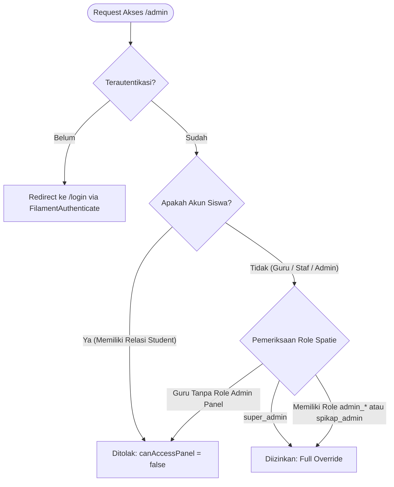
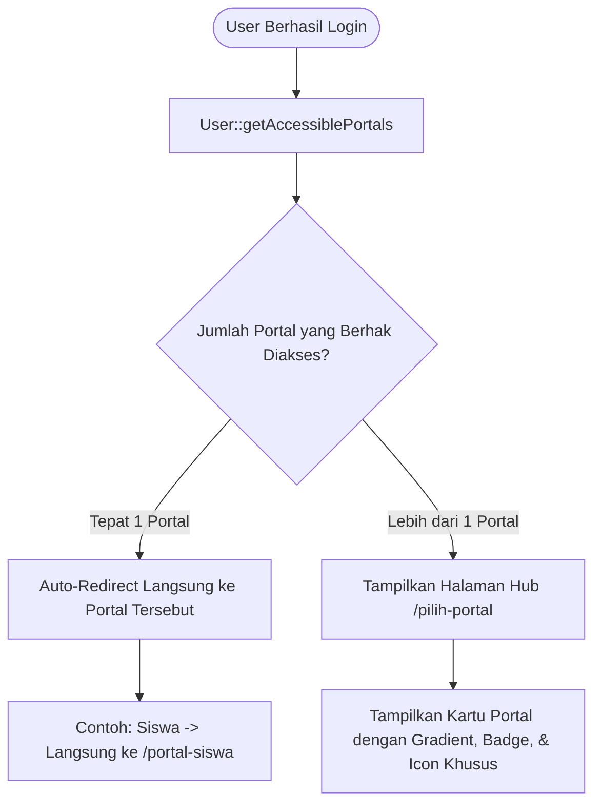

# 🔐 Arsitektur Panel & Manajemen Akses Pengguna

Dokumen ini mendokumentasikan sistem keamanan, autentikasi berbasis peran (*Role-Based Access Control* / RBAC), pengelolaan akun staf/admin ([`App\Filament\Resources\UserResource`](file:///home/sutris-remote/Documents/projek-laravel/projek-absensi-barcode/app/Filament/Resources/UserResource.php)), serta pusat kendali izin akses portal mandiri ([`App\Filament\Resources\ManajemenAksesPortalResource`](file:///home/sutris-remote/Documents/projek-laravel/projek-absensi-barcode/app/Filament/Resources/ManajemenAksesPortalResource.php)).

---

## 1. Arsitektur Keamanan Panel Admin Filament

Panel admin dilindungi oleh pengamanan bertingkat untuk menjamin hanya personel yang berwenang yang dapat mengakses dashboard `/admin`:



### A. Single Unified Login ([`App\Http\Middleware\FilamentAuthenticate`](file:///home/sutris-remote/Documents/projek-laravel/projek-absensi-barcode/app/Http/Middleware/FilamentAuthenticate.php))
Filament tidak menggunakan halaman login terpisah. Semua permintaan ke `/admin` yang belum terautentikasi akan dialihkan secara mulus ke rute login tunggal sistem sekolah:
```php
protected function redirectTo($request): ?string
{
    return route('login');
}
```

### B. Evaluasi Hak Masuk Panel ([`App\Models\User::canAccessPanel`](file:///home/sutris-remote/Documents/projek-laravel/projek-absensi-barcode/app/Models/User.php))
Model `User` mengimplementasikan interface `FilamentUser`:
- **Blokir Siswa Absolut**: Siswa yang memiliki record di relasi `student` ditolak secara mutlak dari akses panel admin (`return false`).
- **Super Admin Bypass**: Pengguna ber-role `super_admin` atau memiliki kolom `is_super_admin = true` diizinkan membuka semua panel.
- **Admin Per Divisi**: Pengguna wajib memiliki setidaknya satu role yang diawali dengan prefix `admin_` (misal: `admin_akademik_viewer`, `admin_presensi_editor`) atau role `spikap_admin`.

---

## 2. Modul Manajemen Admin & Staf (`UserResource`)

Dikelola melalui menu **Manajemen Akses &rarr; Manajemen Admin** (`/admin/users`):
- **Lingkup Data**: Kueri dibatasi hanya untuk akun non-siswa:
  ```php
  public static function getEloquentQuery(): Builder
  {
      return parent::getEloquentQuery()->whereDoesntHave('student');
  }
  ```

### A. Integrasi Profil Guru & Generator Email Otomatis
Pada formulir pembuatan akun ([`UserForm`](file:///home/sutris-remote/Documents/projek-laravel/projek-absensi-barcode/app/Filament/Resources/UserResource/Schemas/UserForm.php)):
- Operator dapat menghubungkan akun dengan data master Guru (`teacher_id`).
- **Otomatisasi Nama & Email**: Saat seorang guru dipilih, sistem otomatis mengisi nama lengkap dan membuat alamat email terstandardisasi dengan formula:
  $$\text{email} = \text{nip} \mathbin{@} \text{domain\_sekolah}$$
  *(Contoh: Guru dengan NIP `198501012010011001` otomatis mendapatkan email `198501012010011001@smpn3tuban.sch.id`)*.

### B. Matriks Penugasan Role & Aturan Otomatis Pintar (*Smart Pairing Logic*)
Formulir dilengkapi logika reaktif Livewire untuk mencegah kesalahan konfigurasi izin:

```text
┌────────────────────────────────────────────────────────────────────────┐
│            Aturan Cerdas Penugasan Role (Smart Pairing Logic)          │
├────────────────────────────────────────────────────────────────────────┤
│ 1. Editor → Viewer Binding:                                            │
│    Mencentang Editor otomatis mencentang Viewer terkait.               │
│    Melepas Viewer otomatis melepaskan hak Editor terkait.              │
├────────────────────────────────────────────────────────────────────────┤
│ 2. Super Admin Master Toggle:                                          │
│    Mencentang Super Admin otomatis mencentang SELURUH role divisi.     │
│    Melepas centang Super Admin otomatis membersihkan seluruh role.     │
├────────────────────────────────────────────────────────────────────────┤
│ 3. Auto Detection:                                                     │
│    Jika semua role divisi dicentang manual → Super Admin aktif otomatis│
│    Jika salah satu role dilepas → Centang Super Admin otomatis copot   │
└────────────────────────────────────────────────────────────────────────┘
```

---

## 3. Standardisasi RBAC Trait ([`HasSimpleRoleAccess`](file:///home/sutris-remote/Documents/projek-laravel/projek-absensi-barcode/app/Filament/Traits/HasSimpleRoleAccess.php))

Setiap Resource di panel admin mengimplementasikan model otorisasi ganda (**Editor** vs **Viewer**):

```php
trait HasSimpleRoleAccess
{
    abstract protected static function getModuleRolePrefix(): string;

    // Viewer & Editor boleh melihat data
    public static function canViewAny(): bool {
        return $user->hasAnyRole(["admin_{$prefix}_viewer", "admin_{$prefix}_editor"]);
    }

    // Hanya Editor yang boleh menambah data
    public static function canCreate(): bool {
        return $user->hasRole("admin_{$prefix}_editor");
    }

    // Hanya Editor yang boleh mengubah data
    public static function canEdit(Model $record): bool {
        return $user->hasRole("admin_{$prefix}_editor");
    }

    // Hanya Editor yang boleh menghapus data
    public static function canDelete(Model $record): bool {
        return $user->hasRole("admin_{$prefix}_editor");
    }
}
```

---

## 4. Manajemen Akses Portal Mandiri (`ManajemenAksesPortalResource`)

Dikelola melalui menu **Manajemen Akses &rarr; Manajemen Akses Portal** (`/admin/manajemen-akses-portal`). Modul ini memungkinkan administrator memberikan hak akses operasional kepada guru/staf untuk menggunakan portal mandiri tanpa harus memberikan hak akses ke panel utama admin Filament.

### A. Konfigurasi Saklar Akses per Portal:

| Portal Sasaran | Parameter Saklar | Role / Permission yang Diberikan | Keterangan Fungsional |
| :--- | :--- | :--- | :--- |
| **Portal Guru** (`/portal-guru`) | `akses_portal_guru` | Role `wali_kelas` | Mengizinkan login ke portal guru untuk mengisi presensi rombel binaan. |
| **Bypass Seluruh Kelas** | `bypass_semua_kelas` | Permission `portal_guru:akses_semua_kelas` | Hak khusus bagi Kepala Sekolah atau Wakasek Kurikulum untuk memantau absensi seluruh rombel. |
| **Rombel Binaan BK** | `kelas_binaan_bk_ids` | Pemetaan Kelas Binaan BK | Khusus Guru BK: membatasi aduan SPIKAP dan pantauan presensi hanya pada kelas asuhannya. |
| **Portal Perpustakaan** (`/portal-perpustakaan`) | `akses_portal_perpustakaan` | Role `petugas_perpustakaan` | Mengizinkan operasional sirkulasi mandiri, peminjaman paket buku, dan absensi pengunjung. |
| **Portal Presensi** (`/portal-presensi`) | `akses_dashboard_presensi` | Role `admin_portal_presensi` & `petugas_presensi` | Mengizinkan pengelolaan monitoring live gerbang, rekapitulasi, dan operasional kiosk barcode. |
| **Portal Web Sekolah** (`/portal-web`) | `akses_portal_web` | Role `admin_portal_web` | Mengizinkan publikasi artikel berita, galeri kegiatan, prestasi siswa, dan halaman layanan publik. |

### B. Tampilan Status Terpadu pada Tabel
Tabel menyajikan indikator visual cepat mengenai status hak akses staf:
- **Akses Portal Guru**: Menampilkan badge *Wali Kelas (1 Kelas)* atau *Bypass Semua Kelas*.
- **Akses Portal Perpus**: Badge hijau *Aktif (Petugas)* jika diizinkan.
- **Akses Kiosk Presensi**: Badge *Diizinkan* untuk seluruh guru dan petugas gerbang.
- **Akses Portal Presensi**: Badge *Admin Presensi* bagi penanggung jawab laporan kehadiran.

---

## 5. Hub Pemilihan Portal (`/pilih-portal`) & Logika Auto-Redirect

Setelah pengguna berhasil login di `/login`, sistem mengevaluasi hak akses secara dinamis melalui method [`App\Models\User::getAccessiblePortals()`](file:///home/sutris-remote/Documents/projek-laravel/projek-absensi-barcode/app/Models/User.php#L321-L426):



### A. Aturan Deteksi Akses per Portal:
1. **Portal Admin (`/admin`)**:
   - Syarat: Role `super_admin` ATAU memiliki salah satu role yang berawalan `admin_` (misal: `admin_master_editor`, `admin_presensi_viewer`).
2. **Portal Guru (`/portal-guru`)**:
   - Syarat: Role `super_admin`, `wali_kelas`, `guru`, ATAU akun memiliki relasi `teacher` aktif.
3. **Portal Presensi & Kiosk (`/portal-presensi`)**:
   - Syarat: Role `super_admin`, `admin_portal_presensi`, `petugas_presensi`, ATAU role `admin_presensi_*`.
   - *Catatan Penting*: Mencentang `akses_dashboard_presensi` di admin otomatis memberikan **2 role sekaligus**: `admin_portal_presensi` (untuk akses rekapitulasi) dan `petugas_presensi` (untuk operasional scanner kiosk gerbang).
4. **Portal Perpustakaan (`/portal-perpustakaan`)**:
   - Syarat: Role `super_admin`, `petugas_perpustakaan`, ATAU role `admin_perpustakaan_*`.
5. **Portal Siswa (`/portal-siswa`)**:
   - Syarat Khusus (*Pure Student Only*): Memiliki role `siswa` atau relasi `student`, dan **bukan** Super Admin atau Guru (`$this->teacher === null`).
6. **Portal Web Sekolah (`/portal-web`)**:
   - Syarat: Role `super_admin` ATAU `admin_portal_web`.

### B. Aturan Auto-Redirect Cerdas (*Zero Click Redirection*)
Jika staf atau siswa hanya berhak mengakses **1 portal saja**, sistem tidak akan membingungkan pengguna dengan menu pilihan:
```php
$accessiblePortals = $user->getAccessiblePortals();
if (count($accessiblePortals) === 1) {
    return redirect($accessiblePortals[0]['url']);
}
return view('pilih-portal', compact('accessiblePortals'));
```
Siswa otomatis langsung dilempar ke `/portal-siswa`, sedangkan Guru murni langsung masuk ke `/portal-guru`. Halaman `/pilih-portal` hanya disajikan kepada pengguna multi-peran (seperti Kepala Sekolah, Super Admin, atau Guru yang merangkap sebagai Petugas Presensi & Perpustakaan).

