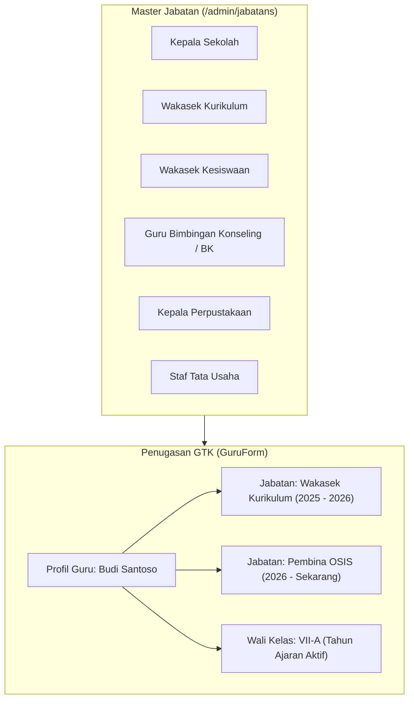

# 👨‍🏫 Master Data Guru, Tenaga Kependidikan (GTK), & Struktur Jabatan

Dokumen ini mendokumentasikan pengelolaan data pendidik dan tenaga kependidikan ([`App\Filament\Akademik\Resources\Guru\GuruResource`](file:///home/sutris-remote/Documents/projek-laravel/projek-absensi-barcode/app/Filament/Akademik/Resources/Guru/GuruResource.php)) serta konfigurasi struktur organisasi dan jabatan sekolah ([`App\Filament\Akademik\Resources\Jabatans\JabatanResource`](file:///home/sutris-remote/Documents/projek-laravel/projek-absensi-barcode/app/Filament/Akademik/Resources/Jabatans/JabatanResource.php)).

---

## 1. Pengelolaan Data GTK (`GuruResource`)

Dikelola melalui menu **Data Master &rarr; Guru** (`/admin/guru`):
- **Model Eloquent**: [`App\Models\Guru`](file:///home/sutris-remote/Documents/projek-laravel/projek-absensi-barcode/app/Models/Guru.php) (tabel `teachers`).
- **Otorisasi**: Memerlukan hak akses `admin_master_viewer` (lihat) atau `admin_master_editor` (tambah/edit/hapus) via trait [`HasSimpleRoleAccess`](file:///home/sutris-remote/Documents/projek-laravel/projek-absensi-barcode/app/Filament/Traits/HasSimpleRoleAccess.php).

### A. Anatomi Formulir Guru ([`GuruForm`](file:///home/sutris-remote/Documents/projek-laravel/projek-absensi-barcode/app/Filament/Akademik/Resources/Guru/Schemas/GuruForm.php))
1. **Foto Profil GTK**:
   - Disimpan di disk `public/guru-photos`.
   - Dilengkapi fitur *circle cropper* dan *image editor* bawaan Filament untuk menjaga kerapian pas foto guru.
2. **Identitas & Legalitas**:
   - **Nama Lengkap**: Disertai gelar akademik (contoh: *Dra. Hj. Siti Rahayu, M.Pd.*).
   - **Jenis Kelamin**: Laki-laki (`L`) / Perempuan (`P`).
   - **NIP / NUPTK**: Nomor Induk Pegawai unik. Jika diisi, NIP otomatis digunakan sebagai username login utama.
3. **Kontak WhatsApp & Normalisasi Otomatis**:
   - Kolom `no_hp` dilengkapi penanganan regex:
     ```php
     $digits = preg_replace('/\D/', '', $value ?? '');
     if (str_starts_with($digits, '0')) {
         $normalized = '62' . substr($digits, 1);
     }
     ```
   - Otomatis mengubah awalan `0812...` menjadi format standar internasional `62812...`. Kontak ini sangat penting untuk pengiriman notifikasi broadcast harian dan persetujuan izin via link WhatsApp.
4. **Jejaring Sosial & Portofolio Digital**:
   - `facebook_url` & `instagram_url`: Tautan akun resmi guru.
   - `microsite_url`: Tautan situs portofolio pembelajaran digital guru (Google Sites / Canva / S.id) yang otomatis dipublikasikan pada halaman publik Web Profil Sekolah.

### B. Otomatisasi Akun Pengguna Terintegrasi
Setiap pembuatan data guru baru:
- Sistem secara otomatis membuat akun login di tabel `users` (relasi `user_id`).
- **Email Generator**: Format email diturunkan dari NIP atau nama guru dengan formula:
  $$\text{email} = \text{nip} \mathbin{@} \text{domain\_sekolah}$$
- **Password Default**: Sistem dapat menghasilkan kata sandi acak aman yang ditampilkan kepada admin saat data pertama kali disimpan, atau admin dapat menetapkan password kustom secara manual.

---

## 2. Struktur Jabatan & Tugas Tambahan

Sekolah memiliki struktur organisasi yang dinamis. Penugasan jabatan dikelola melalui dua tingkat:



### A. Master Jabatan (`JabatanResource`)
Dikelola di `/admin/jabatans`:
- Mendefinisikan nama jabatan fungsional dan struktural di sekolah.
- Menjadi referensi penugasan hak khusus (misal: jabatan *Guru BK* otomatis mengaktifkan modul Bimbingan Konseling dan Satgas SPIKAP).

### B. Riwayat Masa Tugas Jabatan (`teacherJabatans`)
Pada formulir guru terdapat komponen `Repeater` yang mencatat linimasa penugasan:
- `jabatan_id`: Referensi ke tabel `jabatans`.
- `tanggal_mulai`: Tanggal berlakunya Surat Keputusan (SK) tugas.
- `tanggal_selesai`: Tanggal berakhirnya masa jabatan (dikosongkan jika masih aktif menjabat).

### C. Konsolidasi Tugas Tambahan Otomatis (`semua_jabatan`)
Sistem menyediakan getter pintar pada model `Guru`:
```php
$guru->semua_jabatan;
```
Menghasilkan daftar gabungan antara jabatan struktural aktif (dari tabel `teacher_jabatans`) dengan penugasan sebagai **Wali Kelas** pada tahun ajaran berjalan (dari tabel `kelas_ajarans`). Informasi ini ditampilkan secara *read-only* pada profil guru untuk memudahkan verifikasi beban kerja guru.

---

## 3. Alokasi Kelompok Dampingan Guru Wali (`KelompokGuruWaliResource`)

Dikelola melalui menu navigasi grup **Guru Wali &rarr; Kelompok Dampingan** (`/admin/guru-wali/kelompok`):
- **Dasar Kebijakan**: Implementasi Permendikdasmen No. 11/2025 mengenai bimbingan karakter siswa secara personal.
- **Model Eloquent**: [`App\Models\KelompokGuruWali`](file:///home/sutris-remote/Documents/projek-laravel/projek-absensi-barcode/app/Models/KelompokGuruWali.php) (tabel `kelompok_guru_walis`).
- **Pelekatan Permanen**: Setiap kelompok dampingan melekat secara permanen pada guru wali yang ditugaskan.
- **Fitur Transfer Siswa Interaktif (`manage_anggota`)**:
  - Tabel dilengkapi tombol aksi modal transfer dua kolom (*Dual Listbox Transfer Modal*).
  - Kolom kiri menampilkan daftar siswa dampingan aktif yang dibina saat ini.
  - Kolom kanan menampilkan daftar siswa aktif sekolah yang belum memiliki kelompok guru wali asuh (*unassigned candidates*).
  - Operator admin dapat memindahkan siswa masuk atau keluar kelompok secara instan dengan pencarian cepat nama/NISN tanpa perlu membuka halaman kesiswaan satu per satu.

