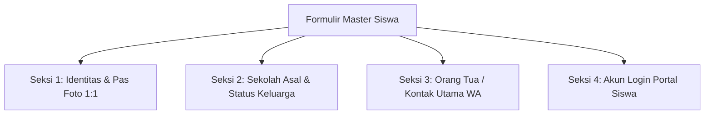

# 🎒 Master Data Kesiswaan & Alat Bantu Impor Massal

Dokumen ini menjelaskan pengelolaan master data peserta didik ([`App\Filament\Akademik\Resources\Siswa\SiswaResource`](file:///home/sutris-remote/Documents/projek-laravel/projek-absensi-barcode/app/Filament/Akademik/Resources/Siswa/SiswaResource.php)) serta alat bantu impor dan pembaruan massal (*bulk actions*) berbasis spreadsheet Excel dan arsip ZIP foto.

---

## 1. Antarmuka Master Siswa (`SiswaResource`)

Dikelola melalui menu **Data Master &rarr; Siswa** (`/admin/siswa`):
- **Model Eloquent**: [`App\Models\Siswa`](file:///home/sutris-remote/Documents/projek-laravel/projek-absensi-barcode/app/Models/Siswa.php) (tabel `students`).
- **Penyajian Tabel Utama ([`SiswaTable`](file:///home/sutris-remote/Documents/projek-laravel/projek-absensi-barcode/app/Filament/Akademik/Resources/Siswa/Tables/SiswaTable.php))**:
  - **Foto Siswa**: Avatar melingkar dengan fallback placeholder dinamis.
  - **NISN & NIS**: Nomor induk resmi bersertifikat kemdikbud.
  - **Nama Siswa**: Nama lengkap sesuai akta kelahiran.
  - **Kelas Aktif**: Menghitung secara dinamis penempatan rombel siswa pada tahun ajaran aktif (disertai status: *Aktif, Naik, Lulus, Pindah*).
  - **Barcode ID**: Nomor kode kartu barcode yang terhubung ke scanner gerbang dan perpustakaan (dilengkapi tombol sekali klik *Copy to Clipboard*).
  - **No. WhatsApp Ortu & Siswa**: Kontak aktif yang telah ternormalisasi.

---

## 2. Formulir Lengkap Biodata Siswa (4 Seksi)

Formulir kesiswaan ([`SiswaForm`](file:///home/sutris-remote/Documents/projek-laravel/projek-absensi-barcode/app/Filament/Akademik/Resources/Siswa/Schemas/SiswaForm.php)) dibagi menjadi 4 bagian terstruktur:



1. **Seksi 1: Identitas & Biodata**:
   - `nisn` & `nis`: Nomor induk unik divalidasi anti-duplikasi.
   - `name`, `birth_place`, `birth_date`, dan `address`.
   - `photo_path`: Pas foto rasio 1:1 (otomatis dipotong dan di-resize ke 400x400 px).
2. **Seksi 2: Data Sekolah & Status Keluarga**:
   - `gender` (*L / P*) dan `religion` (*Islam, Kristen, Katolik, Hindu, Buddha, Konghucu*).
   - `previous_school`: Asal sekolah dasar (SD/MI).
   - `admission_date` & `admission_class`: Riwayat penerimaan awal siswa.
   - `family_status` (*Kandung / Tiri / Angkat*) dan `child_order` (urutan anak ke-).
3. **Seksi 3: Data Orang Tua / Wali**:
   - Nama dan pekerjaan Ayah, Ibu, serta Wali.
   - **`no_hp_orang_tua`**: Kontak WhatsApp utama keluarga. Nomor ini menjadi tujuan utama pengiriman laporan presensi masuk/pulang harian dari sistem barcode gerbang.
4. **Seksi 4: Akun Login Portal Siswa**:
   - Akun user otomatis terdaftar di tabel `users`.
   - **Password Bawaan**: Jika dikosongkan saat pendaftaran, sistem otomatis menetapkan nomor **NISN** sebagai kata sandi awal siswa.

---

## 3. Empat Alat Bantu Impor & Pembaruan Massal (Power Tools)

Untuk menangani penerimaan peserta didik baru (PPDB) ratusan siswa serentak, sistem menyediakan 4 aksi massal canggih:

```text
┌────────────────────────────────────────────────────────────────────────┐
│                   4 Alat Bantu Pemrosesan Massal Siswa                 │
├──────────────────────────┬─────────────────────────────────────────────┤
│ 1. Import Siswa + Kelas  │ 2. Upload Foto Massal (ZIP)                 │
│    Unggah Excel 8 kolom  │    Ekstraksi ZIP pas foto {NISN}.jpg        │
│    otomatis enroll rombel│    auto-resize 500x500 kompresi 80%         │
├──────────────────────────┼─────────────────────────────────────────────┤
│ 3. Update No. HP Massal  │ 4. Update Data Siswa Massal                 │
│    Download Excel kontak,│    Sinkronisasi massal biodata dan alamat   │
│    edit & upload kembali │    tanpa merusak histori absensi            │
└──────────────────────────┴─────────────────────────────────────────────┘
```

### A. Impor Siswa Baru (+ Kelas) ([`ImportSiswaBaruAction`](file:///home/sutris-remote/Documents/projek-laravel/projek-absensi-barcode/app/Filament/Akademik/Resources/Siswa/Actions/ImportSiswaBaruAction.php))
- **Template Resmi 8 Kolom**: *NISN, NIS, Nama, Tempat Lahir, Tanggal Lahir, Alamat, Password, Kelas*.
- **Pencegahan Duplikat**: Otomatis mendeteksi jika ada NISN yang kembar di dalam file Excel maupun yang sudah ada di database.
- **Auto Enrollment**: Jika kolom `Kelas` diisi nama rombel valid (misal: *VII-A*), siswa langsung otomatis didaftarkan ke tahun ajaran aktif tanpa perlu proses ploting kelas manual.
- **Pratinjau Interaktif**: Menampilkan tabel pratinjau dengan 7 status kondisi baris sebelum data di-commit.
- **Unduh Laporan Hasil**: Menyediakan laporan Excel rekapitulasi data yang berhasil dan yang gagal diimpor.

### B. Unggah Foto Massal via Arsip ZIP ([`ImportFotoMassalAction`](file:///home/sutris-remote/Documents/projek-laravel/projek-absensi-barcode/app/Filament/Akademik/Resources/Siswa/Actions/ImportFotoMassalAction.php))
- Panitia foto sekolah cukup mengumpulkan pas foto siswa dengan format nama file:
  `{NISN}.jpg` &rarr; contoh: `0081234567.jpg`.
- Seluruh foto dikompresi ke dalam satu file `.zip`.
- **Pemrosesan Otomatis**:
  - Arsip diekstrak ke direktori sementara.
  - Library `Intervention/Image` memotong dan memperkecil resolusi foto secara proporsional (*max dimension 500x500 px, kualitas 80%*) untuk menghemat ruang penyimpanan server.
  - Foto lama siswa dihapus secara bersih dari storage dan digantikan foto baru.

### C. Pembaruan Kontak WhatsApp Massal ([`UpdateNoHpSiswaAction`](file:///home/sutris-remote/Documents/projek-laravel/projek-absensi-barcode/app/Filament/Akademik/Resources/Siswa/Actions/UpdateNoHpSiswaAction.php))
- Admin dapat mengunduh seluruh data kontak siswa dan orang tua per kelas ke format spreadsheet `.xlsx`.
- Operator mengoreksi nomor HP di Excel.
- Saat diunggah kembali, sistem otomatis menormalkan nomor telepon ke format internasional `628xxx` dan memperbarui data kesiswaan secara instan.

---

## 4. Manajemen Status Mutasi & Reaktivasi Siswa

Untuk menjaga integritas riwayat presensi lampau, sistem tidak mengizinkan penghapusan data siswa yang sudah memiliki riwayat absensi:
- **`MutateStudentAction`**: Digunakan saat siswa pindah sekolah, lulus, atau dikeluarkan. Record enrollment diubah statusnya menjadi non-aktif sehingga nama siswa tidak lagi muncul di lembar presensi kelas harian.
- **`ReactivateStudentAction`**: Mengaktifkan kembali siswa jika terjadi kesalahan administratif saat mutasi.
