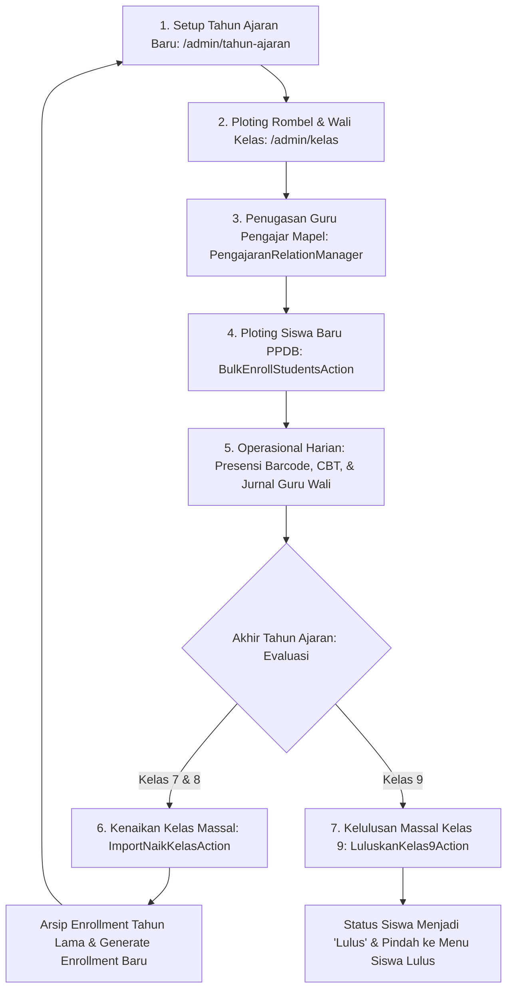

# 🎓 Siklus Akademik, Rombongan Belajar, & Mekanisme Kelulusan

Dokumen ini mendokumentasikan tata kelola siklus akademik tahunan, penataan rombongan belajar (rombel), pemetaan guru pengajar per mata pelajaran, serta prosedur kenaikan kelas dan kelulusan massal peserta didik.

---

## 1. Siklus Hidup Akademik Sekolah (Annual Academic Lifecycle)

Operasional sekolah bergerak dalam siklus tahunan terstruktur yang diotomatisasi oleh sistem:



---

## 2. Manajemen Tahun Ajaran (`TahunAjaranResource`)

Dikelola melalui menu **Data Master &rarr; Tahun Ajaran** (`/admin/tahun-ajaran`):
- **Model Eloquent**: [`App\Models\TahunAjaran`](file:///home/sutris-remote/Documents/projek-laravel/projek-absensi-barcode/app/Models/TahunAjaran.php) (tabel `academic_years`).
- **Otorisasi Khusus**: Hanya dapat diakses oleh **Super Admin** (`canAccess()`):
  ```php
  public static function canAccess(): bool
  {
      return auth()->user()?->isSuperAdmin() ?? false;
  }
  ```

### A. Aturan Integritas Tahun Ajaran
1. **Formula Tahun Selesai Otomatis**:
   Saat admin menginput `start_year` (contoh: `2026`), sistem otomatis menetapkan `end_year = 2027` dengan label tahun pelajaran: **2026/2027**.
2. **Kunci Singleton Tahun Ajaran Aktif (*Active Lock*)**:
   Hanya ada **satu** tahun ajaran yang boleh berstatus `aktif` dalam satu waktu. Mengaktifkan tahun ajaran baru akan secara otomatis mengarsipkan tahun ajaran sebelumnya.
3. **Immutability Protection**:
   Jika tahun ajaran telah memiliki data relasi (kelas binaan, riwayat presensi harian, atau enrollment siswa), kolom tahun mulai dikunci permanen agar tidak merusak data historis.

---

## 3. Manajemen Rombel & Plotting Pengajaran

Modul akademik memisahkan entitas kelas fisik dengan operasional rombongan belajar aktif:

### A. Kelas Fisik ([`KelasResource`](file:///home/sutris-remote/Documents/projek-laravel/projek-absensi-barcode/app/Filament/Akademik/Resources/Kelas/KelasResource.php))
Dikelola di **Akademik &rarr; Kelas** (`/admin/kelas`):
- **Model**: [`App\Models\Kelas`](file:///home/sutris-remote/Documents/projek-laravel/projek-absensi-barcode/app/Models/Kelas.php) (tabel `classes`).
- **Tingkat (*Grade Level*)**: 7, 8, atau 9.
- **Wali Kelas per Periode** ([`KelasAjaranRelationManager`](file:///home/sutris-remote/Documents/projek-laravel/projek-absensi-barcode/app/Filament/Akademik/Resources/Kelas/RelationManagers/KelasAjaranRelationManager.php)): Menghubungkan kelas fisik dengan tahun ajaran aktif dan menunjuk seorang guru sebagai **Wali Kelas** (memberikan wewenang presensi rombel di Portal Guru).
- **Pemetaan Guru Pengajar per Mapel** ([`PengajaranRelationManager`](file:///home/sutris-remote/Documents/projek-laravel/projek-absensi-barcode/app/Filament/Akademik/Resources/Kelas/RelationManagers/PengajaranRelationManager.php)): Menautkan mata pelajaran dengan guru pengampunya (tabel `pengajarans`) yang menentukan hak penarikan nilai ZenCBT.

### B. Rombongan Belajar Aktif ([`RombonganBelajarResource`](file:///home/sutris-remote/Documents/projek-laravel/projek-absensi-barcode/app/Filament/Akademik/Resources/RombonganBelajarResource.php))
Dikelola di **Akademik &rarr; Rombongan Belajar** (`/admin/rombongan-belajar`):
- Menyajikan agregat operasional kelas khusus untuk **Tahun Ajaran Aktif**.
- Dilengkapi pintasan langsung aksi `Kelola Pembelajaran` (`ManagePembelajaranKelas`) untuk meninjau distribusi beban mengajar guru tanpa harus membuka edit modal kelas satu per satu.

### C. Master Kurikulum & Mata Pelajaran ([`MataPelajaranResource`](file:///home/sutris-remote/Documents/projek-laravel/projek-absensi-barcode/app/Filament/Akademik/Resources/MataPelajarans/MataPelajaranResource.php))
Dikelola di **Data Master &rarr; Mata Pelajaran** (`/admin/mata-pelajarans`):
- Menyimpan katalog mata pelajaran resmi (`nama_mapel`, `kode_mapel`), misalnya *Matematika (MTK)*, *Bahasa Indonesia (BIN)*.
- Menjadi referensi wajib saat menugaskan guru pengajar di `PengajaranRelationManager` maupun konfigurasi paket soal di modul CBT.

### D. Klasifikasi Jenis Ujian ([`JenisUjianResource`](file:///home/sutris-remote/Documents/projek-laravel/projek-absensi-barcode/app/Filament/Akademik/Resources/JenisUjianResource.php))
Dikelola di **Data Master &rarr; Jenis Ujian** (`/admin/jenis-ujians`):
- Mendefinisikan kode dan kategori asesmen sekolah: *STS* (Sumatif Tengah Semester), *SAS* (Sumatif Akhir Semester), *SAT* (Sumatif Akhir Tahun), maupun *Try Out*.
- Menjadi kunci pengelompokan penarikan nilai dari server ZenCBT dan pembobotan di transkrip nilai siswa.

---

## 4. Mesin Kenaikan Kelas & Kelulusan Massal (`EnrollmentResource`)

Dikelola melalui menu **Akademik &rarr; Pendaftaran Kelas** (`/admin/enrollment/enrollments`):
- **Model Eloquent**: [`App\Models\EnrollmentSiswa`](file:///home/sutris-remote/Documents/projek-laravel/projek-absensi-barcode/app/Models/EnrollmentSiswa.php) (tabel `enrollment_siswas`).

### A. Saklar Pengaman Kenaikan Kelas (`enable_promotion_features`)
Untuk mencegah tertekannya tombol kenaikan kelas secara tidak sengaja saat kegiatan belajar mengajar masih berlangsung di tengah semester, aksi kenaikan kelas dan kelulusan diproteksi oleh toggle di Pengaturan Akademik:
```php
$this->visible(fn () => PengaturanSekolah::current()?->enable_promotion_features ?? false)
```
Tombol aksi hanya akan muncul jika Super Admin telah mengaktifkan saklar kenaikan kelas menjelang akhir tahun ajaran di halaman **Pengaturan Akademik**.

---

### B. Empat Aksi Massal Siklus Siswa:

#### 1. Penempatan Siswa Baru ([`BulkEnrollStudentsAction`](file:///home/sutris-remote/Documents/projek-laravel/projek-absensi-barcode/app/Filament/Akademik/Resources/Enrollment/Actions/BulkEnrollStudentsAction.php))
- Digunakan untuk siswa baru tingkat 7 yang belum memiliki rombel.
- Admin memilih Tahun Ajaran Aktif dan Rombel Tujuan (contoh: *VII-B*).
- Sistem hanya menampilkan daftar siswa aktif yang belum memiliki enrollment pada tahun ajaran tersebut.

#### 2. Kenaikan Kelas Massal ([`ImportNaikKelasAction`](file:///home/sutris-remote/Documents/projek-laravel/projek-absensi-barcode/app/Filament/Akademik/Resources/Enrollment/Actions/ImportNaikKelasAction.php))
- **Validasi Tahun Berurutan**: Memastikan tahun ajaran asal dan tahun ajaran tujuan berurutan secara sah (misal: 2025/2026 &rarr; 2026/2027).
- **Proses Berkas Excel**:
  - Admin mengunggah file spreadsheet pemetaan kelas baru.
  - Pratinjau interaktif memvalidasi apakah siswa memenuhi syarat naik kelas.
  - Saat dieksekusi: status enrollment lama diubah menjadi `naik`, dan sistem otomatis membuat record enrollment baru berstatus `aktif` di kelas tingkat berikutnya (contoh: dari *VII-A* menjadi *VIII-A*).

#### 3. Kelulusan Massal Kelas 9 ([`LuluskanKelas9Action`](file:///home/sutris-remote/Documents/projek-laravel/projek-absensi-barcode/app/Filament/Akademik/Resources/Enrollment/Actions/LuluskanKelas9Action.php))
- Memilih tahun ajaran aktif dan memproses seluruh rombel dengan `grade_level = 9`.
- **Eksekusi Sekali Klik**:
  - Mengubah status enrollment menjadi `lulus`.
  - Mengubah status kesiswaan di tabel `students` menjadi `lulus`.
  - Siswa yang lulus otomatis diarsipkan dari lembar absensi gerbang dan dipindahkan ke menu **Siswa Lulus**.

#### 4. Pembatalan Kelulusan Massal (*Rollback Safety*) ([`BatalkanKelulusanMassalAction`](file:///home/sutris-remote/Documents/projek-laravel/projek-absensi-barcode/app/Filament/Akademik/Resources/Enrollment/Actions/BatalkanKelulusanMassalAction.php))
- Jika terjadi kesalahan administratif (misal: tanggal kelulusan belum resmi atau ada nilai ujian yang perlu direvisi), admin dapat membatalkan status kelulusan secara massal.
- Sistem memulihkan status enrollment dan siswa kembali menjadi `aktif` seperti semula.

---

## 5. Mutasi, Rotasi Kelas, & Arsip Alumni

Untuk menjaga akurasi statistik dan rekam jejak historis siswa:
1. **Pindah Kelas Berjalan ([`PindahKelasResource`](file:///home/sutris-remote/Documents/projek-laravel/projek-absensi-barcode/app/Filament/Akademik/Resources/PindahKelasResource.php))**:
   - Dikelola di **Akademik &rarr; Pindah Kelas** (`/admin/pindah-kelas`).
   - Mencatat rotasi siswa antar-rombel pada tingkat kelas yang sama dalam satu tahun ajaran berjalan (misal: dari *VIII-A* pindah ke *VIII-C*).
   - Menghasilkan audit trail di tabel `riwayat_pindah_kelas` dengan mencatat kelas asal, kelas tujuan, alasan mutasi intern, dan tanggal efektif pemindahan tanpa merusak riwayat kehadiran sebelumnya.
2. **Siswa Mutasi Keluar ([`SiswaMutasiResource`](file:///home/sutris-remote/Documents/projek-laravel/projek-absensi-barcode/app/Filament/Akademik/Resources/SiswaMutasiResource.php))**:
   - Dikelola di **Akademik &rarr; Siswa Mutasi** (`/admin/siswa-mutasi`).
   - Menyimpan arsip data siswa yang keluar/pindah ke sekolah lain dengan status `mutasi`.
   - Dilengkapi aksi **Reaktivasi Siswa** ([`ReactivateStudentAction`](file:///home/sutris-remote/Documents/projek-laravel/projek-absensi-barcode/app/Actions/Student/ReactivateStudentAction.php)) bila siswa yang bersangkutan kembali mendaftar ulang.
3. **Siswa Lulus ([`SiswaLulusResource`](file:///home/sutris-remote/Documents/projek-laravel/projek-absensi-barcode/app/Filament/Akademik/Resources/SiswaLulusResource.php))**:
   - Dikelola di **Akademik &rarr; Siswa Lulus** (`/admin/siswa-lulus`).
   - Menampilkan repositori seluruh alumni yang telah lulus per angkatan tahun ajaran, yang menjadi basis data bagi penelusuran di modul **Tracer Study Alumni**.

---

## 6. Halaman Pengaturan Akademik (`AkademikSettingsPage`)

Dikelola di **Akademik &rarr; Pengaturan Akademik** (`/admin/pengaturan-akademik`):
- **Otorisasi**: Memerlukan role `super_admin` atau `akademik_editor`.
- **Tahun Ajaran Aktif**: Menampilkan label Tahun Pelajaran yang sedang aktif saat ini secara *read-only* (diproteksi agar hanya dapat diganti lewat menu Tahun Ajaran).
- **Pengendali Saklar Kenaikan & Kelulusan (`enable_promotion_features`)**: Tombol aktivasi global yang mengontrol visibilitas tombol *Luluskan Siswa* dan *Naik Kelas* di tabel kesiswaan dan enrollment. Ketika dinonaktifkan di masa tengah semester, tombol-tombol aksi mutasi massal disembunyikan untuk menjaga kestabilan data.
