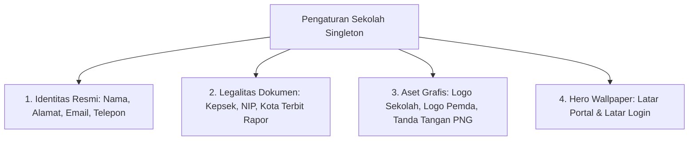

# 🏛️ Pengaturan Global Sekolah, Branding, & Manajemen Sistem

Dokumen ini mendokumentasikan pengaturan terpusat profil sekolah, legalitas instansi, aset grafis (*branding*), kustomisasi tema visual, mode pemeliharaan (*maintenance*), serta integrasi pihak ketiga pada panel admin ([`App\Filament\Pages\SchoolSettingsPage`](file:///home/sutris-remote/Documents/projek-laravel/projek-absensi-barcode/app/Filament/Pages/SchoolSettingsPage.php) dan [`App\Filament\Pages\ThemeSettingsPage`](file:///home/sutris-remote/Documents/projek-laravel/projek-absensi-barcode/app/Filament/Pages/ThemeSettingsPage.php)).

---

## 1. Arsitektur Singleton Pengaturan Sekolah (`SchoolSettingsPage`)

Dikelola melalui menu **Pengaturan Sistem &rarr; Pengaturan Sekolah** (`/admin/pengaturan-sekolah`):
- **Model Eloquent**: [`App\Models\PengaturanSekolah`](file:///home/sutris-remote/Documents/projek-laravel/projek-absensi-barcode/app/Models/PengaturanSekolah.php) (tabel `school_settings`).
- **Prinsip Singleton**: Hanya ada **satu baris data** konfigurasi di seluruh sistem yang diakses melalui method statis `PengaturanSekolah::current()`.
- **Invaliasi Cache Otomatis**: Setiap kali pengaturan diperbarui, cache global dibersihkan:
  ```php
  \Illuminate\Support\Facades\Cache::forget('public_pengaturan_sekolah');
  ```
- **Hak Akses**: Dikhususkan secara eksklusif hanya untuk **Super Admin** (`canAccess()`).

---

## 2. Cakupan Konfigurasi Identitas & Legalitas Sekolah

Pada tab **Identitas & Tema Sekolah**:



1. **Identitas Instansi**:
   - `school_name`: Nama resmi sekolah (ditampilkan pada title bar, header kop surat, kartu ujian, dan rapor).
   - `school_address`: Alamat lengkap sekolah beserta kode pos.
   - `school_email` & `school_phone`: Kontak resmi untuk header surat dan footer portal publik.
2. **Legalitas Kepala Sekolah & Titimangsa Rapor**:
   - `principal_name` & `principal_nip`: Nama dan NIP Kepala Sekolah sebagai fallback jika tidak ada guru aktif yang memegang jabatan Kepala Sekolah.
   - `kota` & `tempat_rapor`: Kota domisili penerbitan dokumen resmi (misal: *Kedungreja*, *Tuban*, atau *Jakarta*).
   - `tanggal_rapor`: Titimangsa tanggal pencetakan rapor semester.
3. **Aset Grafis & Branding Kartu**:
   - `school_logo_path`: Logo resmi sekolah (tampil di kanan kartu presensi/OSIS, header web, dan navbar panel admin).
   - `district_logo_path`: Logo Pemerintah Daerah / Dinas Pendidikan (tampil di kiri kartu presensi/OSIS).
   - `principal_signature_path`: File gambar tanda tangan digital Kepala Sekolah berformat **PNG transparan** untuk dicetak otomatis pada kartu tanda pelajar dan kartu barcode.
4. **Wallpaper Latar Antarmuka**:
   - `hero_image_path`: Gambar latar beresolusi tinggi (disarankan 1920x1080 px) untuk landing page web sekolah.
   - `login_background_path`: Gambar latar khusus halaman login terpadu.

---

## 3. Manajemen Mode Pemeliharaan (*Maintenance Mode*)

Pada tab **Manajemen Portal & Pengumuman**, Super Admin dapat mengunci akses ke masing-masing portal secara terisolasi tanpa mematikan seluruh server:

| Parameter Toggle | Portal yang Dikunci | Dampak bagi Pengguna |
| :--- | :--- | :--- |
| `maintenance_portal_siswa` | `/portal-siswa` | Siswa dan orang tua tidak dapat login; menampilkan pesan kustom `welcome_message_siswa`. |
| `maintenance_portal_guru` | `/portal-guru` | Wali kelas dan guru mapel tidak dapat membuka lembar absensi/nilai; menampilkan `welcome_message_guru`. |
| `maintenance_portal_perpustakaan` | `/portal-perpustakaan` | Menutup layanan kiosk dan sirkulasi perpus; menampilkan `welcome_message_perpustakaan`. |

*Catatan: Super Admin tetap memiliki hak bypass untuk masuk dan melakukan pengujian selama masa pemeliharaan berlangsung.*

---

## 4. Banner Pengumuman Global (*Global Alert Banner*)

- `global_announcement_active`: Saklar aktif/nonaktif banner.
- `global_announcement`: Formulir teks kaya (*Rich Editor*) yang mendukung penekanan tebal, miring, dan tautan hyperlink.
- **Dampak Tampilan**: Saat diaktifkan, banner ini muncul melayang (*floating alert bar*) di bagian paling atas seluruh layar portal yang sedang aktif (Portal Siswa, Portal Guru, Portal Presensi, dan Portal Web) untuk menyampaikan maklumat darurat (misal: libur mendadak, perubahan jadwal ujian, atau pemeliharaan server).

---

## 5. Kustomisasi Tema & Palet Visual (`ThemeSettingsPage`)

Dikelola melalui menu **Pengaturan Sistem &rarr; Pengaturan Tema** (`/admin/pengaturan-tema`):
- **Palet Warna Bawaan (*Color Presets*)**:
  - 🌊 **Ocean Blue** (`#0284c7`) - Warna default standar institusi pendidikan.
  - 🌲 **Emerald Green** (`#059669`) - Nuansa segar sekolah Adiwiyata / madrasah.
  - 🍯 **Amber Gold** (`#d97706`) - Nuansa hangat profesional.
  - 🍇 **Royal Violet** (`#7c3aed`) - Tampilan modern berkarakter.
  - 🌹 **Rose Pink** (`#e11d48`) - Nuansa dinamis ceria.
- **Dukungan Kustom Warna (*ColorPicker*)**: Operator dapat memilih warna primer khusus yang sesuai dengan identitas korporat almamater sekolah.

---

## 6. Pengumuman Running Text & Display Publik (`PengumumanResource`)

Dikelola melalui menu **Konten &rarr; Dashboard Publik** (`/admin/pengumumen`):
- **Model Eloquent**: [`App\Models\Pengumuman`](file:///home/sutris-remote/Documents/projek-laravel/projek-absensi-barcode/app/Models/Pengumuman.php) (tabel `pengumumen`).
- **Otorisasi**: Memerlukan role `super_admin` atau `master_editor` (menggunakan trait [`HasSimpleRoleAccess`](file:///home/sutris-remote/Documents/projek-laravel/projek-absensi-barcode/app/Filament/Traits/HasSimpleRoleAccess.php)).
- **Tujuan Operasional**:
  Menyediakan pesan maklumat berjalan (*running text marquee*) dan kartu pengumuman yang ditayangkan pada layar monitor monitor display kehadiran publik (`/dashboard`), layar TV lobi sekolah, dan anjungan kiosk presensi gerbang.
- **Formulir Pengumuman**:
  - **Judul & Isi Maklumat**: Teks pesan ringkas dan padat.
  - **Tipe Pesan**:
    - 🔵 `info` - Informasi umum / kegiatan ekstrakurikuler.
    - 🟡 `penting` - Pemberitahuan jadwal asesmen atau agenda rapat dinas.
    - 🔴 `peringatan` - Maklumat kedisiplinan dan larangan.
  - **Jadwal Tayang Otomatis**: Mendukung tanggal mulai dan tanggal selesai masa tayang, sehingga pengumuman otomatis hilang dari layar display publik saat masa aktifnya berakhir tanpa perlu dihapus manual.
  - **Urutan Prioritas (`urutan`)**: Mengatur urutan rotasi pemutaran teks pada running banner.
