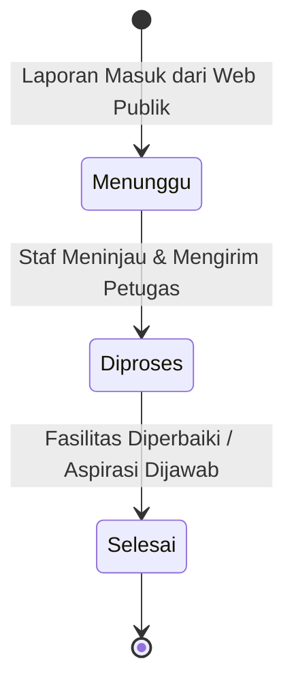

# 🛡️ Administrasi Pengaduan Sarpras, Satgas SPIKAP, & Tracer Alumni

Dokumen ini mendokumentasikan tata kelola modul penanganan aspirasi sarpras ([`App\Filament\Resources\PengaduanResource`](file:///home/sutris-remote/Documents/projek-laravel/projek-absensi-barcode/app/Filament/Resources/PengaduanResource.php)), pengawasan kasus kekerasan dan perundungan oleh Satgas SPIKAP ([`App\Filament\Resources\SpikapLaporanResource`](file:///home/sutris-remote/Documents/projek-laravel/projek-absensi-barcode/app/Filament/Resources/SpikapLaporanResource.php)), serta pelacakan rekam jejak lulusan melalui Tracer Study Alumni ([`App\Filament\Resources\AlumniResource`](file:///home/sutris-remote/Documents/projek-laravel/projek-absensi-barcode/app/Filament/Resources/AlumniResource.php)).

---

## 1. Layanan Aspirasi & Pengaduan Sekolah (`PengaduanResource`)

Dikelola melalui menu **Layanan Publik &rarr; Data Aspirasi & Pengaduan** (`/admin/pengaduan/data`):
- **Model Eloquent**: [`App\Models\Pengaduan`](file:///home/sutris-remote/Documents/projek-laravel/projek-absensi-barcode/app/Models/Pengaduan.php) (tabel `pengaduans`).
- **Tujuan**: Menerima laporan kerusakan fasilitas sekolah, keluhan sarana prasarana (sarpras), aspirasi kurikulum, atau masukan kebersihan dari warga sekolah dan orang tua murid melalui portal web publik.

### A. Kategori Pengaduan (`PengaduanKategoriResource`)
Dikelola di `/admin/pengaduan/kategori`:
- Mengelompokkan jenis laporan: *Sarana & Prasarana*, *Pelayanan Akademik*, *Kebersihan Lingkungan*, *Keamanan Sekolah*, atau *Lainnya*.
- Membantu Kepala Tata Usaha mengarahkan disposisi perbaikan ke unit kerja yang tepat.

### B. Alur Siklus Tiket Pengaduan

- **`menunggu`**: Laporan baru masuk dan menunggu review admin.
- **`diproses`**: Laporan telah diverifikasi dan sedang dalam proses perbaikan fisik oleh tim sarpras.
- **`selesai`**: Penanganan tuntas dan dicatat dalam log rekap tahunan sekolah.

### C. Pengaturan Notifikasi Pengaduan (`PengaduanSettingPage`)
Dikelola di `/admin/pengaduan/settings`:
- Mengonfigurasi nomor WhatsApp admin piket penerima laporan. Setiap kali ada pengaduan fasilitas baru masuk dari masyarakat, sistem memicu notifikasi instan ke staf sarpras terkait.

### D. Modul Konten Layanan Publik & FAQ Sekolah
Di bawah grup navigasi **Layanan Publik**:
1. **Halaman Layanan ([`WebHalamanLayananResource`](file:///home/sutris-remote/Documents/projek-laravel/projek-absensi-barcode/app/Filament/Resources/WebHalamanLayananResource.php) di `/admin/layanan/halaman`)**:
   - Menyusun artikel panduan dan syarat layanan administrasi sekolah (contoh: *Prosedur Legalisir Ijazah*, *Syarat Mutasi Masuk/Keluar*, *Pengajuan Surat Keterangan Siswa Aktif*).
2. **FAQ Sekolah ([`WebFaqResource`](file:///home/sutris-remote/Documents/projek-laravel/projek-absensi-barcode/app/Filament/Resources/WebFaqResource.php) di `/admin/layanan/faq`)**:
   - Basis pengetahuan tanya-jawab interaktif (*Frequently Asked Questions*) yang tampil di web publik sekolah untuk menjawab pertanyaan rutin calon wali murid terkait PPDB, jam belajar, dan tata tertib.

---

## 2. Satgas Pencegahan & Penanganan Kekerasan (`SpikapLaporanResource`)

Dikelola melalui menu navigasi grup **SPIKAP / Anti-Bullying** (`/admin/spikap/laporan`):
- **Model Eloquent**: [`App\Models\SpikapLaporan`](file:///home/sutris-remote/Documents/projek-laravel/projek-absensi-barcode/app/Models/SpikapLaporan.php) (tabel `spikap_laporans`).
- **Grup Navigasi Dinamis**: Label menu diatur secara dinamis mengikuti nama program pencegahan kekerasan yang diakui sekolah melalui [`App\Models\SpikapNotifSetting::instance()->getNamaAplikasi()`](file:///home/sutris-remote/Documents/projek-laravel/projek-absensi-barcode/app/Models/SpikapNotifSetting.php) (misal: *SPIKAP*, *Aman Bersama*, atau *Satgas TPPK*).

### A. Prinsip Perlindungan Kerahasiaan Saksi & Pelapor
1. **Dukungan Laporan Anonim**:
   Siswa yang merasa takut atau terancam dapat melaporkan insiden perundungan (*bullying*), pemalakan, atau pelecehan secara anonim.
2. **Kerahasiaan Tingkat Basis Data**:
   Nama pelapor disamarkan oleh sistem dan hanya anggota Satgas resmi yang memiliki kredensial verifikasi identitas fisik jika penyelidikan membutuhkan keterangan langsung.

### B. Tahapan Investigasi & Log Kronologi Kasus ([`App\Models\SpikapLogStatus`](file:///home/sutris-remote/Documents/projek-laravel/projek-absensi-barcode/app/Models/SpikapLogStatus.php))
Setiap tindakan tim pemeriksa dicatat dalam audit trail formal:
- **Tingkat Urgensi Kasus**: *Rendah*, *Sedang*, *Tinggi / Darurat*.
- **Log Tahapan Penanganan**:
  1. *Laporan Diterima*: Pengecekan kebenaran informasi awal dan lampiran bukti (foto/tangkapan layar).
  2. *Investigasi Bukti*: Wawancara terpisah antara korban, saksi, dan terlapor di ruang privat BK.
  3. *Mediasi / Konseling Khusus*: Pendampingan psikologis korban dan pemanggilan orang tua peserta didik.
  4. *Sanksi / Pembinaan Karakter*: Pelaksanaan bimbingan terpadu bersama Guru Wali Asuh.
  5. *Kasus Ditutup (Selesai)*: Penyelesaian tertulis berkeadilan restoratif.

### C. Pengaturan Notifikasi Darurat Satgas (`SpikapNotifSettingPage`)
Dikelola di `/admin/spikap/pengaturan-notifikasi`:
- Mengatur nomor handphone anggota Satgas Pencegahan Kekerasan (Guru BK, Kepala Sekolah, dan Pembina Kesiswaan).
- Jika ada laporan berkategori **Darurat / Kritis**, sistem otomatis mengirimkan pesan darurat via WhatsApp Gateway agar tim satgas dapat segera bertindak di lapangan.

---

## 3. Tracer Study & Penelusuran Jenjang Alumni (`AlumniResource`)

Dikelola melalui menu **Data Alumni &rarr; Data Tracer Alumni** (`/admin/alumni/data`):
- **Model Eloquent**: [`App\Models\Alumni`](file:///home/sutris-remote/Documents/projek-laravel/projek-absensi-barcode/app/Models/Alumni.php) (tabel `alumnis`).

### A. Integrasi dengan Kelulusan Kelas 9
- Siswa yang telah diluluskan melalui aksi [`LuluskanKelas9Action`](file:///home/sutris-remote/Documents/projek-laravel/projek-absensi-barcode/app/Filament/Akademik/Resources/Enrollment/Actions/LuluskanKelas9Action.php) dapat mengisi data penelusuran jenjang alumni secara mandiri melalui form publik di web sekolah.

### B. Parameter Pelacakan Alumni:
1. **Identitas**: NISN, Nama Lengkap, Jenis Kelamin, dan Tahun Kelulusan.
2. **Status Kelanjutan Pendidikan**:
   - **Melanjutkan (`melanjutkan = true`)**:
     - `jenjang_id` ([`AlumniJenjangResource`](file:///home/sutris-remote/Documents/projek-laravel/projek-absensi-barcode/app/Filament/Resources/AlumniJenjangResource.php) di `/admin/alumni/jenjang`): Pilihan jenjang lanjutan (*SMA Negeri/Swasta, SMK, MA, Pondok Pesantren, Perguruan Tinggi*).
     - `nama_sekolah`: Nama instansi/sekolah lanjutan yang menerima alumni tersebut.
   - **Tidak Melanjutkan / Bekerja / Wirausaha**: Pencatatan bidang vokasi atau aktivitas wirausaha alumni.
3. **Statistik Evaluasi Mutu Sekolah**:
   - Data tracer study diproses menjadi grafik persentase keterserapan alumni di sekolah negeri/favorit yang dipublikasikan secara transparan pada widget statistik Web Profil Sekolah.
4. **Pengaturan Tracer Alumni ([`AlumniSettingPage`](file:///home/sutris-remote/Documents/projek-laravel/projek-absensi-barcode/app/Filament/Pages/AlumniSettingPage.php) di `/admin/alumni/settings`)**:
   - Pengaturan aktivasi kuesioner tracer publik dan kustomisasi teks pengantar alumni.
