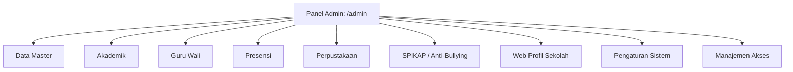

# ⚙️ Fitur 07: Portal Admin Filament (School ERP Command Center)

Dokumen ini memuat panduan komprehensif mengenai **Portal Admin (`/admin`)**, pusat kendali operasional terpadu (*Unified ERP Command Center*) berbasis **Filament v3**. Modul ini digunakan oleh Super Admin, Staf Tata Usaha, Tim IT Sekolah, Pimpinan Sekolah, dan Admin Divisi (Akademik, Presensi, Perpustakaan, Humas) untuk mengelola seluruh data master dan konfigurasi sistem.

---

## 📌 Peta Navigasi Dokumen Portal Admin

| Dokumen | Topik Pembahasan |
| :--- | :--- |
| [`01-arsitektur-dan-manajemen-akses.md`](file:///home/sutris-remote/Documents/projek-laravel/projek-absensi-barcode/docs/03-fitur/07-portal-admin/01-arsitektur-dan-manajemen-akses.md) | Arsitektur Filament Panel Provider, keamanan login (`canAccessPanel`), Manajemen User Admin ([`UserResource`](file:///home/sutris-remote/Documents/projek-laravel/projek-absensi-barcode/app/Filament/Resources/UserResource.php)), dan saklar buka-tutup akses portal mandiri ([`ManajemenAksesPortalResource`](file:///home/sutris-remote/Documents/projek-laravel/projek-absensi-barcode/app/Filament/Resources/ManajemenAksesPortalResource.php)). |
| [`02-master-data-guru-dan-tenaga-kependidikan.md`](file:///home/sutris-remote/Documents/projek-laravel/projek-absensi-barcode/docs/03-fitur/07-portal-admin/02-master-data-guru-dan-tenaga-kependidikan.md) | Manajemen Guru & Tenaga Kependidikan (GTK) ([`GuruResource`](file:///home/sutris-remote/Documents/projek-laravel/projek-absensi-barcode/app/Filament/Akademik/Resources/Guru/GuruResource.php)), struktur organisasi/jabatan ([`JabatanResource`](file:///home/sutris-remote/Documents/projek-laravel/projek-absensi-barcode/app/Filament/Akademik/Resources/Jabatans/JabatanResource.php)), penugasan wali kelas, guru BK, dan kontak WhatsApp GTK. |
| [`03-master-data-siswa-dan-import-massal.md`](file:///home/sutris-remote/Documents/projek-laravel/projek-absensi-barcode/docs/03-fitur/07-portal-admin/03-master-data-siswa-dan-import-massal.md) | Pengelolaan master data kesiswaan ([`SiswaResource`](file:///home/sutris-remote/Documents/projek-laravel/projek-absensi-barcode/app/Filament/Akademik/Resources/Siswa/SiswaResource.php)), generator barcode ID kartu, import data siswa massal via Excel, import foto profil ZIP massal, dan sinkronisasi nomor WhatsApp ortu. |
| [`04-siklus-akademik-rombel-dan-kelulusan.md`](file:///home/sutris-remote/Documents/projek-laravel/projek-absensi-barcode/docs/03-fitur/07-portal-admin/04-siklus-akademik-rombel-dan-kelulusan.md) | Manajemen Tahun Ajaran aktif ([`TahunAjaranResource`](file:///home/sutris-remote/Documents/projek-laravel/projek-absensi-barcode/app/Filament/Akademik/Resources/TahunAjarans/TahunAjaranResource.php)), Rombel ([`KelasResource`](file:///home/sutris-remote/Documents/projek-laravel/projek-absensi-barcode/app/Filament/Akademik/Resources/Kelas/KelasResource.php)), pembagian jadwal pengajaran, aksi kenaikan kelas massal, kelulusan kelas 9, mutasi, dan pembatalan kelulusan. |
| [`05-pengaturan-global-sekolah-dan-branding.md`](file:///home/sutris-remote/Documents/projek-laravel/projek-absensi-barcode/docs/03-fitur/07-portal-admin/05-pengaturan-global-sekolah-dan-branding.md) | Halaman pengaturan singleton sekolah ([`SchoolSettingsPage`](file:///home/sutris-remote/Documents/projek-laravel/projek-absensi-barcode/app/Filament/Pages/SchoolSettingsPage.php)), logo/favicon, kop surat resmi, tema panel admin ([`ThemeSettingsPage`](file:///home/sutris-remote/Documents/projek-laravel/projek-absensi-barcode/app/Filament/Pages/ThemeSettingsPage.php)), serta konfigurasi gateway WhatsApp & CBT. |
| [`06-administrasi-pengaduan-spikap-dan-alumni.md`](file:///home/sutris-remote/Documents/projek-laravel/projek-absensi-barcode/docs/03-fitur/07-portal-admin/06-administrasi-pengaduan-spikap-dan-alumni.md) | Pengelolaan aduan sarpras/layanan sekolah ([`PengaduanResource`](file:///home/sutris-remote/Documents/projek-laravel/projek-absensi-barcode/app/Filament/Resources/PengaduanResource.php)), tiket penanganan kekerasan SPIKAP admin ([`SpikapLaporanResource`](file:///home/sutris-remote/Documents/projek-laravel/projek-absensi-barcode/app/Filament/Resources/SpikapLaporanResource.php)), dan tracer study alumni ([`AlumniResource`](file:///home/sutris-remote/Documents/projek-laravel/projek-absensi-barcode/app/Filament/Resources/AlumniResource.php)). |

---

## 🏛️ Arsitektur Panel Provider & Grup Navigasi

Panel admin dikonfigurasikan secara terpusat di [`App\Providers\Filament\AdminPanelProvider`](file:///home/sutris-remote/Documents/projek-laravel/projek-absensi-barcode/app/Providers/Filament/AdminPanelProvider.php):
- **ID Panel**: `admin`
- **Rute Path**: `/admin`
- **Warna Utama**: `Color::Amber` (dinamis sesuai preferensi tema sekolah)
- **Tema CSS**: `resources/css/filament/admin/theme.css`

### Daftar 13 Grup Navigasi Resmi di Panel Admin:
1. **`(Tanpa Grup)`**: Dashboard Utama (`/admin`).
2. **`Data Master`**: Master Guru (`/admin/guru`), Jabatan GTK (`/admin/jabatans`), Mata Pelajaran (`/admin/mata-pelajarans`), Tahun Ajaran (`/admin/tahun-ajaran`), dan Jenis Ujian (`/admin/jenis-ujians`).
3. **`Akademik`**: Master Siswa (`/admin/siswa`), Kelas (`/admin/kelas`), Rombongan Belajar (`/admin/rombongan-belajar`), Sinkron Nilai CBT (`/admin/ujian-akademik`), Pendaftaran Kelas / Enrollment (`/admin/enrollment/enrollments`), Pindah Kelas (`/admin/pindah-kelas`), Siswa Lulus (`/admin/siswa-lulus`), Siswa Mutasi (`/admin/siswa-mutasi`), dan Pengaturan Akademik (`/admin/pengaturan-akademik`).
4. **`Guru Wali`**: Kelompok Dampingan Bimbingan Karakter (`/admin/guru-wali/kelompok`) & Transfer Siswa Binaan.
5. **`Presensi`**: Laporan Detail, Rekap Kelas, Rekap Sekolah, Ijin Kehadiran (`/admin/ijin-kehadirans`), Cetak Laporan Presensi, Cetak Laporan Sholat Dhuhur, Input Presensi Manual, Kartu Presensi Siswa, Pengaturan Hari Libur, Manajemen Notifikasi WA, Pengaturan Presensi, dan Laporan WhatsApp.
6. **`Perpustakaan`**: Katalog Buku, Inventaris Buku, Koleksi/Klasifikasi Buku, Klasifikasi DDC, Peminjaman Aktif, Riwayat Presensi Pengunjung, Reservasi Segera Hadir, Laporan Sirkulasi, Anggota, Import dari SLiMS, dan Pengaturan Default.
7. **`SPIKAP`**: Laporan Kasus Perundungan/Kekerasan (`/admin/spikap/laporan`) & Pengaturan Satgas Anti-Bullying (`/admin/spikap/pengaturan-notifikasi`).
8. **`Konten`**: Dashboard Publik (`/admin/pengumumen` - Pengumuman Running Text & Banner Kiosk Monitor).
9. **`Layanan Publik`**: Data Aspirasi & Pengaduan, Kategori Pengaduan, Halaman Layanan, FAQ Sekolah, dan Pengaturan Layanan.
10. **`Data Alumni`**: Data Tracer Alumni, Pilihan Jenjang Pendidikan Lanjutan, dan Pengaturan Tracer Study.
11. **`Web Profil Sekolah`**: Pengaturan Web Profil, Fasilitas/Sarpras, Artikel & Pengumuman, Pilar Keunggulan, Prestasi, Statistik, Menu Aplikasi, Galeri, Akses Cepat (`/admin/web-quick-links`), Halaman Akademik, dan Microsite.
12. **`Pengaturan Sistem`**: Pengaturan Sekolah Singleton (Profil, Logo, Kop Surat, Maintenance) dan Pengaturan Tema Visual.
13. **`Manajemen Akses`**: Manajemen Admin (User & Role RBAC) dan Manajemen Akses Portal Mandiri (Saklar Portal Guru, Presensi, Perpus, Web).
14. **`Akses Portal & Web`**: Pintasan cepat ke Web Utama (`/`), Hub Pemilih Portal (`/pilih-portal`), dan Portal Web Profil (`/portal-web`).
