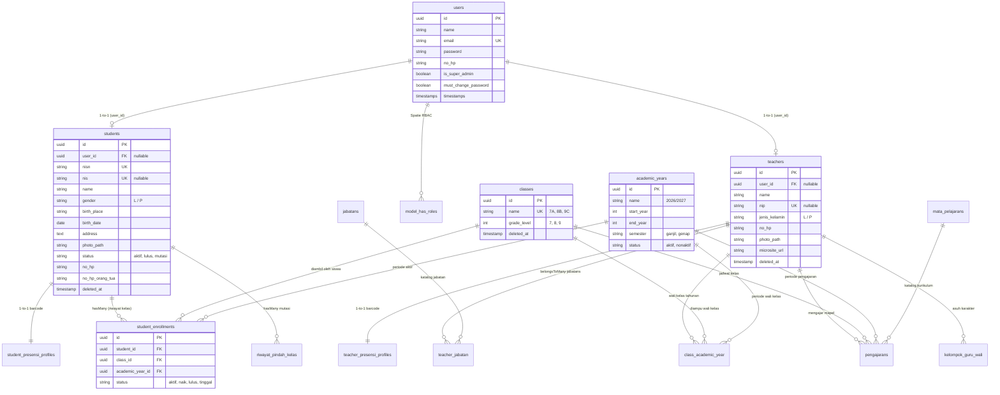

# 🗄️ Arsitektur & Skema Database Master Data ERP

Dokumen ini memuat spesifikasi teknis arsitektur basis data, Entity Relationship Diagram (ERD), kamus data terstruktur, strategi penindeksan performa, serta pola otentikasi identitas tunggal (*Single Identity Auth*) yang mendasari data master **Siswa** dan **Guru (GTK)**.

> [!NOTE]
> Dokumen ini selaras penuh dengan referensi skema basis data global di [`docs/02-database/01-akademik-dan-users.md`](file:///home/sutris-remote/Documents/projek-laravel/projek-absensi-barcode/docs/02-database/01-akademik-dan-users.md) dan [`docs/02-database/skema-dan-relasi.md`](file:///home/sutris-remote/Documents/projek-laravel/projek-absensi-barcode/docs/02-database/skema-dan-relasi.md). Dokumen ini berfokus pada implementasi fungsional, relasi model Eloquent, dan alur integrasi ERP.

---

## 1. Filosofi Desain: Single Source of Truth (SSOT)

Seluruh subsistem aplikasi (Presensi Kiosk, Perpustakaan, Guru/SI-WALI, CBT, Layanan Pengaduan, dan Panel Admin) tidak memiliki tabel kesiswaan atau kepegawaian terpisah. Semua modul merujuk ke tabel inti yang sama:
1. **Identitas Otentikasi Terpusat**: Seluruh pengguna (admin, staf, guru, hingga siswa) memiliki kredensial di tabel `users`.
2. **Pemisahan Entitas Profil**: Biodata spesifik siswa disimpan di `students`, sedangkan data kepegawaian GTK disimpan di `teachers`.
3. **Pemisahan Kelas Fisik vs Rombel Akademik**: Kelas fisik bersifat statis di `classes`, sedangkan keanggotaan siswa diikat per periode tahun ajaran melalui `student_enrollments`.
4. **Keamanan Identitas**: Menggunakan **UUID v4 (36 karakter)** sebagai *primary key* untuk mencegah *ID enumeration attacks* pada API dan rute publik.

---

## 2. Diagram Relasi Entitas Terpadu (Comprehensive Master ERD)



---

## 3. Pola Otentikasi Identitas Tunggal (*Single Identity Auth*)

Sistem mengadopsi model terpadu di [`App\Models\User`](file:///home/sutris-remote/Documents/projek-laravel/projek-absensi-barcode/app/Models/User.php):
- **Relasi ke Profil Guru**:
  ```php
  public function teacher(): HasOne
  {
      return $this->hasOne(Guru::class, 'user_id');
  }
  ```
- **Relasi ke Profil Siswa**:
  ```php
  public function student(): HasOne
  {
      return $this->hasOne(Siswa::class, 'user_id');
  }
  ```
- **Proteksi Gerbang Panel Admin (`canAccessPanel`)**:
  - Akun siswa (`$this->student()->exists()`) **secara mutlak ditolak** masuk ke Panel Admin Filament demi menjamin integritas data tata usaha.
  - Akun guru dan admin dievaluasi berdasarkan role Spatie (`super_admin`, `admin_akademik`, `admin_presensi`, dsb).
- **Resolusi Nama Tampilan Dinamis (`getDisplayNameAttribute`)**:
  Sistem mengevaluasi nama profil secara bertingkat: Nama Lengkap Guru beserta gelar &rarr; Nama Siswa &rarr; Nama Akun Pengguna.

---

## 4. Kamus Data Teknis Tabel Utama

### A. Tabel `users` (Otentikasi & Akun Login)
| Nama Kolom | Tipe Data | Modifiers | Keterangan Bisnis |
| :--- | :--- | :--- | :--- |
| `id` | `char(36)` | PK, UUID | Pengenal unik universal akun. |
| `name` | `varchar(255)` | NOT NULL | Nama akun default sistem. |
| `email` | `varchar(255)` | UNIQUE, NOT NULL | Alamat email / username login. |
| `password` | `varchar(255)` | NOT NULL | Password terenkripsi algoritma Bcrypt/Argon2id. |
| `no_hp` | `varchar(20)` | NULLABLE | Kontak seluler (ternormalisasi format `628...`). |
| `is_super_admin`| `boolean` | DEFAULT false | Flag bypass darurat Super Administrator. |
| `must_change_password` | `boolean` | DEFAULT false | Memaksa ganti password saat login perdana. |

### B. Tabel `students` (Biodata Lengkap Siswa)
Tabel ini memuat 35 kolom atribut kesiswaan:

| Kategori | Kolom Kunci | Tipe Data | Keterangan & Aturan Bisnis |
| :--- | :--- | :--- | :--- |
| **Identitas Pokok** | `id` | `char(36)` (PK) | UUID siswa. |
| | `user_id` | `char(36)` (FK) | Relasi 1-to-1 ke `users.id` (ON DELETE SET NULL). |
| | `nisn` | `varchar(20)` | **Unique Index**, 10 digit Nomor Induk Siswa Nasional. |
| | `nis` | `varchar(20)` | Unique per sekolah, Nomor Induk Siswa lokal. |
| | `name` | `varchar(255)` | Nama lengkap siswa sesuai akta kelahiran. |
| | `gender` | `enum('L','P')` | Laki-laki / Perempuan (menentukan avatar default). |
| | `birth_place` | `varchar(100)` | Kota/kabupaten tempat lahir. |
| | `birth_date` | `date` | Tanggal lahir (format YYYY-MM-DD). |
| | `photo_path` | `varchar(255)` | Lokasi berkas pas foto di disk `public/storage`. |
| **Status Siswa** | `status` | `varchar(20)` | Status kesiswaan: `aktif`, `lulus`, `mutasi`. |
| | `deleted_at` | `timestamp` | Timestamp soft delete (perlindungan histori data). |
| **Kontak & Domisili** | `no_hp` | `varchar(20)` | Nomor WA pribadi siswa. |
| | `no_hp_orang_tua` | `varchar(20)` | Nomor WA orang tua tujuan broadcast notifikasi presensi. |
| | `address` | `text` | Alamat lengkap domisili tempat tinggal. |
| **Keluarga** | `nama_ayah`, `nama_ibu` | `varchar(255)` | Nama orang tua kandung. |
| | `pekerjaan_ayah`, `pekerjaan_ibu` | `varchar(100)` | Profesi orang tua. |
| | `nama_wali`, `pekerjaan_wali` | `varchar(255)` | Data wali jika tinggal bersama wali. |
| **Mutasi Keluar** | `tujuan_mutasi` | `varchar(255)` | Nama sekolah tujuan pindah. |
| | `alasan_mutasi` | `text` | Alasan administratif kepindahan. |
| | `tanggal_mutasi`| `date` | Tanggal resmi penerbitan surat pindah. |
| **Tracer Alumni** | `status_melanjutkan` | `boolean` | Flag melanjutkan pendidikan ke jenjang SMA/SMK/MA. |
| | `jenjang_lanjutan_id` | `bigint unsigned` | Relasi ke katalog jenjang `alumni_jenjangs`. |
| | `nama_sekolah_lanjutan` | `varchar(255)` | Nama institusi pendidikan lanjutan alumni. |

### C. Tabel `teachers` (Data Pokok GTK)
| Nama Kolom | Tipe Data | Modifiers | Keterangan Bisnis |
| :--- | :--- | :--- | :--- |
| `id` | `char(36)` | PK, UUID | UUID unik GTK. |
| `user_id` | `char(36)` | FK, NULLABLE | Relasi 1-to-1 ke `users.id` akun login. |
| `name` | `varchar(255)` | NOT NULL | Nama lengkap GTK beserta gelar akademik. |
| `nip` | `varchar(30)` | UNIQUE, NULL | Nomor Induk Pegawai (18 digit) / NUPTK resmi. |
| `jenis_kelamin` | `enum('L','P')`| NOT NULL | Laki-laki / Perempuan. |
| `no_hp` | `varchar(20)` | NULLABLE | Nomor WA aktif untuk rekap presensi otomatis. |
| `photo_path` | `varchar(255)` | NULLABLE | Foto profil resmi berlatar belakang dinas. |
| `microsite_url` | `varchar(255)` | NULLABLE | Tautan laman portofolio guru di Web Profil Sekolah. |
| `deleted_at` | `timestamp` | NULLABLE | Soft delete kepegawaian. |

### D. Tabel `classes` & `student_enrollments` (Siklus Rombel)
- **`classes`**: Menyimpan daftar fisik kelas permanen (contoh: *VII-A*, *VIII-B*, *IX-C*) dengan atribut `grade_level` (7, 8, atau 9).
- **`student_enrollments`**: Menjadi tabel penengah riwayat kenaikan kelas siswa:
  - `student_id`: Foreign key ke `students.id`.
  - `class_id`: Foreign key ke `classes.id`.
  - `academic_year_id`: Foreign key ke `academic_years.id`.
  - `status`: Enum status kenaikan: `aktif` (sedang belajar), `naik` (promosi ke tingkat atas), `lulus` (selesai kelas 9), `tinggal` (mengulang).

---

## 5. Strategi Integritas & Indeks Performa Database

### A. Penindeksan Kunci (*Database Indexing*)
Untuk menjamin kecepatan pemindaian pada mesin scanner gerbang berkecepatan tinggi (< 500ms):
1. **Index Komposit**:
   - `student_enrollments(student_id, academic_year_id, status)`: Mempercepat resolusi kelas aktif siswa saat proses scan barcode.
   - `class_academic_year(class_id, academic_year_id)`: Mempercepat pemanggilan wali kelas per rombel.
2. **Unique B-Tree Indexes**:
   - `students.nisn` dan `students.nis` diindeks unik untuk mencegah registrasi ganda.
   - `teachers.nip` diindeks unik untuk verifikasi identitas kepegawaian.

### B. Otomasi Profil Barcode Presensi (`booted model event`)
Saat data siswa baru tersimpan di tabel `students`, model Eloquent [`App\Models\Siswa`](file:///home/sutris-remote/Documents/projek-laravel/projek-absensi-barcode/app/Models/Siswa.php) secara otomatis memicu pembuatan entitas barcode:
```php
protected static function booted()
{
    static::created(function ($siswa) {
        $siswa->presensiProfile()->create([
            'barcode_code'   => $siswa->nisn,
            'barcode_active' => true,
        ]);
    });
}
```
Hal ini memastikan siswa yang baru diimpor langsung memiliki barcode aktif yang siap dicetak dan dikenali oleh kiosk scanner gerbang tanpa perlu konfigurasi manual tambahan.
