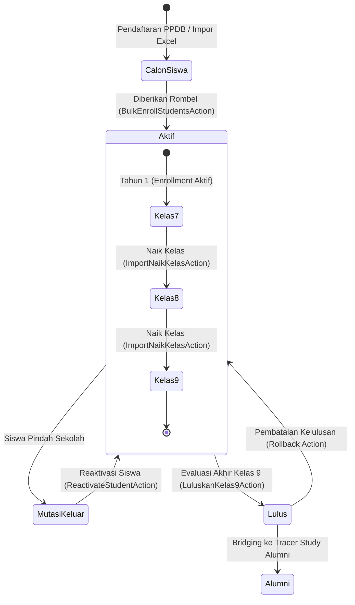

# 🎒 Master Data Siswa & Manajemen Siklus Hidup Kesiswaan

Dokumen ini menjelaskan tata kelola master data kesiswaan di Panel Admin ([`SiswaResource`](file:///home/sutris-remote/Documents/projek-laravel/projek-absensi-barcode/app/Filament/Akademik/Resources/Siswa/SiswaResource.php)), perincian 35 kolom biodata pokok, mekanisme generator barcode ID, serta mesin siklus hidup (*lifecycle state machine*) siswa mulai dari PPDB, promosi kelas, mutasi, hingga kelulusan.

---

## 1. Anatomi 4 Seksi Formulir Kesiswaan (`SiswaForm`)

Formulir kesiswaan pada panel admin dikelompokkan ke dalam 4 seksi logis untuk memastikan kelengkapan data administratif sekolah:

### A. Seksi 1: Data Identitas & Biodata Pokok
- **NISN (Nomor Induk Siswa Nasional)**: 10 digit angka standar Pusdatin Kemendikbudristek. Diatur `required` dan divalidasi `unique` pada tabel `students`. Berfungsi sebagai username dan default password akun.
- **NIS (Nomor Induk Siswa)**: Nomor registrasi internal sekolah. Bersifat unik dan dapat dikonfigurasi sebagai nomor barcode fisik kartu pelajar.
- **Nama Lengkap (`name`)**: Ditulis lengkap sesuai akta kelahiran/ijazah SD tanpa gelar.
- **Tempat & Tanggal Lahir (`birth_place`, `birth_date`)**: Format tanggal ISO YYYY-MM-DD.
- **Nomor WhatsApp Siswa (`no_hp`)**: Divalidasi menggunakan closure regex Indonesia:
  ```php
  $digits = preg_replace('/\D/', '', $value ?? '');
  if (str_starts_with($digits, '0')) $digits = '62' . substr($digits, 1);
  if (!preg_match('/^628[0-9]{7,12}$/', $digits)) {
      $fail('Format nomor HP tidak valid. Contoh: 081234567890');
  }
  ```
- **Pas Foto Siswa (`photo_path`)**: Komponen FileUpload interaktif dengan rasio crop 1:1, target resize 400x400px mode `cover`, batas ukuran maksimal 2MB pada disk `public/siswa-photos`.

### B. Seksi 2: Data Sekolah & Status Keluarga
- **Jenis Kelamin (`gender`)**: `L` (Laki-laki) atau `P` (Perempuan) yang otomatis menentukan avatar ilustrasi default jika foto belum diunggah.
- **Agama (`religion`)**: Pilihan 6 agama resmi di Indonesia.
- **Asal Sekolah (`previous_school`)**: Nama SD/MI asal siswa baru.
- **Tanggal Masuk & Kelas Masuk (`admission_date`, `admission_class`)**: Mencatat historis saat pertama kali diterima di sekolah (misal: *7A*).
- **Status Keluarga & Urutan Anak (`family_status`, `child_order`)**: Status kandung/tiri/angkat serta anak ke-berapa dalam susunan keluarga.

### C. Seksi 3: Data Orang Tua & Kontak WhatsApp Utama
- **Nama & Pekerjaan Orang Tua**: `nama_ayah`, `pekerjaan_ayah`, `nama_ibu`, `pekerjaan_ibu`, serta data wali opsional (`nama_wali`, `pekerjaan_wali`).
- **Nomor WhatsApp Orang Tua (`no_hp_orang_tua`)**:
  - Kolom paling krusial untuk subsistem **WhatsApp Gateway Broadcast**.
  - Setiap kali siswa scan di gerbang, presensi sholat, atau izin disetujui wali kelas, pesan otomatis dikirimkan ke nomor ini.
  - Otomatis dinormalisasi ke awalan `628...` sebelum disimpan ke database.

### D. Seksi 4: Kredensial Login Portal Siswa (`User`)
- **Email Login**: Otomatis di-generate menggunakan formula `{nisn}@siswa.sekolah.sch.id` jika dikosongkan pada saat registrasi siswa baru.
- **Password**: Otomatis menggunakan `nisn` sebagai kata sandi awal pada saat pendaftaran. Siswa dapat memperbaruinya secara mandiri di Portal Siswa (`/portal-siswa/profil`).

---

## 2. Generator Barcode ID & Profil Presensi Otomatis

Setiap kali baris siswa baru dibuat di tabel `students`, model [`App\Models\Siswa`](file:///home/sutris-remote/Documents/projek-laravel/projek-absensi-barcode/app/Models/Siswa.php) secara otomatis memicu listener `booted()`:

```php
protected static function booted()
{
    static::created(function ($siswa) {
        $siswa->presensiProfile()->create([
            'barcode_code'   => $siswa->nisn,
            'barcode_active' => true,
        ]);
    });
}
```

### Standar Barcode Code 128:
1. **Resolusi Tinggi**: Menggunakan standar barcode 1 dimensi format Code 128 yang mendukung pemindaian instan oleh barcode scanner laser USB maupun kamera smartphone kiosk.
2. **Fleksibilitas Mode Barcode**: Administrator dapat memilih apakah barcode berbasis **NISN** atau **NIS** melalui saklar `PengaturanSekolah::current()->barcode_scan_mode`.
3. **Pencetakan Kartu**: Terintegrasi langsung dengan menu cetak kartu pelajar massal di Portal Presensi (`/portal-presensi/cetak-kartu`).

---

## 3. Siklus Hidup Kesiswaan (*Student Lifecycle State Machine*)

Operasional status siswa diatur secara ketat agar tidak terjadi kehilangan riwayat akademik (*historical data integrity*):



### A. Status Siswa `aktif`
- Terdaftar resmi dan memiliki baris aktif di `student_enrollments` pada tahun ajaran aktif.
- Berhak melakukan scan presensi di gerbang, meminjam buku di perpustakaan, mengikuti sesi tes CBT, dan masuk ke Portal Siswa.

### B. Status Siswa `mutasi` (Pindah Sekolah)
- Dicatat melalui aksi mutasi kesiswaan. Kolom `tujuan_mutasi`, `alasan_mutasi`, dan `tanggal_mutasi` wajib diisi.
- Siswa mutasi otomatis diarsipkan dari scanner gerbang.
- **Fitur Reaktivasi ([`ReactivateStudentAction`](file:///home/sutris-remote/Documents/projek-laravel/projek-absensi-barcode/app/Actions/Student/ReactivateStudentAction.php))**: Jika siswa mutasi kembali mendaftar ke sekolah asal, staf tata usaha dapat mereaktivasi data profil siswa beserta seluruh riwayat lampau tanpa membuat record duplikat baru.

### C. Status Siswa `lulus`
- Ditetapkan melalui aksi massal [`LuluskanKelas9Action`](file:///home/sutris-remote/Documents/projek-laravel/projek-absensi-barcode/app/Filament/Akademik/Resources/Enrollment/Actions/LuluskanKelas9Action.php) pada rombel tingkat 9.
- Status enrollment diubah menjadi `lulus` dan status kesiswaan menjadi `lulus`.
- Data alumni secara otomatis dialirkan ke menu **Data Alumni & Tracer Study** (`/admin/alumni/data`) untuk mendata kelanjutan sekolah (SMA/SMK/MA/Pondok Pesantren).

---

## 4. Mutasi Antarkelas Berjalan (`RiwayatPindahKelas`)

Untuk rotasi siswa antar-rombel dalam tingkat yang sama (misal: perpindahan dari kelas *VIII-B* ke *VIII-A* di pertengahan semester):
- Dikelola di menu **Akademik &rarr; Pindah Kelas** ([`PindahKelasResource`](file:///home/sutris-remote/Documents/projek-laravel/projek-absensi-barcode/app/Filament/Akademik/Resources/PindahKelasResource.php)).
- **Audit Trail Abadi**: Sistem membuat rekaman di tabel `riwayat_pindah_kelas`:
  - `student_id`: Siswa yang berpindah.
  - `from_class_id`: Kelas asal.
  - `to_class_id`: Kelas tujuan.
  - `academic_year_id`: Tahun ajaran berjalan.
  - `alasan`: Catatan administratif alasan rotasi (rekomendasi BK / penyesuaian daya tampung).
- **Integritas Presensi**: Riwayat presensi gerbang yang telah tercatat di kelas lama tetap tersimpan utuh dan tidak terhapus.
