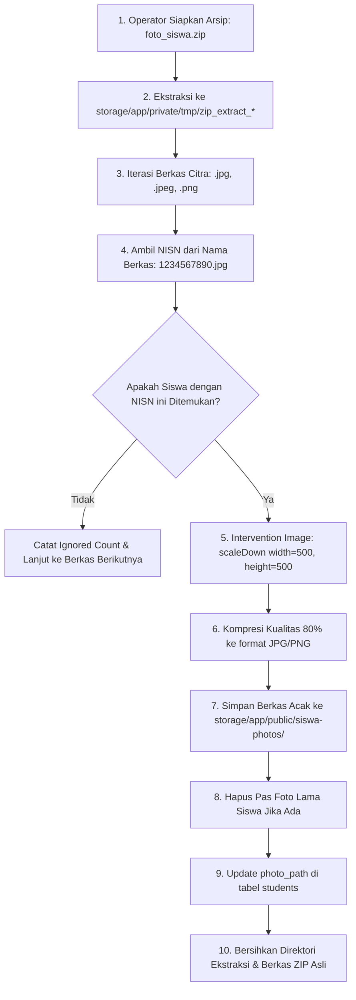

# 📥 Mekanisme Impor Massal & Sinkronisasi Data Siswa

Dokumen ini mendokumentasikan mesin otomasi impor dan pembaruan massal data kesiswaan di Panel Admin Filament. Fitur ini dirancang khusus untuk memfasilitasi masa Penerimaan Peserta Didik Baru (PPDB) dan pembaruan rutin awal tahun pelajaran tanpa memerlukan entri data manual satu per satu.

---

## 1. Peta Empat Aksi Massal Kesiswaan

Seluruh aksi impor massal dapat diakses melalui header tombol tabel pada menu **Akademik &rarr; Siswa** ([`SiswaResource`](file:///home/sutris-remote/Documents/projek-laravel/projek-absensi-barcode/app/Filament/Akademik/Resources/Siswa/SiswaResource.php)):

| Aksi Massal | Tombol & Warna | Handler Class | Fungsi & Ekstensi File |
| :--- | :--- | :--- | :--- |
| **Impor Siswa + Kelas** | 🟢 Hijau (`success`) | [`ImportSiswaBaruAction`](file:///home/sutris-remote/Documents/projek-laravel/projek-absensi-barcode/app/Filament/Akademik/Resources/Siswa/Actions/ImportSiswaBaruAction.php) | Mendaftarkan siswa baru PPDB, membuat akun login, dan plotting ke kelas awal (`.xlsx`). |
| **Upload Foto Massal** | 🔵 Biru (`info`) | [`ImportFotoMassalAction`](file:///home/sutris-remote/Documents/projek-laravel/projek-absensi-barcode/app/Filament/Akademik/Resources/Siswa/Actions/ImportFotoMassalAction.php) | Ekstraksi ZIP pas foto, pencocokan NISN, auto-resizing 500x500px (`.zip`). |
| **Update No. HP Siswa & Ortu** | 🟢 Hijau (`success`) | [`UpdateNoHpSiswaAction`](file:///home/sutris-remote/Documents/projek-laravel/projek-absensi-barcode/app/Filament/Akademik/Resources/Siswa/Actions/UpdateNoHpSiswaAction.php) | Pembaruan massal kontak WhatsApp orang tua dan siswa (`.xlsx`). |
| **Update Data Siswa** | 🟡 Kuning (`warning`) | [`UpdateDataSiswaAction`](file:///home/sutris-remote/Documents/projek-laravel/projek-absensi-barcode/app/Filament/Akademik/Resources/Siswa/Actions/UpdateDataSiswaAction.php) | Pembaruan massal biodata pokok, alamat, dan data orang tua (`.xlsx`). |

---

## 2. Impor Data Pokok Siswa Baru (`ImportSiswaBaruAction`)

Digunakan pada saat PPDB untuk memasukkan ratusan siswa baru sekaligus ke dalam sistem:

### A. Template Resmi 8 Kolom Spreadsheet
Sistem menyediakan tautan unduh template Excel resmi (`route('admin.siswa.download-template')`):
1. **`NISN`** (Wajib): 10 digit unik penanda identitas siswa nasional.
2. **`NIS`** (Opsional/Direkomendasikan): Nomor induk sekolah untuk kartu barcode.
3. **`Nama Siswa`** (Wajib): Nama lengkap peserta didik.
4. **`Tempat Lahir`**: Kota tempat lahir.
5. **`Tanggal Lahir`**: Format tanggal standar (`YYYY-MM-DD` atau `DD/MM/YYYY`).
6. **`Alamat`**: Alamat domisili tempat tinggal siswa.
7. **`Password`** (Opsional): Kata sandi awal (jika kosong, sistem otomatis menetapkan NISN sebagai password).
8. **`Kelas`** (Opsional): Nama rombel awal (contoh: *7A*, *7B*).

### B. Validasi & Integritas Tahun Ajaran Aktif
- Aksi ini mengecek status `TahunAjaran::where('status', 'aktif')`.
- Jika tidak ada tahun ajaran aktif, modal menampilkan peringatan merah: siswa tetap dapat diimpor ke database pokok, namun plotting kelas ditunda sampai tahun ajaran diaktifkan.

### C. Mesin Pratinjau Interaktif (*7 Status Evaluasi Pra-Impor*)
Sebelum data ditulis ke database, parser mengevaluasi setiap baris dan menampilkan pratinjau visual:
- 🟢 **Siap Impor**: Data lengkap, NISN unik, dan rombel valid.
- 🟡 **Duplikat di File**: Terdapat dua baris dengan NISN/NIS yang sama di spreadsheet unggahan.
- 🔴 **Duplikat di Database**: NISN/NIS sudah terdaftar atas nama siswa lain.
- 🟠 **Kelas Tidak Dikenali**: Nama kelas di kolom 8 tidak cocok dengan master kelas fisik.
- ⚠️ **Format Tanggal Invalid**: Tanggal lahir tidak dapat di-parse.
- 🛑 **NISN Kosong**: Baris ditolak.

### D. Laporan Pasca-Impor (*Post-Import Excel Report*)
Setelah tombol eksekusi ditekan, sistem menyediakan unduhan file laporan hasil pemrosesan (`SiswaImportLaporanExport`) yang merinci daftar baris yang berhasil diimpor, baris yang dilewati, serta alasan kegagalannya.

---

## 3. Impor Pas Foto Massal via Arsip ZIP (`ImportFotoMassalAction`)

Mengunggah pas foto ratusan siswa satu per satu sangat memakan waktu. Modul ini menyediakan pipeline pemrosesan citra otomatis via arsip ZIP:

### Keunggulan Teknis Pipeline Citra:
1. **Kompatibilitas Format**: Mendukung ekstensi `.jpg`, `.jpeg`, dan `.png`.
2. **Downscaling Proporsional (`scaleDown: 500x500`)**: Foto dengan resolusi kamera DSLR/HP tinggi (misal: 4000x3000px, 5MB) otomatis diperkecil secara proporsional hingga dimensi maksimum 500px tanpa distorsi rasio wajah.
3. **Pencegahan Sampah Storage (*Orphan File Cleanup*)**: Jika siswa sebelumnya sudah memiliki foto lama, foto lama tersebut langsung dihapus dari disk penyimpanan (`Storage::disk('public')->delete`) sebelum nama file baru disimpan.
4. **Keamanan Ekstraksi**: Direktori ekstraksi sementara dan file ZIP yang diunggah langsung dihapus tuntas setelah proses selesai untuk mencegah kebocoran data di server.

---

## 4. Pembaruan Massal Nomor Kontak WhatsApp (`UpdateNoHpSiswaAction`)

Nomor WhatsApp orang tua sering berganti seiring berjalannya tahun ajaran. Aksi ini memfasilitasi rekonsiliasi data kontak berkala:
1. **Unduh Kontak Terkini**: Operator mengklik tombol *Download Data Kontak* (`route('admin.siswa.download-nohp')`) untuk mengunduh spreadsheet yang telah berisi ID siswa, NISN, Nama, Kelas, Nomor HP Siswa, dan Nomor HP Orang Tua.
2. **Edit Nomor Kontak**: Wali kelas atau staf TU memperbarui nomor handphone yang baru pada spreadsheet.
3. **Proteksi Kolom Kunci**: Sistem memvalidasi kolom `ID` siswa tidak boleh diubah agar pembaruan data tepat sasaran.
4. **Normalisasi Otomatis**: Pada saat berkas diunggah ulang, nomor dengan awalan `08...`, `+628...`, atau spasi/tanda hubung (`0812-3456-7890`) secara otomatis dibersihkan dan distandarisasi ke format internasional `628xxxxxxxxxx`.

---

## 5. Pembaruan Massal Biodata Siswa (`UpdateDataSiswaAction`)

Digunakan saat sinkronisasi berkala data pokok Dapodik/EMIS:
- Mengunduh seluruh master kesiswaan aktif lengkap dengan kolom pengenal (`route('admin.siswa.download-data')`).
- Memungkinkan pembaruan data orang tua, nama ayah/ibu, pekerjaan, alamat rumah, status keluarga, dan riwayat sekolah asal secara serentak dalam satu kali unggah.
