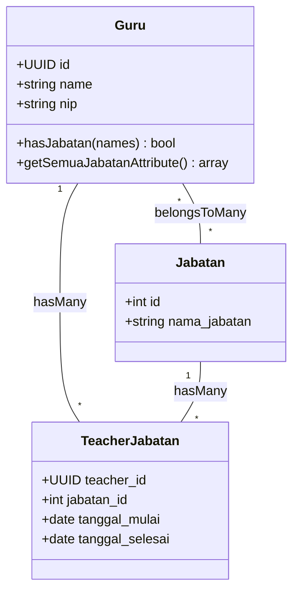

# 👨‍🏫 Fitur 08: Master Guru, GTK, & Struktur Organisasi Sekolah

Dokumen ini membedah secara menyeluruh tata kelola **Master Data Guru dan Tenaga Kependidikan (GTK)** dalam ekosistem ERP Sekolah Terpadu. Modul ini mengintegrasikan profil biodata kepegawaian, akun autentikasi terpusat, struktur hierarki jabatan/SK tugas tambahan, plotting wali kelas tahunan, serta pemetaan beban mengajar mata pelajaran.

---

## 📌 Daftar Isi
1. [Filosofi Desain Entitas GTK](#1-filosofi-desain-entitas-gtk)
2. [Anatomi Biodata Profil Guru (`teachers`)](#2-anatomi-biodata-profil-guru-teachers)
3. [Otomasi Akun Login Pengguna (`users`)](#3-otomasi-akun-login-pengguna-users)
4. [Tata Kelola Jabatan & Riwayat SK Penugasan](#4-tata-kelola-jabatan--riwayat-sk-penugasan)
5. [Plotting Akademik & Distribusi Beban Mengajar](#5-plotting-akademik--distribusi-beban-mengajar)
6. [Mekanisme Impor Massal Data Guru (`GuruImport`)](#6-mekanisme-impor-massal-data-guru-guruimport)
7. [Integrasi Barcode Presensi Guru](#7-integrasi-barcode-presensi-guru)

---

## 1. Filosofi Desain Entitas GTK

Dalam sistem sekolah terpadu, seorang guru bukan sekadar pencatat nilai, melainkan pemegang multi-peran operasional: pendidik kelas, wali rombel, pembina karakter, guru piket, anggota satgas kedisiplinan, hingga kepala laboratorium. 

Untuk memfasilitasi peran dinamis tersebut, sistem mengadopsi model **Dual-Entity Bridge**:

```mermaid
flowchart LR
    subgraph AuthLayer [1. Lapisan Autentikasi: users]
        U[User Account\n- email\n- password (bcrypt)\n- Spatie Roles & Permissions\n- must_change_password]
    end

    subgraph CoreLayer [2. Lapisan Profil Kepegawaian: teachers]
        T[Teacher / Guru Profile\n- id (UUID)\n- name (gelar)\n- nip / nuptk\n- no_hp (628...)\n- microsite_url\n- photo_path]
    end

    subgraph AcademicLayer [3. Lapisan Penugasan & Tugas Tambahan]
        J[Jabatan: teacher_jabatan\n- Kepala Sekolah, BK, Waka, dll.]
        W[Wali Kelas: class_academic_year\n- Penugasan Rombel per Tahun]
        P[Pengajaran: pengajarans\n- Beban Mengajar Mapel per Kelas]
        B[Akses Pantau BK: teacher_class_accesses\n- Binaan Konseling Kelas]
        SI[Kelompok Guru Wali: kelompok_guru_walis\n- Pembinaan SI-WALI Permen 11/2025]
    end

    U <-->|1-to-1 Bidirectional| T
    T --> J
    T --> W
    T --> P
    T --> B
    T --> SI
```

Pemisahan ini menjamin integritas data: jika kredensial login pengguna di-reset atau hak akses peran diubah, seluruh riwayat mengajar, catatan konseling, dan log absensi historis guru tetap utuh dan terhubung ke UUID `teachers`.

---

## 2. Anatomi Biodata Profil Guru (`teachers`)

Biodata GTK dikelola melalui model [`App\Models\Guru`](file:///home/sutris-remote/Documents/projek-laravel/projek-absensi-barcode/app/Models/Guru.php) dan antarmuka Filament Resource [`GuruForm`](file:///home/sutris-remote/Documents/projek-laravel/projek-absensi-barcode/app/Filament/Akademik/Resources/Guru/Schemas/GuruForm.php).

### Struktur Atribut Inti

| Atribut | Tipe Data | Keterangan & Validasi |
| :--- | :--- | :--- |
| `id` | `UUID (PK)` | Kunci primer string UUID v4 non-inkremental. |
| `user_id` | `BIGINT (FK)` | Relasi *One-to-One* ke akun login `users.id` (nullable on creation). |
| `name` | `VARCHAR(255)` | Nama lengkap beserta gelar akademik resmi (contoh: `Dr. Budi Santoso, M.Pd.`). Wajib diisi. |
| `jenis_kelamin` | `ENUM('L','P')` | Laki-laki (`L`) atau Perempuan (`P`). Menentukan fallback avatar default sistem (`avatar-m.svg` atau `avatar-f.svg`). |
| `nip` | `VARCHAR(30)` | Nomor Induk Pegawai resmi. Bersifat *unique* di tabel `teachers`. Opsional bagi guru honorer/GTT. Jika diisi, menjadi basis generator username login. |
| `no_hp` | `VARCHAR(20)` | Nomor telepon/WhatsApp. Dilengkapi **Eloquent Attribute Mutator** otomatis: menghapus karakter non-digit, mengonversi awalan `0` atau non-62 menjadi `628xxxxxxxxxx`. |
| `photo_path` | `VARCHAR(255)` | Path berkas pas foto di disk `public/guru-photos/`. Diunggah melalui editor lingkaran (*circle cropper*). |
| `facebook_url` | `VARCHAR(255)` | Tautan profil Facebook resmi (opsional). |
| `instagram_url` | `VARCHAR(255)` | Tautan profil Instagram resmi (opsional). |
| `microsite_url` | `VARCHAR(255)` | Tautan situs portofolio atau media ajar digital guru (Google Sites, Canva, S.id) yang ditampilkan di menu publik portal sekolah. |
| `deleted_at` | `TIMESTAMP` | Timestamp penanda *Soft Delete* agar arsip mengajar masa lalu tidak terputus. |

### Normalisasi Nomor WhatsApp Otomatis

Nomor telepon diproteksi melalui mutator pada model [`Guru.php`](file:///home/sutris-remote/Documents/projek-laravel/projek-absensi-barcode/app/Models/Guru.php#L156-L170):

```php
protected function noHp(): Attribute
{
    return Attribute::make(
        set: function (?string $value) {
            if (!$value) return null;
            $digits = preg_replace('/\D/', '', $value);
            if (str_starts_with($digits, '0')) {
                $digits = '62' . substr($digits, 1);
            } elseif (!str_starts_with($digits, '62')) {
                $digits = '62' . $digits;
            }
            return $digits;
        }
    );
}
```

---

## 3. Otomasi Akun Login Pengguna (`users`)

Sistem mengotomasi pembuatan akun pengguna login saat admin menambahkan guru baru melalui [`CreateGuru`](file:///home/sutris-remote/Documents/projek-laravel/projek-absensi-barcode/app/Filament/Akademik/Resources/Guru/Pages/CreateGuru.php) atau impor massal.

### Formula Pembuatan Kredensial

1. **Email / Username Login**:
   - Jika NIP tersedia: `{nip}@{domain_sekolah}` (contoh: `198507112010011002@sekolah.sch.id`).
   - Jika NIP kosong: Menggunakan helper [`UsernameHelper::generateForGuru($name, null)`](file:///home/sutris-remote/Documents/projek-laravel/projek-absensi-barcode/app/Helpers/UsernameHelper.php) yang membersihkan gelar dan menghasilkan slug nama unik (contoh: `budi.santoso@sekolah.sch.id`).
2. **Password Awal**:
   - Jika admin mengosongkan kolom password, sistem secara otomatis menghasilkan string acak aman 8 karakter (`Str::random(8)`).
3. **Role Default**:
   - Pengguna baru otomatis diberikan peran Spatie `wali_kelas` pada guard `web`.
4. **Relasi Dua Arah**:
   - `teachers.user_id` diisi `users.id`.
   - `users.teacher_id` diisi `teachers.id`.
5. **Notifikasi Sekali Tampil (*One-Time Flash*)**:
   - Password plain-text hanya ditampilkan 1 kali melalui modal notifikasi persistent Filament setelah data berhasil disimpan:
   > **Email Login:** `budi.santoso@sekolah.sch.id`  
   > **Password Default:** `kX8#pQ2z`  
   *(Admin diimbau mencatat atau membagikan kredensial ini langsung kepada guru bersangkutan)*.
6. **Inisialisasi Otomatis SI-WALI via Model Event**:
   - Saat model `Guru` disimpan, event `Guru::booted()` secara otomatis menjalankan `KelompokGuruWali::firstOrCreate()` untuk membentuk kelompok bimbingan karakter guru wali aktif.

---

## 4. Tata Kelola Jabatan & Riwayat SK Penugasan

Sekolah memiliki struktur organisasi yang dinamis. Seorang guru dapat mengemban satu atau lebih jabatan struktural dan fungsional dengan masa berlaku surat keputusan (SK) tertentu.

### Master Jabatan (`jabatans`)

Dikelola melalui tabel `jabatans` ([`App\Models\Jabatan`](file:///home/sutris-remote/Documents/projek-laravel/projek-absensi-barcode/app/Models/Jabatan.php)):
- **Jabatan Struktural:** Kepala Sekolah, Waka Kurikulum, Waka Kesiswaan, Waka Sarana & Prasarana, Waka Hubungan Masyarakat (Humas).
- **Jabatan Fungsional/Tugas:** Guru Bimbingan Konseling (BK), Kepala Perpustakaan, Kepala Laboratorium Komputer/IPA, Pembina OSIS, Pembina Pramuka, Tim Pengembang Sekolah (SPM), dan Satgas Pencegahan & Penanganan Kekerasan (PPK/SPIKAP).

### Riwayat SK Penugasan (`teacher_jabatan`)

Relasi *Many-to-Many* antara Guru dan Jabatan dimediasi oleh tabel pivot `teacher_jabatan` ([`App\Models\TeacherJabatan`](file:///home/sutris-remote/Documents/projek-laravel/projek-absensi-barcode/app/Models/TeacherJabatan.php)) yang memuat:
- `teacher_id`: UUID guru.
- `jabatan_id`: ID master jabatan.
- `tanggal_mulai`: Tanggal efektif berlakunya penugasan SK.
- `tanggal_selesai`: Tanggal berakhirnya penugasan SK (nullable jika masih aktif bertugas).



### Logika Pemeriksaan Hak Akses Jabatan Aktif

Model `Guru` menyediakan metode cerdas [`hasJabatan()`](file:///home/sutris-remote/Documents/projek-laravel/projek-absensi-barcode/app/Models/Guru.php#L86-L102) yang memfilter hanya jabatan yang **masih berlaku hari ini** (`tanggal_selesai IS NULL OR tanggal_selesai >= CURRENT_DATE`):

```php
// Contoh evaluasi hak akses modul SPIKAP Satgas:
if ($guru->hasJabatan(['Satgas', 'Kesiswaan', 'Kepala Sekolah'])) {
    // Berikan otorisasi akses investigasi kasus
}
```

Accessor [`getSemuaJabatanAttribute()`](file:///home/sutris-remote/Documents/projek-laravel/projek-absensi-barcode/app/Models/Guru.php#L109-L134) menggabungkan seluruh jabatan SK aktif dengan status **Wali Kelas** pada tahun ajaran berjalan secara dinamis (contoh hasil: `["Kepala Lab Komputer", "Wali Kelas 9A"]`).

---

## 5. Plotting Akademik & Distribusi Beban Mengajar

Setiap pergantian tahun ajaran, manajemen kurikulum melakukan pembagian tugas mengajar dan wali kelas tanpa merusak data tahun-tahun sebelumnya.

### 1. Penugasan Wali Kelas (`class_academic_year` / `KelasAjaran`)

Model [`KelasAjaran`](file:///home/sutris-remote/Documents/projek-laravel/projek-absensi-barcode/app/Models/KelasAjaran.php) bertindak sebagai tabel penghubung penugasan rombongan belajar per tahun ajaran:
- `academic_year_id`: ID tahun ajaran aktif (misal: 2025/2026 Ganjil).
- `class_id`: ID rombel kelas permanen (misal: Kelas 8B).
- `teacher_id`: UUID guru yang ditugaskan sebagai wali kelas.

Wali kelas yang ditugaskan otomatis memiliki hak operasional di [Portal Guru](file:///home/sutris-remote/Documents/projek-laravel/projek-absensi-barcode/docs/03-fitur/05-portal-guru/README.md) untuk:
- Mengisi presensi manual jurnal harian siswa sekelasnya.
- Menyetujui surat izin/sakit siswa.
- Mengunduh rekap kehadiran bulanan rombel.
- Memberikan catatan kemajuan karakter siswa di buku rapor.

### 2. Plotting Beban Mengajar Mapel (`pengajarans` / `Pengajaran`)

Model [`Pengajaran`](file:///home/sutris-remote/Documents/projek-laravel/projek-absensi-barcode/app/Models/Pengajaran.php) memetakan pembagian jam mengajar:
- `class_academic_year_id`: Rombel kelas aktif.
- `mata_pelajaran_id`: Mata pelajaran yang diajarkan (misal: Matematika).
- `teacher_id`: Guru pengampu.

Accessor [`$guru->mapel_aktif`](file:///home/sutris-remote/Documents/projek-laravel/projek-absensi-barcode/app/Models/Guru.php#L135-L154) secara otomatis mengembalikan daftar mata pelajaran beserta kelas yang sedang diampu pada tahun berjalan (contoh: `["Matematika (7A)", "Matematika (7B)", "Informatika (9C)"]`).

### 3. Penugasan Akses Pantau & Bimbingan Konseling (`teacher_class_accesses`)

Untuk Guru BK atau Tim Kesiswaan yang perlu memantau rombel di luar kelas walinya, sistem menggunakan model [`TeacherClassAccess`](file:///home/sutris-remote/Documents/projek-laravel/projek-absensi-barcode/app/Models/TeacherClassAccess.php).
- Metode [`getKelasBinaanBkIds()`](file:///home/sutris-remote/Documents/projek-laravel/projek-absensi-barcode/app/Models/Guru.php#L196-L207) memfilter seluruh kelas binaan yang dapat dipantau rekap absensi, pelanggaran poin, dan konseling privatnya oleh guru BK tersebut.

---

## 6. Mekanisme Impor Massal Data Guru (`GuruImport`)

Untuk inisialisasi data tahun ajaran baru atau migrasi sistem awal, modul ini menyediakan aksi impor Excel berbasis Maatwebsite Excel melalui [`App\Imports\GuruImport`](file:///home/sutris-remote/Documents/projek-laravel/projek-absensi-barcode/app/Imports/GuruImport.php).

### Fitur Unggulan Impor Guru:
1. **Pendeteksian Kolom Fleksibel (*Header Auto-Mapping*)**:
   Sistem tidak kaku pada urutan indeks kolom. Script secara pintar membaca header baris pertama dan mengenali berbagai variasi nama kolom:
   - Nama: `nama`, `nama lengkap`, `guru`
   - NIP: `nip`, `nuptk`, `nomor induk`
   - Gender: `jk`, `jenis kelamin`, `gender`
   - HP/WA: `no hp`, `wa`, `telepon`, `kontak`
   - Medsos: `facebook`, `instagram`, `microsite`
2. **Tweak Performa Bcrypt (Mencegah Timeout)**:
   Menghasilkan ratusan hash Bcrypt pada loop impor berisiko memicu PHP *maximum execution time exceeded*. Script secara aman menurunkan *rounds cost* menjadi 4 selama proses impor berlangsung:
   ```php
   \Illuminate\Support\Facades\Config::set('hashing.bcrypt.rounds', 4);
   set_time_limit(300); // Batas waktu 5 menit
   ```
3. **Pembersihan dan Validasi URL Portofolio**:
   URL Facebook, Instagram, dan Microsite dinormalisasi secara otomatis: menghapus simbol `@` yang keliru dimasukkan dan menambahkan skema `https://` yang valid.

---

## 7. Integrasi Barcode Presensi Guru

Selain siswa, guru dan staf kependidikan juga melakukan presensi harian di gerbang atau mesin kiosk menggunakan kartu ID fisik berbasis barcode.

1. **Model Profil Presensi (`TeacherPresensiProfile`)**:
   Tabel `teacher_presensi_profiles` menyimpan barcode ID unik guru (`barcode_code`) dengan status keaktifan `barcode_active` (boolean).
2. **Generator Kode Otomatis**:
   Saat guru baru ditambahkan, hook [`CreateGuru::afterCreate()`](file:///home/sutris-remote/Documents/projek-laravel/projek-absensi-barcode/app/Filament/Akademik/Resources/Guru/Pages/CreateGuru.php#L78-L91) secara otomatis mengevaluasi:
   - Jika guru memiliki NIP resmi: NIP digunakan sebagai barcode code presensi.
   - Jika guru belum memiliki NIP: Sistem menghasilkan angka numerik 10-digit berawalan `2` (misal: `2847291048`) untuk membedakannya dari kartu barcode siswa.
3. **Cetak Kartu Pegawai**:
   Data profil dan barcode ini siap dicetak langsung menjadi Kartu Identitas Pendidik berformat ID Card standar CR-80 dengan enkoding simbolik Code 128.
