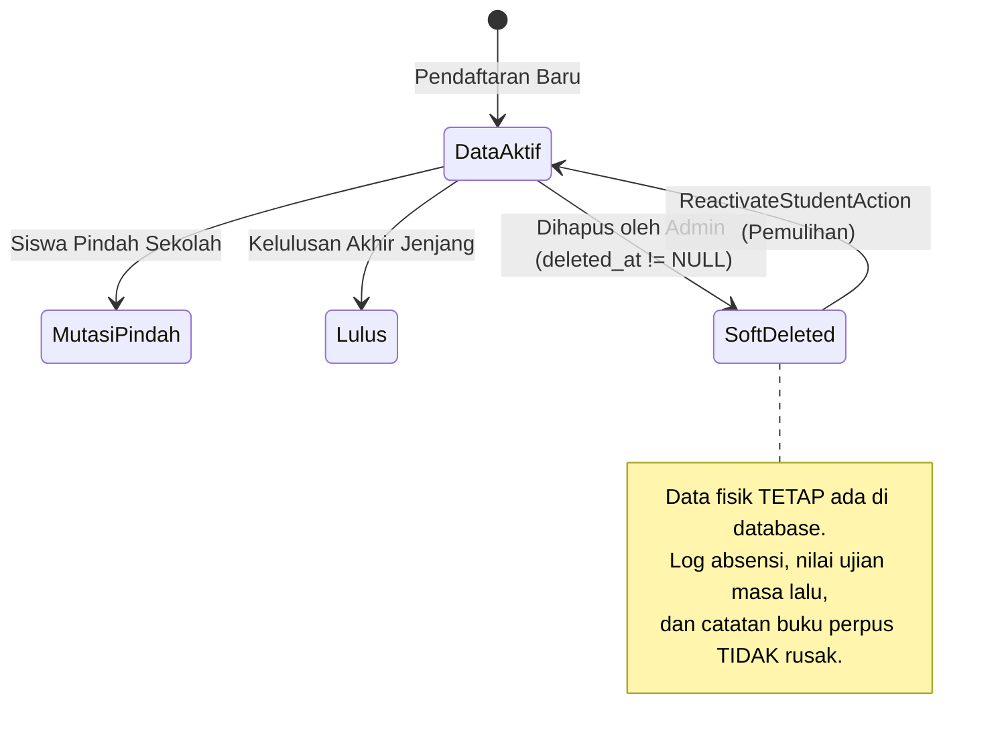

# 🌐 Fitur 08: Integrasi Lintas Portal ERP & Shared Services

Dokumen ini memaparkan secara komprehensif bagaimana **Master Data Siswa (`students`) dan Guru (`teachers`)** berfungsi sebagai fondasi sentral (*Central Backbone*) yang mengalirkan data secara konsisten ke **6 Portal Operasional Sekolah**, tata kelola integritas referensial data, serta standarisasi layanan bersama (*Shared Services & Caching*).

---

## 📌 Daftar Isi
1. [Arsitektur Aliran Data Sentral ERP](#1-arsitektur-aliran-data-sentral-erp)
2. [Matriks Konsumsi Data Master di 6 Portal Operasional](#2-matriks-konsumsi-data-master-di-6-portal-operasional)
3. [Tata Kelola Integritas Data & Perlindungan Histori](#3-tata-kelola-integritas-data--perlindungan-histori)
4. [Layanan Bersama (*Shared Services & Utilities*)](#4-layanan-bersama-shared-services--utilities)
5. [Strategi Caching & Mekanisme Cache Busting](#5-strategi-caching--mekanisme-cache-busting)
6. [Kepatuhan Regulasi & Privasi Data Pribadi (UU PDP)](#6-kepatuhan-regulasi--privasi-data-pribadi-uu-pdp)

---

## 1. Arsitektur Aliran Data Sentral ERP

Dalam arsitektur ERP Sekolah Terpadu, modul master data tidak bekerja secara terisolasi. Seluruh perubahan profil siswa, kenaikan kelas, mutasi, dan penugasan jabatan guru berpropagasi langsung ke subsistem layanan terkait:

```mermaid
flowchart TD
    subgraph MasterBackbone [PUSAT DATA MASTER ERP]
        STU[Master Siswa: students\n- Barcode ID\n- No WA Ortu (628...)\n- Status Enrollment]
        TEA[Master Guru: teachers\n- NIP / Barcode ID\n- Jabatan Aktif\n- Rombel Binaan]
        AY[Tahun Ajaran Aktif: academic_years]
    end

    subgraph Portals [6 PORTAL OPERASIONAL SEKOLAH]
        P1[1. Portal Presensi\n- Scan Gerbang / Kiosk\n- Broadcast WA Gateway Ortu\n- Rekap Absensi Harian]
        P2[2. Portal Guru & GTK\n- Jurnal Rombel Wali Kelas\n- SI-WALI Permen 11/2025\n- Konseling Privat BK]
        P3[3. Portal Perpustakaan\n- Barcode Anggota Digital\n- Sirkulasi Eksemplar & Kuota\n- Portofolio Literasi]
        P4[4. ZenCBT & Akademik\n- Akun Peserta Ujian Siswa\n- Plotting Guru Pengampu\n- Transkrip Nilai Rapor]
        P5[5. Portal Siswa Mandiri\n- Kartu Pelajar Digital\n- Kalender Presensi Mandiri\n- Chat Konsultasi Guru Wali]
        P6[6. Satgas SPIKAP\n- Identifikasi Pihak Terlibat\n- Investigasi Tertutup\n- Rekam Disposisi Kasus]
    end

    MasterBackbone --> P1
    MasterBackbone --> P2
    MasterBackbone --> P3
    MasterBackbone --> P4
    MasterBackbone --> P5
    MasterBackbone --> P6
```

---

## 2. Matriks Konsumsi Data Master di 6 Portal Operasional

Berikut adalah rincian interaksi dan pemanfaatan data master siswa dan guru pada masing-masing portal aplikasi:

### 1. Portal Presensi (Gerbang, Kiosk, & Mobile)
- **Konsumsi Barcode ID**: Kiosk scanner membaca barcode Code 128 dari kartu fisik/digital siswa (`students.barcode_code`) dan profil presensi guru ([`teacher_presensi_profiles.barcode_code`](file:///home/sutris-remote/Documents/projek-laravel/projek-absensi-barcode/app/Models/TeacherPresensiProfile.php)).
- **Validasi Status Enrollment**: Mesin scanner memverifikasi bahwa siswa terdaftar dengan status `aktif` pada tahun ajaran berjalan. Siswa berstatus `mutasi`, `lulus`, atau `keluar` otomatis ditolak oleh sistem dengan suara peringatan audio.
- **WhatsApp Gateway Otomatis**: Setiap scan presensi masuk/pulang berhasil memicu pengiriman pesan WhatsApp secara *real-time* ke nomor orang tua (`students.no_hp_orang_tua`) yang telah dinormalisasi ke standar internasional `628...`.
- **Input Manual Guru Piket/Wali**: Transaksi presensi manual menggunakan relasi polimorfik [`morphMany(Presensi::class, 'manual_input_by')`](file:///home/sutris-remote/Documents/projek-laravel/projek-absensi-barcode/app/Models/Guru.php#L67-L70), merekam guru atau admin yang melakukan penyesuaian status kehadiran (Sakit, Izin, Alpa).

### 2. Portal Guru (Wali Kelas, Guru Mapel, BK, & GTK)
- **Single Sign-On (SSO)**: Guru masuk menggunakan akun `users` yang terhubung timbal balik ke UUID `teachers`.
- **Rombel Binaan Wali Kelas**: Berdasarkan penugasan tahunan di [`KelasAjaran`](file:///home/sutris-remote/Documents/projek-laravel/projek-absensi-barcode/app/Models/KelasAjaran.php), wali kelas hanya dapat melihat dan mengelola siswa yang terdaftar di kelasnya.
- **Bimbingan Karakter SI-WALI (Permendikdasmen No. 11/2025)**:
  - Setiap guru otomatis memiliki [`KelompokGuruWali`](file:///home/sutris-remote/Documents/projek-laravel/projek-absensi-barcode/app/Models/KelompokGuruWali.php).
  - Siswa asuh dipetakan melalui pivot [`KelompokGuruWaliSiswa`](file:///home/sutris-remote/Documents/projek-laravel/projek-absensi-barcode/app/Models/KelompokGuruWaliSiswa.php).
  - Guru mencatat pembinaan karakter berkala di [`JurnalGuruWali`](file:///home/sutris-remote/Documents/projek-laravel/projek-absensi-barcode/app/Models/JurnalGuruWali.php).
  - Siswa dapat mengirim pesan konsultasi privat via [`KonsultasiGuruWali`](file:///home/sutris-remote/Documents/projek-laravel/projek-absensi-barcode/app/Models/KonsultasiGuruWali.php).
- **Layanan Bimbingan Konseling (BK)**:
  - Guru BK mengakses rombel binaan melalui [`TeacherClassAccess`](file:///home/sutris-remote/Documents/projek-laravel/projek-absensi-barcode/app/Models/TeacherClassAccess.php).
  - Rekam jejak konseling privat dan pembinaan perilaku disimpan pada modul [`KonselingBk`](file:///home/sutris-remote/Documents/projek-laravel/projek-absensi-barcode/app/Models/KonselingBk.php).
- **Plotting Beban Mengajar Mapel**: Berdasarkan data [`Pengajaran`](file:///home/sutris-remote/Documents/projek-laravel/projek-absensi-barcode/app/Models/Pengajaran.php), guru mapel membuka jurnal mengajar per jam pelajaran untuk kelas yang diampunya.

### 3. Portal Perpustakaan (Sirkulasi & Literasi)
- **Single Card Identity**: Kartu pelajar siswa dan kartu ID guru langsung berfungsi sebagai Kartu Anggota Perpustakaan tanpa perlu membuat kartu baru.
- **Pembedaan Kuota Sirkulasi**:
  - Siswa: Maksimal peminjaman 2 eksemplar buku, durasi pinjam 7 hari.
  - Guru: Maksimal peminjaman 5 eksemplar buku referensi mengajar, durasi pinjam 30 hari.
- **Portofolio Membaca Terpadu**: Catatan riwayat buku yang dipinjam dan direview oleh siswa dapat ditarik langsung ke lembar portofolio literasi rapor kesiswaan.

### 4. ZenCBT & Asesmen Akademik
- **Penyediaan Akun Peserta Tes**: Akun peserta ujian CBT digenerate langsung dari master siswa (menggunakan NISN sebagai nomor ujian dan tanggal lahir sebagai PIN akses).
- **Pengelompokan Rombel Ujian**: Asesmen dapat ditugaskan secara spesifik per rombel kelas aktif berdasarkan data `student_enrollments`.
- **Integrasi Nilai Rapor**: Guru pengampu yang terdaftar di `pengajarans` dapat mengimpor hasil asesmen pilihan ganda dan esai dari ZenCBT langsung ke buku nilai akademik.

### 5. Portal Siswa (Self-Service Kesiswaan)
- **Kartu Pelajar Digital Interaktif**: Menampilkan foto resmi siswa, NISN, barcode Code 128, dan watermark identitas sekolah.
- **Kalender Presensi Mandiri**: Siswa dapat memantau akumulasi kehadiran, keterlambatan, dan status kehadiran harian secara transparan.
- **Pengajuan Izin/Sakit Daring**: Siswa/wali dapat mengunggah foto surat dokter langsung dari gawai, yang kemudian diteruskan ke dasbor wali kelas untuk persetujuan (*approval*).
- **Konsultasi Guru Wali**: Kanal pesan langsung dua arah untuk konsultasi kendala belajar dan pengembangan bakat minat siswa.

### 6. Satgas SPIKAP (Pencegahan & Penanganan Kekerasan)
- **Identifikasi Entitas Kasus**: Formulir aduan mengaitkan pihak yang terlibat (Korban, Terlapor, Saksi) langsung ke UUID master `students` atau `teachers`.
- **Hak Akses Investigasi Terproteksi**: Hanya guru yang memegang SK Satgas atau jabatan struktural tertentu ([`User::canAccessSpikapGuru()`](file:///home/sutris-remote/Documents/projek-laravel/projek-absensi-barcode/app/Models/User.php#L223-L234) dan middleware [`EnsureCanAccessSpikapGuru`](file:///home/sutris-remote/Documents/projek-laravel/projek-absensi-barcode/app/Http/Middleware/EnsureCanAccessSpikapGuru.php)) yang diizinkan membuka berkas laporan penanganan kasus.

---

## 3. Tata Kelola Integritas Data & Perlindungan Histori

Sistem menerapkan prinsip ketat untuk memastikan rekam jejak akademik masa lalu tidak terhapus (*data immutability*):



1. **Kebijakan Soft Deletes**:
   Model `Siswa` dan `Guru` mengimplementasikan *trait* `SoftDeletes`. Operasi "Hapus" dari antarmuka Filament hanya mengisi kolom `deleted_at`. Seluruh relasi historis (tabel `presensis`, `peminjamans`, `nilai_rapors`) tetap utuh dan terhindar dari *foreign key integrity violation*.
2. **Audit Trail Mutasi Kelas (`riwayat_pindah_kelas`)**:
   Setiap perpindahan siswa antar rombel kelas selama tahun ajaran berjalan dicatat di tabel audit [`riwayat_pindah_kelas`](file:///home/sutris-remote/Documents/projek-laravel/projek-absensi-barcode/app/Models/RiwayatPindahKelas.php) lengkap dengan kelas asal, kelas tujuan, tanggal mutasi, dan alasan perpindahan.
3. **Pemisahan Kelas Fisik vs Enrollment Tahunan**:
   Tabel `classes` bersifat konstan (misal: "Kelas 7A"), sedangkan keanggotaan siswa dimodelkan per tahun di `student_enrollments`. Hal ini memungkinkan pencatatan siswa tinggal kelas atau riwayat kelas dari tahun ajaran lampau tetap akurat.

---

## 4. Layanan Bersama (*Shared Services & Utilities*)

Untuk menjamin standarisasi format data di seluruh modul, sistem menyediakan komponen utilitas terpusat:

### 1. Username & Credential Generator ([`UsernameHelper`](file:///home/sutris-remote/Documents/projek-laravel/projek-absensi-barcode/app/Helpers/UsernameHelper.php))
- Membersihkan gelar akademik, tanda baca, spasi, dan karakter non-alfanumerik.
- Menghasilkan slug email unik dengan domain resmi sekolah yang dikonfigurasi pada `config('school.email_domain')`.

### 2. Normalisasi Format Nomor Telepon Indonesia
- Seluruh nomor HP orang tua dan guru diproses melalui mutator Eloquent. Karakter `+`, spasi, strip, dan awalan `0` dikonversi menjadi standar numerik internasional `628xxxxxxxxxx`. Format ini siap dikonsumsi langsung oleh API WhatsApp Gateway tanpa pemformatan ulang.

### 3. Avatar Fallback Cerdas
- Jika foto profil belum diunggah, antarmuka portal secara otomatis menampilkan vektor avatar berbasis jenis kelamin:
  - Siswa: `images/student-avatar-m.svg` (Putra) / `student-avatar-f.svg` (Putri)
  - Guru: `images/avatar-m.svg` (Pria) / `avatar-f.svg` (Wanita)

---

## 5. Strategi Caching & Mekanisme Cache Busting

Data master guru, siswa, rombel kelas, dan tahun ajaran sangat sering dibaca (*read-heavy*) oleh scanner presensi gerbang dan halaman portal, namun perubahannya relatif jarang (*infrequent writes*).

### Strategi Cache Tagging

Sistem mengelompokkan cache menggunakan tag Redis/File Cache:
- `master:tahun_ajaran_aktif`: Menyimpan ID dan metadata tahun ajaran yang sedang aktif (TTL: 24 jam).
- `master:rombel_kelas`: Menyimpan daftar kelas fisik beserta wali kelas yang ditugaskan (TTL: 12 jam).
- `master:daftar_mapel`: Menyimpan master mata pelajaran per kurikulum (TTL: 24 jam).

### Otomasi Cache Busting

Setiap kali admin melakukan aksi Simpan, Perbarui, atau Hapus pada Filament Resource:
```php
// Contoh pada Observer / Model Event:
protected static function booted(): void
{
    static::saved(function () {
        Cache::tags(['master_guru', 'master_akademik'])->flush();
    });

    static::deleted(function () {
        Cache::tags(['master_guru', 'master_akademik'])->flush();
    });
}
```
Langkah ini menjamin bahwa seluruh mesin kiosk scanner dan portal langsung mendapatkan versi data terbaru tanpa jeda inkonsistensi.

---

## 6. Kepatuhan Regulasi & Privasi Data Pribadi (UU PDP)

Pengelolaan data master kesiswaan dan kepegawaian tunduk pada **Undang-Undang Perlindungan Data Pribadi (UU No. 27 Tahun 2022)** dan **Permendikbudristek No. 46 Tahun 2023**:

1. **Prinsip Minimasi Akses (*Need-to-Know Basis*)**:
   - Nomor telepon orang tua, alamat domisili, dan tempat tanggal lahir siswa hanya dapat dilihat oleh Wali Kelas, Guru BK, dan Admin Tata Usaha.
   - Guru mata pelajaran umum tidak dapat melihat kontak pribadi orang tua siswa untuk mencegah penyalahgunaan data di luar ranah dinas pendidikan.
2. **Perlindungan Catatan Konseling & Kasus Kekerasan**:
   - Catatan konseling BK dan laporan SPIKAP dikunci menggunakan enkripsi atau otorisasi peran ketat. Akses audit trail mencatat setiap kali dokumen kasus dibuka (*read access log*).
3. **Penyimpanan Berkas Digital Aman**:
   - Pas foto siswa dan guru disimpan pada disk `public` dengan penamaan hash acak 24 karakter (`Str::random(24)`) untuk mencegah *directory traversal* dan *enumeration attacks*.
