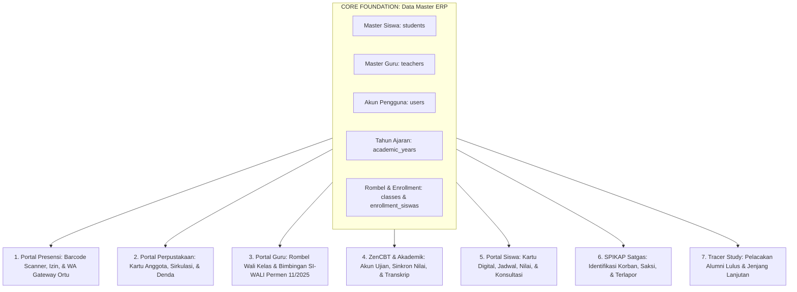

# 👥 Fitur 08: Master Data Siswa & Guru (ERP Core Foundation)

Dokumen ini memuat panduan komprehensif mengenai **Master Data Siswa & Guru (Tenaga Kependidikan/GTK)**, yang berfungsi sebagai **Jantung dan Pondasi Utama (*Core Backbone & Single Source of Truth*)** bagi seluruh ekosistem ERP Sekolah Terpadu.

Setiap modul di dalam sistem—mulai dari absensi gerbang ber-barcode, sirkulasi peminjaman buku perpustakaan, penilaian ujian CBT, pembinaan karakter guru wali, hingga layanan pengaduan dan portal mandiri—bergantung langsung pada konsistensi, validitas, dan relasi data master ini.

---

## 📌 Peta Navigasi Dokumen Master Data ERP

| Dokumen | Topik Pembahasan |
| :--- | :--- |
| [`01-arsitektur-dan-skema-database-erp.md`](file:///home/sutris-remote/Documents/projek-laravel/projek-absensi-barcode/docs/03-fitur/08-master-data-siswa-dan-guru/01-arsitektur-dan-skema-database-erp.md) | Arsitektur skema database inti: ERD terpadu, relasi 1-to-1 akun login `User` dengan profil `Student` dan `Teacher`, foreign keys, tipe data, indeks performa, dan strategi *soft deletes*. |
| [`02-master-siswa-dan-siklus-hidup-kesiswaan.md`](file:///home/sutris-remote/Documents/projek-laravel/projek-absensi-barcode/docs/03-fitur/08-master-data-siswa-dan-guru/02-master-siswa-dan-siklus-hidup-kesiswaan.md) | Anatomi 35 kolom biodata siswa, generator barcode ID (Code 128) kartu pelajar, siklus hidup status kesiswaan (`aktif`, `naik`, `mutasi`, `lulus`), pendaftaran kelas (*enrollment*), dan mutasi kelas berjalan. |
| [`03-mekanisme-import-massal-dan-sinkronisasi-siswa.md`](file:///home/sutris-remote/Documents/projek-laravel/projek-absensi-barcode/docs/03-fitur/08-master-data-siswa-dan-guru/03-mekanisme-import-massal-dan-sinkronisasi-siswa.md) | Otomasi impor data massal: impor Excel data pokok 8 kolom, impor ZIP pas foto massal dengan auto-resizing 500x500px 80% WebP, unduh-unggah nomor WhatsApp orang tua, dan pencegahan duplikasi NISN. |
| [`04-master-guru-gtk-dan-struktur-organisasi.md`](file:///home/sutris-remote/Documents/projek-laravel/projek-absensi-barcode/docs/03-fitur/08-master-data-siswa-dan-guru/04-master-guru-gtk-dan-struktur-organisasi.md) | Manajemen data GTK (`teachers`), NIP/NUPTK, otomasi akun login email `{nip}@{domain}`, struktur jabatan & riwayat SK tugas, plotting wali kelas per tahun ajaran, dan pemetaan beban mengajar mapel. |
| [`05-integrasi-lintas-portal-erp-dan-shared-services.md`](file:///home/sutris-remote/Documents/projek-laravel/projek-absensi-barcode/docs/03-fitur/08-master-data-siswa-dan-guru/05-integrasi-lintas-portal-erp-dan-shared-services.md) | Matriks konsumsi data Siswa & Guru di 6 portal operasional sekolah (Presensi, Perpus, CBT, Guru, Siswa, SPIKAP), tata kelola integritas referensial data, kepatuhan UU PDP, dan manajemen cache sistem. |

---

## 🏛️ Arsitektur Hubungan Master Data dengan Seluruh Portal ERP

Sebagai pusat operasional, perubahan data master siswa dan guru berpropagasi secara *real-time* ke seluruh subsistem aplikasi:

---

## 🔑 Prinsip Kunci Pengelolaan Data Master

1. **Single Identity, Multi-Role Access**:
   Satu record di tabel `users` dapat dihubungkan ke profil guru (`teachers`) atau siswa (`students`), sekaligus memiliki hak akses peran dinamis (*Spatie Role*) yang menentukan portal mana saja yang dapat dibuka saat mengakses sistem melalui Hub Pemilihan Portal ([`/pilih-portal`](file:///home/sutris-remote/Documents/projek-laravel/projek-absensi-barcode/docs/03-fitur/07-portal-admin/01-arsitektur-dan-manajemen-akses.md)).
2. **Immutability & Historical Data Protection**:
   Data historis presensi, nilai rapor, dan peminjaman buku tidak boleh rusak akibat mutasi atau kelulusan siswa. Oleh karena itu, sistem mengadopsi pola **Status Enrollment per Tahun Ajaran** dan **Soft Deletes** (`deleted_at`), bukan penghapusan fisik (*hard delete*).
3. **Penyelarasan Format Komunikasi Nasional**:
   Seluruh nomor telepon orang tua dan guru dinormalisasi secara otomatis ke standar internasional Indonesia (`628xxxxxxxxxx`) agar siap dikonsumsi langsung oleh WhatsApp Gateway untuk pengiriman broadcast absensi harian dan notifikasi kedaruratan.
4. **Kepatuhan Privasi Data Pribadi (UU PDP)**:
   Informasi sensitif (tempat tanggal lahir, alamat tinggal, kontak wali, catatan bimbingan konseling) diproteksi menggunakan otorisasi peran ketat berbasis *Policy* dan *Trait* (`HasSimpleRoleAccess`), memastikan hak akses hanya terbuka bagi pihak yang berkepentingan resmi (Wali Kelas, Guru BK, dan Admin Tata Usaha).
