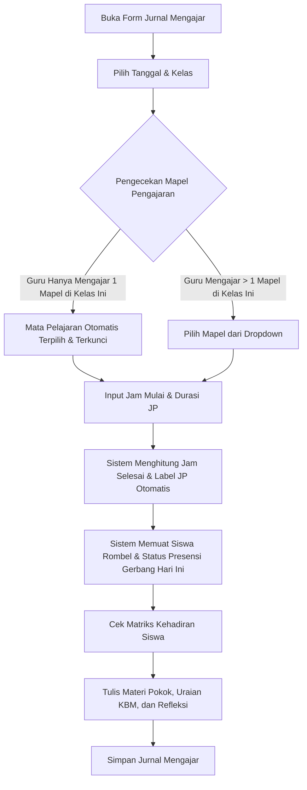

# 📖 Alur Kerja Pengisian Jurnal Mengajar & Presensi KBM

Dokumen ini memuat petunjuk teknis pengisian jurnal mengajar harian guru mata pelajaran, formula perhitungan jam pelajaran (JP), logika otomasi mapel, dan aturan sinkronisasi presensi harian siswa.

---

## 1. Alur Pengisian Formulir Jurnal

Guru mengakses menu **Jurnal Mengajar** (`/portal-guru/jurnal-mengajar`), lalu menekan tombol **"+ Tulis Jurnal Baru"** (`/portal-guru/jurnal-mengajar/tambah`).

---

## 2. Kalkulasi Jam Pelajaran (JP) Dinamis

Guru tidak perlu mengetik label jam secara manual. Guru cukup memasukkan dua angka:
1. **Jam Mulai (Ke-)**: Nilai integer dari $1$ sampai $15$.
2. **Durasi JP**: Lama pertemuan KBM (contoh: $2$ JP, $3$ JP).

### Formula Perhitungan:
$$\text{Jam Selesai} = \text{Jam Mulai} + \text{Durasi JP} - 1$$

* **Contoh 1:** Jam Mulai: $1$, Durasi: $2$ JP $\rightarrow$ Jam Selesai: $2$ $\rightarrow$ Label: `"Jam ke 1 - 2 (2 JP)"`.
* **Contoh 2:** Jam Mulai: $3$, Durasi: $2$ JP $\rightarrow$ Jam Selesai: $4$ $\rightarrow$ Label: `"Jam ke 3 - 4 (2 JP)"`.
* **Contoh 3:** Jam Mulai: $5$, Durasi: $1$ JP $\rightarrow$ Jam Selesai: $5$ $\rightarrow$ Label: `"Jam ke 5 (1 JP)"`.

---

## 3. Matriks Integritas Presensi Siswa

Sistem secara otomatis menarik status kehadiran gerbang siswa pada tanggal yang dipilih dari tabel `attendances`:

| Status Gerbang Siswa | Tampilan di Form Jurnal | Tindakan Sistem & Hak Guru |
| :--- | :--- | :--- |
| **Hadir Tepat Waktu / Telat** | Badge Hijau / Kuning | Default **Hadir** di KBM. Jika siswa membolos atau meninggalkan kelas saat jam pelajaran, guru dapat mengubahnya menjadi **"Tidak Hadir"** dan mengisi kolom keterangan khusus. |
| **Sakit / Izin / Alpa** | Badge Biru / Ungu / Merah | **DIKUNCI (READ-ONLY)**. Muncul badge *"Tidak Mengikuti (Terkunci)"*. Guru dilarang mengubah status menjadi hadir di kelas secara sepihak. Siswa diarahkan melapor ke Guru BK / Piket jika fisiknya ada di kelas untuk koreksi gerbang. |
| **Belum Absen** (tidak scan pagi) | Badge Abu-abu | Muncul tombol aksi **"+ Hadirkan (Wajib Telat)"**. Jika ditekan, sistem menandai siswa hadir di jurnal dan **otomatis membuat record presensi sekolah di tabel `attendances` dengan status `telat`**. |

---

## 4. Efek Penyimpanan ke Basis Data

Saat formulir disimpan (`wire:submit="save"`):
1. **Tabel `jurnal_pembelajarans`**: Menyimpan master data KBM, durasi jam, teks materi, uraian KBM, refleksi, dan statistik rekap siswa hadir vs tidak hadir.
2. **Tabel `jurnal_pembelajaran_presensis`**: Menyimpan snapshot kehadiran setiap siswa per sesi KBM.
3. **Tabel `attendances`**: Siswa yang sebelumnya berstatus belum absen dan diabsenkan telat oleh guru otomatis dibuatkan baris presensi dengan `status = 'telat'`, `source = 'jurnal_guru'`, dan `is_manual_input = true`.
