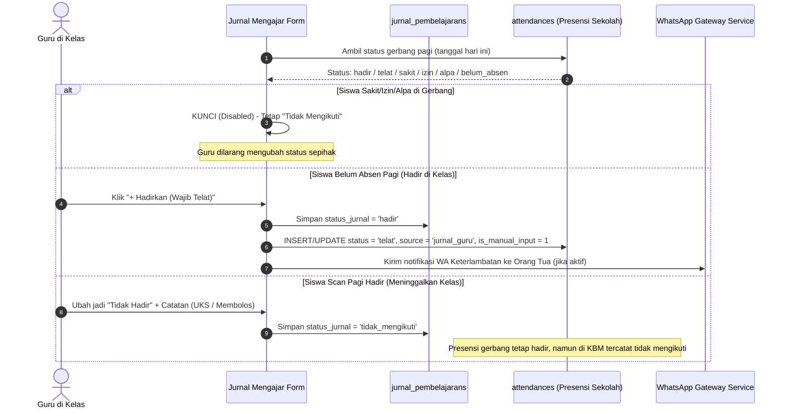

# 🔌 Integrasi Presensi Gerbang, Notifikasi WhatsApp & Pemecahan Masalah

Dokumen ini memuat detail teknis integrasi dua arah antara **Jurnal Mengajar**, **Presensi Gerbang (`attendances`)**, **Gateway Notifikasi WhatsApp**, serta panduan pemecahan masalah (*troubleshooting*).

---

## 1. Integrasi Sinkronisasi Presensi Gerbang

Jurnal Mengajar tidak berdiri sendiri terpisah dari data kehadiran sekolah. Jurnal membaca dan memperbarui status presensi siswa dengan aturan ketat untuk menjaga integritas data:

### Aturan Perlindungan Data:
1. **Pencegahan Kehadiran Fiktif Siswa Izin/Sakit**:
   Jika orang tua telah mengajukan izin resmi atau siswa terdata sakit di pos UKS/piket, form jurnal mengunci tombol ubah agar tidak terjadi manipulasi kehadiran di ruang kelas.
2. **Kompensasi Keterlambatan Siswa**:
   Siswa yang menyelinap masuk kelas tanpa memindai barcode di pos gerbang pagi wajib mendapatkan catatan **TELAT** (bukan Hadir Tepat Waktu), demi keadilan kedisiplinan sekolah.

---

## 2. Integrasi Notifikasi WhatsApp

Saat seorang siswa yang belum absen gerbang pagi diabsenkan oleh guru di kelas via tombol **"+ Hadirkan (Wajib Telat)"**, sistem memanggil [`WhatsAppGatewayService`](file:///home/sutris-remote/Documents/projek-laravel/projek-absensi-barcode/app/Services/WhatsAppGatewayService.php):

1. Sistem memeriksa konfigurasi di tabel `presensi_notification_settings`:
   * Apakah modul notifikasi siswa telat aktif?
   * Apakah opsi pengiriman otomatis (`auto_send_telat = true`) diizinkan?
2. Jika aktif, sistem menyusun pesan otomatis kepada nomor WhatsApp orang tua/wali siswa:
   * Menyebutkan nama siswa, kelas, waktu pencatatan di kelas, dan status kehadiran terlambat.
3. Seluruh riwayat pengiriman tercatat di tabel `whats_app_notification_logs`.

---

## 3. Panduan Pemecahan Masalah (Troubleshooting)

### A. Rombel atau Mata Pelajaran Tidak Muncul di Dropdown
* **Penyebab**: Belum ada penugasan mengajar (`pengajarans`) untuk guru tersebut pada tahun ajaran aktif.
* **Solusi**:
  1. Masuk ke **Panel Admin &rarr; Akademik &rarr; Penugasan Guru / Pengajaran**.
  2. Pastikan akun guru dipetakan ke rombel kelas dan mata pelajaran yang relevan pada tahun ajaran aktif.

### B. Siswa Fisiknya Ada di Kelas tapi Status Terkunci (Sakit/Izin/Alpa)
* **Penyebab**: Petugas piket atau wali kelas telah menyetujui surat izin/sakit pagi hari.
* **Solusi**:
  1. Jangan memaksakan bypass database.
  2. Arahkan siswa/perwakilan kelas melapor ke Guru BK / Petugas Piket agar data di gerbang dikoreksi terlebih dahulu.
  3. Setelah status gerbang diperbaiki, muat ulang halaman formulir jurnal mengajar.

### C. Guru Tidak Bisa Mengakses Portal (`403 Akses Ditolak`)
* **Penyebab**: Akun user belum terhubung ke relasi `teacher_id` atau belum memiliki permission/role.
* **Solusi**:
  1. Periksa akun di **Panel Admin &rarr; Manajemen Akses &rarr; Akses Portal Pengguna (`/admin/manajemen-akses-portal`)**.
  2. Pastikan toggle **Akses Portal Guru** aktif.
  3. Pastikan user terhubung dengan entitas guru di tabel `teachers`.
