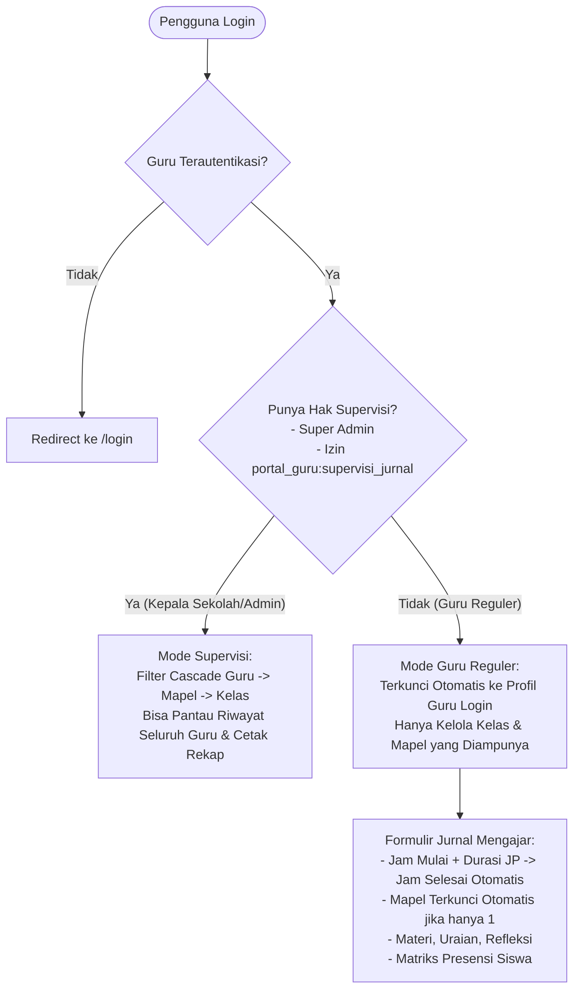

# 📋 Dokumentasi Modul 09: Jurnal Mengajar (Jurnal Pembelajaran)

Modul **Jurnal Mengajar** adalah sistem pencatatan agenda dan dokumentasi kegiatan belajar mengajar (KBM) harian guru mata pelajaran yang terintegrasi secara otomatis dengan **pemetaan penugasan mengajar (`pengajarans`)**, **kalender tahun ajaran aktif**, dan **sistem presensi harian siswa (`attendances`)**.

---

## 📌 Peta Berkas Dokumentasi

| Berkas | Topik Pembahasan |
| :--- | :--- |
| [`plan-dan-progress.md`](file:///home/sutris-remote/Documents/projek-laravel/projek-absensi-barcode/docs/03-fitur/09-jurnal-mengajar/plan-dan-progress.md) | Lembar pelacakan tahapan implementasi, checklist 15 tugas teknis, dan log progres real-time. |
| [`01-alur-input-dan-presensi.md`](file:///home/sutris-remote/Documents/projek-laravel/projek-absensi-barcode/docs/03-fitur/09-jurnal-mengajar/01-alur-input-dan-presensi.md) | Panduan teknis pengisian KBM, formula kalkulasi Jam Pelajaran (JP), otomasi mata pelajaran, dan aturan sinkronisasi presensi gerbang. |
| [`02-supervisi-dan-manajemen-akses.md`](file:///home/sutris-remote/Documents/projek-laravel/projek-absensi-barcode/docs/03-fitur/09-jurnal-mengajar/02-supervisi-dan-manajemen-akses.md) | Konfigurasi wewenang supervisi Kepala Sekolah/Waka Kurikulum melalui `/admin/manajemen-akses-portal` dan pemantauan cascade guru. |
| [`03-panduan-cetak-rekap-pdf.md`](file:///home/sutris-remote/Documents/projek-laravel/projek-absensi-barcode/docs/03-fitur/09-jurnal-mengajar/03-panduan-cetak-rekap-pdf.md) | Format resmi cetak rekapitulasi KBM lanskap A4, kop dinamis, tabel materi, dan titimangsa tanda tangan otomatis. |
| [`04-integrasi-dan-troubleshooting.md`](file:///home/sutris-remote/Documents/projek-laravel/projek-absensi-barcode/docs/03-fitur/09-jurnal-mengajar/04-integrasi-dan-troubleshooting.md) | Arsitektur sinkronisasi dua arah ke `attendances`, gateway WhatsApp orang tua, dan panduan solusi kendala umum. |
| [`docs/02-database/08-jurnal-pembelajaran.md`](file:///home/sutris-remote/Documents/projek-laravel/projek-absensi-barcode/docs/02-database/08-jurnal-pembelajaran.md) | Definisi skema tabel database `jurnal_pembelajarans` dan `jurnal_pembelajaran_presensis`. |

---

## 🏛️ Arsitektur & Otorisasi

### Karakteristik Utama:
1. **Fokus Murni KBM & Kehadiran**: Tidak ada input nilai (penilaian formatif/sumatif tetap terpusat di `/portal-guru/nilai`).
2. **Kalkulasi Jam Pelajaran (JP) Cerdas**:
   $$\text{Jam Selesai} = \text{Jam Mulai} + \text{Durasi JP} - 1$$
   *Contoh:* Jam Mulai $3$, Durasi $2$ JP $\rightarrow$ Otomatis Jam Selesai $4$ (tersimpan `"Jam ke 3 - 4 (2 JP)"`).
3. **Integritas Presensi Dua Arah**:
   * Siswa berstatus **Sakit, Izin, atau Alpa di gerbang DIKUNCI** (tidak boleh diubah hadir di kelas secara sepihak).
   * Siswa yang **Belum Absen** pagi dapat diabsenkan hadir di kelas dengan **status wajib TELAT** ke sistem presensi gerbang.
   * Siswa yang pagi hadir namun meninggalkan kelas dapat ditandai **Tidak Mengikuti KBM**.
4. **Desain Ultra-Modern**: Dilengkapi *quick duration buttons*, *batch 1-click attendance*, dan *sticky bottom action bar*.
