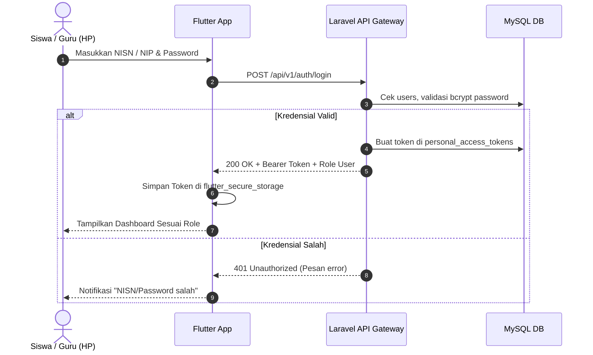

# 📱 Modul 10: Mobile API Gateway (REST API & Multi-Sekolah)

Dokumen ini merinci arsitektur dan spesifikasi fungsional **API Gateway Backend Laravel** yang melayani aplikasi mobile Flutter, mencakup skenario implementasi lintas server/sekolah (*Multi-Instance School*).

---

## 🎯 1. Tujuan & Peran Modul

Modul ini bertindak sebagai jembatan resmi antara basis data ERP Laravel dengan aplikasi mobile pengguna (Siswa, Orang Tua, dan Guru/Wali Kelas):
1. **Pemisahan Logika Presentation**: Mengembalikan payload JSON murni tanpa rendering HTML/Blade.
2. **Keamanan Sanctum**: Token otentikasi terenkripsi dengan proteksi *rate-limiting* (mencegah *brute-force* login).
3. **Mendukung Multi-Server / Multi-Sekolah**: Arsitektur API didesain standar sehingga kode aplikasi mobile yang sama dapat berkomunikasi dengan server sekolah mana pun yang menjalankan sistem ERP ini.

---

## 🌐 2. Model Penyebaran Multi-Sekolah (Multi-Instance)

Aplikasi backend Laravel ini dapat di-deploy pada beberapa sekolah berbeda dengan domain/server masing-masing:
- **Sekolah A (Default)**: `https://smpn1sampang.sch.id`
- **Sekolah B**: `https://smpn2bangkalan.sch.id`
- **Sekolah C (Staging/Demo)**: `https://coba.haflaitsolution.my.id`
- **Lokal Dev**: `http://localhost:8001` atau `http://192.168.1.x:8001`

### Endpoint Identitas Lembaga (`GET /api/v1/school-info`)
Untuk memudahkan aplikasi mobile mengenali server dan menampilkan identitas sekolah yang tepat secara dinamis, backend menyediakan endpoint publik:

**Response JSON:**
```json
{
  "success": true,
  "data": {
    "npsn": "20528990",
    "nama_sekolah": "SMP Negeri 1 Sampang",
    "jenjang": "SMP",
    "alamat": "Jl. Wijaya Kusuma No. 1, Sampang",
    "logo_url": "https://smpn1sampang.sch.id/storage/settings/logo.png",
    "theme_color": "#1E40AF",
    "active_academic_year": "2024/2025 Genap",
    "fitur_aktif": {
      "presensi_sholat": true,
      "izin_online": true,
      "spikap": true,
      "kartu_digital": true
    }
  }
}
```
*Manfaat*: Aplikasi mobile cukup mengonsumsi endpoint ini satu kali, dan warna tema serta logo sekolah di aplikasi HP akan otomatis menyesuaikan dengan sekolah tujuan!

---

## 🔐 3. Alur Otentikasi & Autorisasi



---

## 📋 4. Ringkasan Endpoint Utama

| Kategori | Endpoint | Method | Fungsi |
| :--- | :--- | :---: | :--- |
| **Identitas** | `/api/v1/school-info` | `GET` | Cek validitas server sekolah, logo, dan profil |
| **Auth** | `/api/v1/auth/login` | `POST` | Login multi-identifier (NISN, NIP, Email) |
| **Auth** | `/api/v1/auth/me` | `GET` | Data profil aktif & info kelas/tugas |
| **Auth** | `/api/v1/auth/logout` | `POST` | Cabut token sesi aktif |
| **Siswa** | `/api/v1/siswa/kartu` | `GET` | Data barcode ID, NISN, foto resmi |
| **Siswa** | `/api/v1/siswa/dashboard`| `GET` | Ringkasan kehadiran & status sholat hari ini |
| **Siswa** | `/api/v1/siswa/presensi/riwayat` | `GET` | Rekap kehadiran per bulan |
| **Siswa** | `/api/v1/siswa/izin` | `POST` | Formulir pengajuan izin/sakit + foto surat |
| **Guru** | `/api/v1/guru/classes` | `GET` | Daftar rombel kelas binaan / ajar |
| **Guru** | `/api/v1/guru/presensi/today` | `GET` | Status kehadiran kelas hari ini |
| **Guru** | `/api/v1/guru/sholat-dhuhur/bulk` | `POST` | Simpan presensi sholat jamaah massal |
| **Guru** | `/api/v1/guru/izin/pending` | `GET` | Daftar pengajuan izin siswa yang butuh persetujuan |

---

## 🛠️ 5. Penanganan Error Standar
Setiap respons gagal mengikuti format baku (HTTP 400, 401, 403, 404, 422, 500):
```json
{
  "success": false,
  "message": "Validasi formulir gagal.",
  "errors": {
    "keterangan": ["Keterangan alasan izin wajib diisi minimal 5 karakter."]
  }
}
```
Dokumentasi teknis lengkap endpoint dan kontrak request-response terdapat di:
[docs/07-aplikasi-mobile/03-desain-rest-api-laravel-sanctum.md](file:///home/sutris-remote/Documents/projek-laravel/projek-absensi-barcode/docs/07-aplikasi-mobile/03-desain-rest-api-laravel-sanctum.md).

