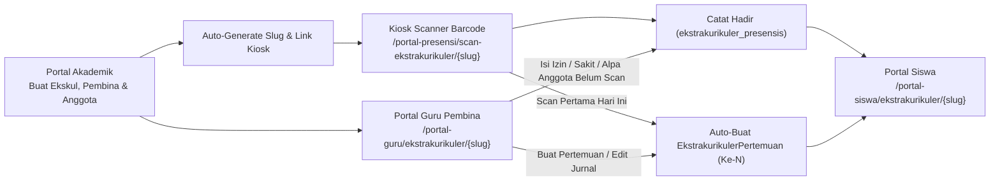

# 🏅 Fitur 13: Ekstrakurikuler & Presensi Barcode Lintas Portal

Modul **Ekstrakurikuler** mengelola kegiatan ekstrakurikuler sekolah secara terintegrasi di 4 titik akses: **Portal Akademik** (master data, plotting pembina & anggota, serta monitoring/ekspor), **Kiosk Scanner Barcode Dinamis** (scan mandiri per ekstrakurikuler), **Portal Guru** (pembina mengelola pertemuan, jurnal kegiatan, dan presensi manual), dan **Portal Siswa** (siswa memantau ekskul yang diikuti beserta riwayat pertemuan & kehadirannya).

---

## 1. Alur End-to-End Lintas Portal

---

## 2. Rincian Per Portal

### A. Portal Akademik (`/portal-akademik/ekstrakurikuler/*`)
- **Manajemen Ekstrakurikuler** ([`EkstrakurikulerResource`](file:///home/sutris-remote/Documents/projek-laravel/projek-absensi-barcode/app/Filament/Akademik/Resources/Ekstrakurikuler/EkstrakurikulerResource.php)):
  - CRUD data ekstrakurikuler per Tahun Ajaran, penugasan **multi-guru pembina** (`pembinas`), status aktif, dan pembuatan `slug` unik otomatis (`generateUniqueSlug()`).
  - **Kelola Anggota Modal Dua Panel** ([`anggota-manager-modal.blade.php`](file:///home/sutris-remote/Documents/projek-laravel/projek-absensi-barcode/resources/views/filament/resources/ekstrakurikuler/pages/anggota-manager-modal.blade.php)) + relation manager [`AnggotaEkskulRelationManager`](file:///home/sutris-remote/Documents/projek-laravel/projek-absensi-barcode/app/Filament/Akademik/Resources/Ekstrakurikuler/RelationManagers/AnggotaEkskulRelationManager.php) untuk memasukkan/mengeluarkan anggota per kelas atau pencarian siswa.
  - Aksi cepat **Salin Link Scanner** dan **Buka Scanner** langsung dari tabel/edit ekskul.
- **Monitoring & Rekap Ekstrakurikuler** (`/portal-akademik/ekstrakurikuler/monitoring` — [`MonitoringEkstrakurikulerPage`](file:///home/sutris-remote/Documents/projek-laravel/projek-absensi-barcode/app/Filament/Akademik/Pages/MonitoringEkstrakurikulerPage.php)):
  - Rekap statistik seluruh ekstrakurikuler aktif pada Tahun Ajaran terpilih menggunakan [`EkstrakurikulerRekapService`](file:///home/sutris-remote/Documents/projek-laravel/projek-absensi-barcode/app/Services/EkstrakurikulerRekapService.php).
  - Mendukung ekspor **Excel** ([`EkstrakurikulerRekapExport`](file:///home/sutris-remote/Documents/projek-laravel/projek-absensi-barcode/app/Exports/EkstrakurikulerRekapExport.php)) dan cetak laporan **PDF** ([`laporan-ekstrakurikuler.blade.php`](file:///home/sutris-remote/Documents/projek-laravel/projek-absensi-barcode/resources/views/pdf/laporan-ekstrakurikuler.blade.php)).

### B. Kiosk Scanner Barcode Dinamis (`/portal-presensi/scan-ekstrakurikuler/{slug}`)
- **Komponen & Action**: [`AttendanceKioskEkstrakurikuler`](file:///home/sutris-remote/Documents/projek-laravel/projek-absensi-barcode/app/Livewire/AttendanceKioskEkstrakurikuler.php) & [`ProcessScanEkstrakurikulerAction`](file:///home/sutris-remote/Documents/projek-laravel/projek-absensi-barcode/app/Actions/ProcessScanEkstrakurikulerAction.php).
- **Otorisasi Kiosk**: Hanya dapat dibuka oleh `super_admin`, role pengelola presensi/akademik/master (`admin_presensi*`, `admin_akademik*`, `admin_master_editor`), atau **Guru Pembina** yang ditugaskan pada ekstrakurikuler terkait (`Ekstrakurikuler::canUserOpenKiosk()`).
- **Aturan Scan Fleksibel**:
  - Tidak terikat jadwal hari tetap: saat siswa pertama kali scan di tanggal tersebut, sistem otomatis membuat baris baru di `ekstrakurikuler_pertemuans` (`findOrCreateForDate()`).
  - Memvalidasi apakah siswa merupakan **anggota aktif** (`ekstrakurikuler_siswas.status_aktif = true`). Jika bukan anggota, mengembalikan status `not_member`.
  - Debounce atomik 3 detik (`Cache::add`) dan deteksi sudah hadir pada pertemuan tanggal yang sama (`already_present`).
  - Meskipun pembina sudah mengubah `status_sesi` pertemuan hari itu menjadi `selesai`, Kiosk **tetap mengizinkan scan baru** selama masih di tanggal yang sama (karena akses kiosk berada di bawah kendali pembina/petugas).

### C. Portal Guru (`/portal-guru/ekstrakurikuler/{slug?}`)
- **Navigasi Sidebar**: Menu **Ekstrakurikuler** berbentuk accordion submenu di [`portal.blade.php`](file:///home/sutris-remote/Documents/projek-laravel/projek-absensi-barcode/resources/views/components/layouts/portal.blade.php) yang menampilkan setiap ekstrakurikuler binaan (contoh: `PRAMUKA`, `Sepak Bola`).
- **Komponen & View**: [`GuruEkstrakurikuler`](file:///home/sutris-remote/Documents/projek-laravel/projek-absensi-barcode/app/Livewire/PortalGuru/Ekstrakurikuler/GuruEkstrakurikuler.php) & [`guru-ekstrakurikuler.blade.php`](file:///home/sutris-remote/Documents/projek-laravel/projek-absensi-barcode/resources/views/livewire/portal-guru/ekstrakurikuler/guru-ekstrakurikuler.blade.php).
- **Antarmuka Hero Banner + 3 Tab**:
  1. **Presensi Pertemuan**: memilih pertemuan, melihat ringkasan `H / I / S / A / Belum`, mengisi manual status siswa yang belum scan (atau aksi cepat `Belum Diisi = Hadir / Izin / Alpa`), serta tetap mempertahankan `scan_time` asli bagi siswa yang sudah scan lewat kiosk.
  2. **Jurnal Kegiatan**: daftar pertemuan di sebelah kiri dengan badge `H`, `I`, `S`, `A`, dan `Belum Absen` berbasis anggota aktif; panel form edit jurnal di sebelah kanan tersembunyi awal dan muncul saat salah satu pertemuan diklik serta dilengkapi tombol **Tutup**.
  3. **Anggota & Rekap**: matriks kehadiran seluruh anggota aktif lintas pertemuan plus tombol ekspor **Excel** dan **PDF**.

### D. Portal Siswa (`/portal-siswa/ekstrakurikuler/{slug?}`)
- **Navigasi Sidebar**: Accordion submenu **Ekstrakurikuler** di [`portal.blade.php`](file:///home/sutris-remote/Documents/projek-laravel/projek-absensi-barcode/resources/views/components/layouts/portal.blade.php) berisi daftar ekstrakurikuler aktif yang diikuti siswa (sehingga siswa yang mengikuti lebih dari satu ekskul dapat berpindah langsung dari sidebar maupun switcher dropdown).
- **Komponen & View**: [`SiswaEkstrakurikuler`](file:///home/sutris-remote/Documents/projek-laravel/projek-absensi-barcode/app/Livewire/PortalSiswa/SiswaEkstrakurikuler.php) & [`siswa-ekstrakurikuler.blade.php`](file:///home/sutris-remote/Documents/projek-laravel/projek-absensi-barcode/resources/views/livewire/portal-siswa/siswa-ekstrakurikuler.blade.php).
- **Otorisasi**: Mengakses slug ekskul yang tidak diikuti siswa mengembalikan HTTP `403`.
- **Tampilan**: Hero Banner `Ekstrakurikuler <Nama Ekskul>` (TA, status Anggota Aktif, nama Pembina, tanggal bergabung, 5 kartu statistik `Hadir`, `Izin`, `Sakit`, `Alpa`, `Persentase Hadir`), filter Tahun Ajaran, dan tabel **Riwayat Pertemuan & Kehadiran** lengkap dengan `judul_kegiatan`, `catatan_pembina`, status kehadiran siswa, serta `scan_time`.
