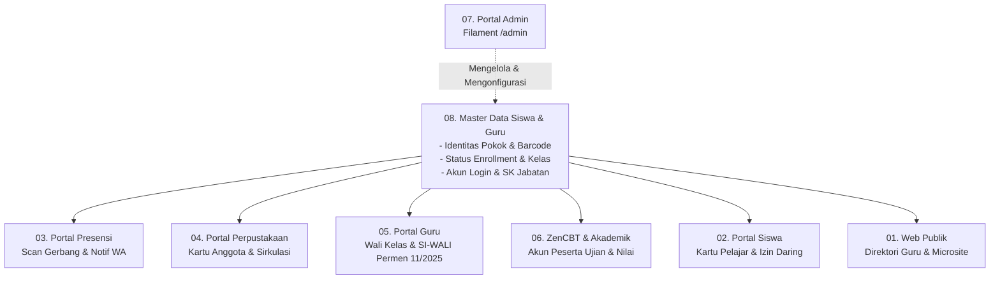

# 📦 Indeks Fitur & Portal ERP Sekolah Terpadu

Direktori ini memuat spesifikasi fungsional, alur kerja teknis, arsitektur antarmuka, serta interaksi basis data untuk seluruh modul aplikasi pada sistem **Presensi Barcode & Smart School ERP**.

---

## 🗺️ Peta Modul Fungsional (9 Klaster Modul)

| Modul | Nama Fitur / Portal | Deskripsi Singkat | Tautan Rujukan |
| :---: | :--- | :--- | :--- |
| **01** | **Tampilan Web Awal (Public Portal)** | Halaman publik resmi sekolah, profil lembaga, 11 seksi interaktif, berita/artikel, galeri, sarana prasarana, microsite guru, dan portal pengaduan masyarakat. | [`01-tampilan-web-awal/`](file:///home/sutris-remote/Documents/projek-laravel/projek-absensi-barcode/docs/03-fitur/01-tampilan-web-awal) |
| **02** | **Portal Siswa (Student Self-Service)** | Dasbor mandiri siswa, kartu pelajar digital ber-barcode Code 128, kalender presensi pribadi, pengajuan izin/sakit mandiri + unggah bukti dokter, dan chat konsultasi daring ke guru wali. | [`02-portal-siswa/`](file:///home/sutris-remote/Documents/projek-laravel/projek-absensi-barcode/docs/03-fitur/02-portal-siswa) |
| **03** | **Portal Presensi (Kiosk Scanner & Gateway)** | Antarmuka pemindaian barcode kartu gerbang/kiosk, monitoring kehadiran *real-time*, validasi status siswa aktif, kalkulasi keterlambatan, dan *trigger* broadcast WhatsApp otomatis ke orang tua. | [`03-portal-presensi/`](file:///home/sutris-remote/Documents/projek-laravel/projek-absensi-barcode/docs/03-fitur/03-portal-presensi) |
| **04** | **Portal Perpustakaan (Library Circulation)** | Otomasi sirkulasi perpustakaan digital, peminjaman buku menggunakan kartu barcode siswa/guru, katalog klasifikasi DDC, pencatatan denda keterlambatan, dan peminjaman buku paket rombel. | [`04-portal-perpustakaan/`](file:///home/sutris-remote/Documents/projek-laravel/projek-absensi-barcode/docs/03-fitur/04-portal-perpustakaan) |
| **05** | **Portal Guru (GTK & Pembinaan Karakter)** | Dasbor kerja guru terpadu, presensi jurnal kelas, modul bimbingan karakter **SI-WALI** (Permendikdasmen No. 11/2025), konseling privat BK, presensi sholat dhuhur berjamaah, dan buku nilai. | [`05-portal-guru/`](file:///home/sutris-remote/Documents/projek-laravel/projek-absensi-barcode/docs/03-fitur/05-portal-guru) |
| **06** | **ZenCBT & Asesmen Akademik** | Mesin ujian online terintegrasi ZenCBT, pembuatan bank soal oleh guru pengampu, penyediaan akun peserta ujian dari master NISN, dan sinkronisasi skor asesmen ke rapor. | [`06-cbt-dan-akademik/`](file:///home/sutris-remote/Documents/projek-laravel/projek-absensi-barcode/docs/03-fitur/06-cbt-dan-akademik) |
| **07** | **Portal Admin (Filament Control Center)** | Pusat kendali manajemen sekolah berbasis Filament Panel (`/admin`), konfigurasi identitas sekolah, manajemen buka/tutup akses portal, hak akses RBAC, dan audit operasional. | [`07-portal-admin/`](file:///home/sutris-remote/Documents/projek-laravel/projek-absensi-barcode/docs/03-fitur/07-portal-admin) |
| **08** | **Master Data Siswa & Guru (ERP Core Backbone)** | **Pondasi inti Single Source of Truth**: skema database terpadu, 35 kolom data pokok siswa, siklus hidup kesiswaan, impor massal (Excel & ZIP foto auto-resize), SK jabatan GTK, dan plotting mengajar. | [`08-master-data-siswa-dan-guru/`](file:///home/sutris-remote/Documents/projek-laravel/projek-absensi-barcode/docs/03-fitur/08-master-data-siswa-dan-guru) |
| **09** | **Jurnal Mengajar (Agenda & Dokumentasi KBM)** | Pencatatan jurnal pembelajaran guru harian, durasi JP dinamis, pemetaan mapel otomatis, integrasi presensi siswa gerbang, serta mode supervisi kepala sekolah. | [`09-jurnal-mengajar/`](file:///home/sutris-remote/Documents/projek-laravel/projek-absensi-barcode/docs/03-fitur/09-jurnal-mengajar) |
| **10** | **Mobile API Gateway (REST API & Multi-Sekolah)** | Antarmuka REST API Laravel Sanctum untuk aplikasi mobile Flutter, otentikasi Bearer Token, endpoint multi-server sekolah, dan sinkronisasi layanan siswa/guru. | [`10-mobile-api-gateway/`](file:///home/sutris-remote/Documents/projek-laravel/projek-absensi-barcode/docs/03-fitur/10-mobile-api-gateway) |

---

## 🏛️ Hubungan Ketergantungan Antar Modul

Modul **08 (Master Data Siswa & Guru)** berfungsi sebagai penyedia data pokok bagi seluruh portal fungsional lainnya:

