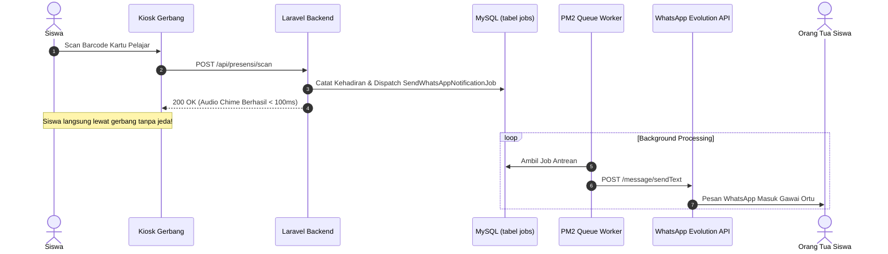

# ⚙️ Panduan Queue Worker & Otomasi Task Scheduler

Dokumen ini memuat panduan lengkap tata kelola **Antrean Latar Belakang (*Background Queue Worker*)** dan **Penjadwalan Tugas Otomatis (*Laravel Task Scheduler & Crontab*)** untuk sistem **Presensi Barcode & Smart School ERP**.

---

## 📌 Daftar Isi
1. [Mengapa Queue Worker Mutlak Diperlukan?](#1-mengapa-queue-worker-mutlak-diperlukan)
2. [Manajemen Queue Worker Menggunakan PM2](#2-manajemen-queue-worker-menggunakan-pm2)
3. [Alternatif Manajemen Queue Menggunakan Supervisor](#3-alternatif-manajemen-queue-menggunakan-supervisor)
4. [Konfigurasi Crontab Task Scheduler (`routes/console.php`)](#4-konfigurasi-crontab-task-scheduler-routesconsolephp)
5. [Daftar Lengkap Command Scheduler & Logika Kerjanya](#5-daftar-lengkap-command-scheduler--logika-kerjanya)
6. [Pemantauan Antrean & Penanganan Failed Jobs](#6-pemantauan-antrean--penanganan-failed-jobs)

---

## 1. Mengapa Queue Worker Mutlak Diperlukan?

Dalam sistem presensi sekolah, jam sibuk kedatangan siswa terjadi dalam rentang waktu yang sangat sempit (**06.30 s.d. 07.15 WIB**). Ratusan siswa melakukan scan barcode secara bergantian dalam hitungan detik.

Jika pengiriman pesan WhatsApp ke orang tua dilakukan secara langsung (*synchronous*):
- Scanner gerbang akan tertahan (*freeze*) selama 2–5 detik per siswa menunggu respons dari server WhatsApp API.
- Terjadi antrean panjang siswa yang mengular di pintu gerbang sekolah.
- Jika koneksi gateway WhatsApp mengalami fluktuasi, proses presensi di kiosk akan gagal (*timeout error*).

**Solusi Arsitektur Queue:**
Kiosk scan mencatat kehadiran ke database dalam hitungan **milidetik**, lalu melemparkan tugas pengiriman pesan WhatsApp ke tabel antrean (`jobs`). **Queue Worker** bekerja di latar belakang (*background daemon*) memproses pengiriman pesan secara asinkron tanpa membebani antarmuka scanner.



---

## 2. Manajemen Queue Worker Menggunakan PM2

Sistem telah dilengkapi berkas konfigurasi siap pakai [`ecosystem.config.cjs`](file:///home/sutris-remote/Documents/projek-laravel/projek-absensi-barcode/ecosystem.config.cjs) di root direktori proyek.

### Bedah Konfigurasi `ecosystem.config.cjs`

```javascript
module.exports = {
  apps: [
    {
      name: "absensi-queue",
      script: "artisan",
      interpreter: "php",
      args: "queue:work --sleep=3 --tries=3 --timeout=3600",
      instances: 1,
      exec_mode: "fork",
      autorestart: true,
      watch: false,
      max_memory_restart: "1G",
      error_file: "storage/logs/queue-error.log",
      out_file: "storage/logs/queue-out.log"
    }
  ]
};
```

| Parameter | Fungsi & Dampak Operasional |
| :--- | :--- |
| `name: "absensi-queue"` | Nama identifier proses di dasbor PM2. |
| `interpreter: "php"` | Mengeksekusi script menggunakan PHP CLI server. |
| `args: "--sleep=3"` | Mengistirahatkan worker selama 3 detik saat antrean kosong untuk menghemat CPU. |
| `args: "--tries=3"` | Mencoba ulang pengiriman maksimal 3 kali sebelum dinyatakan gagal (*failed job*). |
| `args: "--timeout=3600"` | Batas maksimal eksekusi job (1 jam). |
| `autorestart: true` | Otomatis menghidupkan kembali worker jika mengalami crash tak terduga. |
| `max_memory_restart: "1G"` | Otomatis me-restart worker jika penggunaan memori melebihi 1 GB (*mencegah memory leak*). |
| `error_file & out_file` | Memisahkan log output dan error ke folder `storage/logs/`. |

### Perintah Operasional PM2

```bash
# 1. Jalankan queue worker pertama kali
pm2 start ecosystem.config.cjs

# 2. Simpan daftar proses agar otomatis aktif setelah server reboot
pm2 save
pm2 startup

# 3. Melihat status dan penggunaan resource
pm2 list
pm2 monit

# 4. Memantau log antrean secara real-time
pm2 logs absensi-queue --lines 50

# 5. Me-restart queue worker (Wajib dijalankan setelah mengubah kode Controller/Job)
pm2 restart absensi-queue

# 6. Menghentikan queue worker
pm2 stop absensi-queue
```

---

## 3. Alternatif Manajemen Queue Menggunakan Supervisor

Jika server produksi berbasis VPS murni tanpa Node.js/PM2, Anda dapat menggunakan **Supervisor** bawaan Linux.

### 1. Pasang Supervisor
```bash
sudo apt update && sudo apt install -y supervisor
```

### 2. Buat Berkas Konfigurasi
Buat berkas `/etc/supervisor/conf.d/absensi-queue.conf`:

```ini
[program:absensi-queue]
process_name=%(program_name)s_%(process_num)02d
command=php /var/www/html/app/artisan queue:work --sleep=3 --tries=3 --max-time=3600
autostart=true
autorestart=true
user=www-data
numprocs=2
redirect_stderr=true
stdout_logfile=/var/www/html/app/storage/logs/queue-supervisor.log
stopwaitsecs=3600
```

### 3. Aktifkan dan Jalankan
```bash
sudo supervisorctl reread
sudo supervisorctl update
sudo supervisorctl start absensi-queue:*
```

---

## 4. Konfigurasi Crontab Task Scheduler (`routes/console.php`)

Laravel Task Scheduler membutuhkan satu *heartbeat* master di crontab Linux server yang dipicu setiap menit.

### Cara Memasang Crontab

Buka editor crontab di server:
```bash
crontab -e
```

> [!WARNING]
> Pasang crontab di bawah **user pemilik aplikasi web** (misalnya `smpn3kedungreja` atau `www-data`), **BUKAN di user root**! Jika dijalankan di bawah user root, berkas log dan cache yang dihasilkan crontab tidak akan bisa ditulis oleh web server.

Tambahkan baris berikut di akhir berkas:
```cron
* * * * * cd /var/www/html/app && php artisan schedule:run >> /dev/null 2>&1
```

*(Sesuaikan `/var/www/html/app` dengan path instalasi absolut aplikasi di server Anda).*

---

## 5. Daftar Lengkap Command Scheduler & Logika Kerjanya

Seluruh jadwal otomatisasi didefinisikan pada [`routes/console.php`](file:///home/sutris-remote/Documents/projek-laravel/projek-absensi-barcode/routes/console.php). Berikut adalah daftar tugas dan mekanisme perlindungannya:

| Perintah Artisan | Frekuensi Cron | Mekanisme & Proteksi Keamanan |
| :--- | :--- | :--- |
| **`scheduler:heartbeat`** | Setiap Menit | Menulis timestamp epoch unix ke berkas `storage/framework/schedule-heartbeat`. Berkas ini dibaca oleh dasbor admin untuk menyalakan banner indikator 🟢 **Scheduler Aktif**. |
| **`presensi:send-unattended-notification`** | Setiap Menit (`withoutOverlapping`, `runInBackground`) | **Notifikasi Pagi Siswa Belum Hadir:**<br>1. Membaca jam cutoff di pengaturan (misal `07:30 WIB`).<br>2. Hanya aktif dalam window 1 jam (`07:30 s.d. 08:30 WIB`).<br>3. Mengecek kalender sekolah (`KalenderSekolahService::isHariSekolah()`).<br>4. *Idempotency guard*: mengecek `last_auto_send_date` agar pesan tidak pernah terkirim dobel. |
| **`presensi:auto-alpa`** | Setiap Menit (`withoutOverlapping`, `runInBackground`) | **Pemrosesan Otomatis Siswa Alpa:**<br>1. Membaca jam cutoff sore di `PengaturanSekolah` (misal `15:00 WIB`).<br>2. Memeriksa hari sekolah.<br>3. Mengubah seluruh siswa aktif yang belum memiliki rekaman absensi hari ini menjadi berstatus `Alpa`.<br>4. Menyimpan rekam tanggal di `last_auto_alpa_run_date`. |
| **`presensi:send-daily-class-report`** | Setiap Menit | **Laporan Harian ke Wali Kelas:**<br>Mengirimkan rekap daftar hadir dan siswa tidak hadir di masing-masing rombel ke nomor WhatsApp wali kelas bersangkutan setelah jam kepulangan sekolah. |
| **`presensi:send-school-summary`** | Setiap Menit | **Resume Kehadiran Sekolah ke Kepala Sekolah:**<br>Mengirimkan rekapitulasi total persentase kehadiran seluruh sekolah, jumlah sakit, izin, dan alpa ke WhatsApp Kepala Sekolah. |
| **`presensi:sync-sholat-dhuhur`** | Setiap Menit (`withoutOverlapping`, `runInBackground`) | Menyinkronkan catatan presensi ibadah sholat dhuhur siswa ke rekam pembinaan karakter. |

### Pengujian Manual Command Scheduler
SysAdmin dapat menguji eksekusi tanpa menunggu jadwal waktu cron:

```bash
# Uji pengiriman notifikasi belum hadir secara paksa (bypass jam cutoff)
php artisan presensi:send-unattended-notification --force

# Uji penandaan Alpa otomatis secara manual
php artisan presensi:auto-alpa

# Cek daftar antrean jadwal aktif yang terdaftar di Laravel
php artisan schedule:list
```

---

## 6. Pemantauan Antrean & Penanganan Failed Jobs

Pesan WhatsApp yang gagal terkirim (misalnya karena nomor tujuan tidak terdaftar atau token gateway sempat mati) akan ditampung di tabel `failed_jobs`.

### Perintah Diagnostik Antrean

```bash
# 1. Pantau volume antrean yang sedang menunggu diproses
php artisan queue:monitor default --max=100

# 2. Lihat daftar pesan yang gagal terkirim
php artisan queue:failed

# 3. Coba kirim ulang seluruh antrean yang gagal
php artisan queue:retry all

# 4. Coba kirim ulang satu job tertentu berdasarkan UUID
php artisan queue:retry [FAILED_JOB_UUID]

# 5. Hapus antrean yang gagal jika nomor tujuan memang tidak valid
php artisan queue:forget [FAILED_JOB_UUID]

# 6. Bersihkan seluruh antrean gagal
php artisan queue:flush
```

### Logika Retry Bertahap (`$backoff`)
Pekerjaan pengiriman pesan pada [`App\Jobs\SendWhatsAppNotificationJob`](file:///home/sutris-remote/Documents/projek-laravel/projek-absensi-barcode/app/Jobs/SendWhatsAppNotificationJob.php) dilengkapi konfigurasi penundaan cerdas:
```php
public $tries = 3;

public function backoff(): array
{
    // Percobaan 1: tunggu 1 menit (60 detik)
    // Percobaan 2: tunggu 5 menit (300 detik)
    // Percobaan 3: tunggu 15 menit (900 detik)
    return [60, 300, 900];
}
```
Langkah ini memastikan bahwa jika server WhatsApp Gateway mengalami *restart*, pesan presensi tidak langsung gagal, melainkan akan dikirim ulang secara otomatis setelah jeda waktu yang ditentukan.
