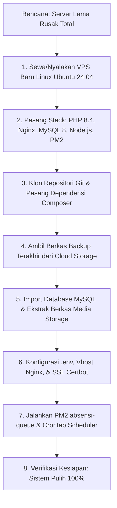

# 💾 Prosedur Backup, Restore, & Disaster Recovery (DRP)

Dokumen ini memuat prosedur standar pencadangan data (*backup*), pemulihan (*restore*), rotasi retensi berkas, sinkronisasi cloud sekunder, serta skenario **Pemulihan Bencana (*Disaster Recovery Plan / DRP*)** untuk sistem **Presensi Barcode & Smart School ERP**.

---

## 📌 Daftar Isi
1. [Prinsip Pencadangan Dua Komponen (*Dual-Component Backup*)](#1-prinsip-pencadangan-dua-komponen-dual-component-backup)
2. [Skrip Otomasi Bash Backup Harian (`backup.sh`)](#2-skrip-otomasi-bash-backup-harian-backupsh)
3. [Kebijakan Retensi Berkas (Rotasi 7 Hari)](#3-kebijakan-retensi-berkas-rotasi-7-hari)
4. [Sinkronisasi Backup ke Penyimpanan Cloud Eksternal (Offsite)](#4-sinkronisasi-backup-ke-penyimpanan-cloud-eksternal-offsite)
5. [Prosedur Pemulihan Data (*Standard Restoration Runbook*)](#5-prosedur-pemulihan-data-standard-restoration-runbook)
6. [Skenario Pemulihan Bencana Total (*Bare-Metal Recovery*)](#6-skenario-pemulihan-bencana-total-bare-metal-recovery)

---

## 1. Prinsip Pencadangan Dua Komponen (*Dual-Component Backup*)

Banyak administrator sistem hanya mencadangkan basis data MySQL (`.sql`), padahal dalam ERP sekolah terpadu ini terdapat dua komponen yang **sama pentingnya**:

1. **Komponen 1: Basis Data Relasional MySQL**
   Memuat tabel identitas siswa, guru, akun login, riwayat presensi harian, nilai asesmen CBT, transaksi peminjaman buku perpustakaan, dan catatan pembinaan konseling.
2. **Komponen 2: Direktori Media Publik (`storage/app/public`)**
   Memuat ratusan hingga ribuan berkas fisik:
   - Pas foto resmi siswa (`siswa-photos/`) & foto profil guru (`guru-photos/`).
   - Lampiran bukti surat izin/sakit dokter yang diunggah siswa.
   - Berkas pindaian SK jabatan, cover buku perpustakaan, dan logo sekolah.

> [!IMPORTANT]
> Merestore basis data tanpa menyertakan folder `storage/app/public` akan menghasilkan "data kosong / gambar rusak" pada kartu pelajar digital, portal siswa, dan antarmuka kiosk!

---

## 2. Skrip Otomasi Bash Backup Harian (`backup.sh`)

Buat berkas skrip `backup.sh` pada direktori root proyek atau direktori khusus skrip `/home/user/scripts/`:

```bash
#!/bin/bash
set -e

# ==========================================
# KONFIGURASI BACKUP ERP SEKOLAH
# ==========================================
APP_DIR="/var/www/html/app"
BACKUP_DIR="${APP_DIR}/database/backups"
DATE=$(date +%Y-%m-%d_%H-%M-%S)
RETENTION_DAYS=7

# Baca konfigurasi DB dari file .env
DB_NAME=$(grep '^DB_DATABASE=' ${APP_DIR}/.env | cut -d '=' -f2)
DB_USER=$(grep '^DB_USERNAME=' ${APP_DIR}/.env | cut -d '=' -f2)
DB_PASS=$(grep '^DB_PASSWORD=' ${APP_DIR}/.env | cut -d '=' -f2)
DB_HOST=$(grep '^DB_HOST=' ${APP_DIR}/.env | cut -d '=' -f2)
DB_PORT=$(grep '^DB_PORT=' ${APP_DIR}/.env | cut -d '=' -f2)

DB_HOST=${DB_HOST:-127.0.0.1}
DB_PORT=${DB_PORT:-3306}

mkdir -p ${BACKUP_DIR}

echo "📦 [${DATE}] Memulai proses backup ERP Sekolah Terpadu..."

# 1. PENCADANGAN BASIS DATA MYSQL DENGAN KOMPRESI GZIP
SQL_FILE="${BACKUP_DIR}/db_${DB_NAME}_${DATE}.sql.gz"
echo "🗄️ Melakukan dump database: ${DB_NAME}..."
mysqldump \
  --host="${DB_HOST}" \
  --port="${DB_PORT}" \
  --user="${DB_USER}" \
  --password="${DB_PASS}" \
  --single-transaction \
  --quick \
  --routines \
  --triggers \
  --no-tablespaces \
  "${DB_NAME}" | gzip -9 > "${SQL_FILE}"

echo "✅ Database berhasil di-dump: ${SQL_FILE} ($(du -h ${SQL_FILE} | cut -f1))"

# 2. PENCADANGAN DIREKTORI MEDIA STORAGE PUBLIK
STORAGE_FILE="${BACKUP_DIR}/storage_${DATE}.tar.gz"
echo "🖼️ Mengarsipkan berkas storage/app/public..."
tar -czf "${STORAGE_FILE}" -C "${APP_DIR}/storage/app" public

echo "✅ Storage berhasil diarsipkan: ${STORAGE_FILE} ($(du -h ${STORAGE_FILE} | cut -f1))"

# 3. ROTASI RETENSI: HAPUS BACKUP LAMA > 7 HARI
echo "🧹 Membersihkan berkas backup yang lebih lama dari ${RETENTION_DAYS} hari..."
find "${BACKUP_DIR}" -type f -name "db_*.sql.gz" -mtime +${RETENTION_DAYS} -delete
find "${BACKUP_DIR}" -type f -name "storage_*.tar.gz" -mtime +${RETENTION_DAYS} -delete

# 4. OPTIONAL: SINKRONISASI KE REMOTE CLOUD (RCLONE)
if command -v rclone &> /dev/null; then
    echo "☁️ Mengunggah backup ke Cloud Storage (Google Drive / S3)..."
    rclone copy "${SQL_FILE}" "gdrive-sekolah:BackupERP/database/"
    rclone copy "${STORAGE_FILE}" "gdrive-sekolah:BackupERP/storage/"
    echo "✅ Sinkronisasi Cloud selesai!"
fi

echo "🎉 [$(date +%Y-%m-%d_%H-%M-%S)] Seluruh proses backup berhasil tuntas!"
```

Berikan hak akses eksekusi:
```bash
chmod +x /var/www/html/app/backup.sh
```

### Penjadwalan Crontab Backup Otomatis
Jalankan pencadangan setiap dini hari pada pukul **01.30 WIB** (saat sistem dalam aktivitas terendah):

```bash
crontab -e
```
Tambahkan entri:
```cron
30 1 * * * /var/www/html/app/backup.sh >> /var/www/html/app/storage/logs/backup.log 2>&1
```

---

## 3. Kebijakan Retensi Berkas (Rotasi 7 Hari)

Untuk mencegah partisi harddisk server penuh akibat akumulasi arsip `.sql.gz` dan `.tar.gz`:
1. Sistem mempertahankan arsip harian selama **7 hari terakhir** secara lokal di server.
2. Perintah `find "${BACKUP_DIR}" -type f -mtime +7 -delete` secara otomatis menghapus berkas hari ke-8 dan seterusnya setiap kali skrip dijalankan.
3. Di penyimpanan cloud sekunder (Google Drive / S3), arsip dapat disimpan dengan siklus retensi lebih panjang (misal: 30 hari atau rekap bulanan akhir semester).

---

## 4. Sinkronisasi Backup ke Penyimpanan Cloud Eksternal (Offsite)

Menyimpan berkas cadangan pada server fisik yang sama dengan aplikasi memiliki risiko tinggi jika harddisk server mengalami kerusakan total (*hardware failure*).

### Setup Rclone ke Google Drive / Wasabi S3
1. Pasang alat bantu Rclone:
   ```bash
   sudo apt install -y rclone
   ```
2. Konfigurasi remote storage:
   ```bash
   rclone config
   # Ikuti instruksi untuk menambahkan Google Drive dinas sekolah atau S3 Bucket
   ```
3. Uji coba pengunggahan manual:
   ```bash
   rclone lsd gdrive-sekolah:
   ```

Skrip `backup.sh` di atas secara otomatis akan mendeteksi keberadaan `rclone` dan menyinkronkan file cadangan ke cloud setiap malam.

---

## 5. Prosedur Pemulihan Data (*Standard Restoration Runbook*)

Gunakan prosedur ini jika data terhapus secara tidak sengaja, terjadi salah konfigurasi, atau perlu memutar kembali data ke tanggal tertentu.

### Langkah 1: Aktifkan Mode Pemeliharaan
```bash
cd /var/www/html/app
php artisan down --secret="kunci-rahasia-admin"
```

### Langkah 2: Pulihkan Basis Data MySQL
Dekompresi dan masukkan berkas `.sql.gz` langsung ke dalam database:

```bash
# Ganti nama berkas dengan file backup yang diinginkan
BACKUP_SQL="database/backups/db_absensi_2026-10-27_01-30-00.sql.gz"

gunzip < "${BACKUP_SQL}" | mysql -h 127.0.0.1 -u [DB_USER] -p[DB_PASSWORD] [DB_NAME]
```

### Langkah 3: Pulihkan Berkas Media Storage
Ekstrak arsip media publik ke direktori `storage/app/`:

```bash
BACKUP_STORAGE="database/backups/storage_2026-10-27_01-30-00.tar.gz"

tar -xzf "${BACKUP_STORAGE}" -C storage/app/
```

### Langkah 4: Pastikan Tautan Simbolik & Izin Berkas Benar
```bash
php artisan storage:link
sudo chown -R www-data:www-data storage bootstrap/cache
sudo chmod -R 775 storage bootstrap/cache
```

### Langkah 5: Bersihkan Cache Aplikasi & Aktifkan Kembali
```bash
php artisan optimize:clear
php artisan optimize
php artisan up
```

---

## 6. Skenario Pemulihan Bencana Total (*Bare-Metal Recovery*)

Skenario ini dijalankan jika server lama rusak total, VPS hangus, atau migrasi mendadak ke server baru dari nol:



### 7 Langkah Cepat Bare-Metal Recovery:
1. **Setup Server Baru**: Ikuti [Panduan Deployment](file:///home/sutris-remote/Documents/projek-laravel/projek-absensi-barcode/docs/04-operasional/01-deployment-dan-lingkungan-server.md) untuk memasang paket PHP 8.4, Nginx, MySQL, dan Composer.
2. **Klon Kode Program**:
   ```bash
   git clone https://github.com/sekolah/absensi-barcode.git /var/www/html/app
   cd /var/www/html/app && composer install --no-dev -o && npm ci && npm run build
   ```
3. **Ambil Arsip dari Cloud**:
   ```bash
   rclone copy gdrive-sekolah:BackupERP/database/db_terbaru.sql.gz ./
   rclone copy gdrive-sekolah:BackupERP/storage/storage_terbaru.tar.gz ./
   ```
4. **Restore Database & Media**:
   ```bash
   mysql -u root -p -e "CREATE DATABASE absensi_db CHARACTER SET utf8mb4 COLLATE utf8mb4_unicode_ci;"
   gunzip < db_terbaru.sql.gz | mysql -u root -p absensi_db
   tar -xzf storage_terbaru.tar.gz -C storage/app/
   php artisan storage:link
   ```
5. **Setup Environment `.env`**:
   Salin `.env.example`, isikan kredensial DB baru, `APP_KEY`, dan konfigurasi WhatsApp API.
6. **Aktifkan Worker & Cron**:
   ```bash
   pm2 start ecosystem.config.cjs && pm2 save
   # Pasang crontab schedule:run
   ```
7. **Alihkan DNS Domain**:
   Arahkan A Record domain `app.sekolah.sch.id` ke alamat IP server baru, lalu terbitkan sertifikat SSL:
   ```bash
   sudo certbot --nginx -d app.sekolah.sch.id
   ```
Sistem sekolah kini telah kembali beroperasi normal tanpa kehilangan riwayat kesiswaan maupun data presensi.
