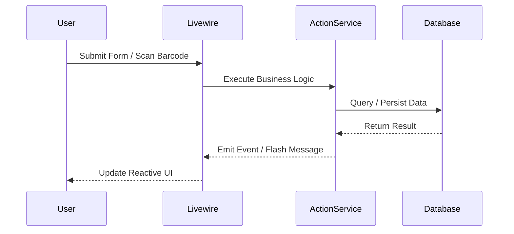

# 📋 Spesifikasi Fitur: [NAMA FITUR]

## 1. Ringkasan Fitur
- **Nama Modul**: [Contoh: Presensi / Perpustakaan / Guru Wali]
- **Target Pengguna**: [Super Admin / Wali Kelas / Siswa / Umum]
- **Tujuan Bisnis**: [Masalah apa yang diselesaikan fitur ini?]

---

## 2. Kebutuhan Fungsional (User Stories)
- Sebagai [Role], saya ingin dapat [Aksi/Keinginan], sehingga [Manfaat yang didapat].
- Sebagai [Role], saya ingin melihat [Laporan/Data], agar [Tujuan tercapai].

---

## 3. Rencana Perubahan Teknis

### A. Basis Data (Database Migration)
- **Tabel Baru / Kolom Tambahan**:
  ```text
  nama_tabel:
    - kolom_1 (tipe_data)
    - kolom_2 (tipe_data)
  ```

### B. Komponen Backend & Model
- **Model Baru**: `App\Models\[NamaModel]`
- **Action / Service Baru**: `App\Actions\` atau `App\Services\`
- **Permission Baru**: `permission_name`

### C. Antarmuka (UI / Frontend)
- **Komponen Livewire / Filament Resource**:
  - `App\Livewire\[NamaKomponen]`
  - Template Blade: `resources/views/livewire/[nama-view].blade.php`

---

## 4. Alur Kerja (Workflow Diagram)


---

## 5. Rencana Pengujian (Test & Acceptance Criteria)
- [ ] Kriteria 1: Validasi form berhasil mencegah input kosong/salah.
- [ ] Kriteria 2: Data berhasil tersimpan ke tabel database.
- [ ] Kriteria 3: Event side-effect (notifikasi WA / log) terpanggil dengan benar.
