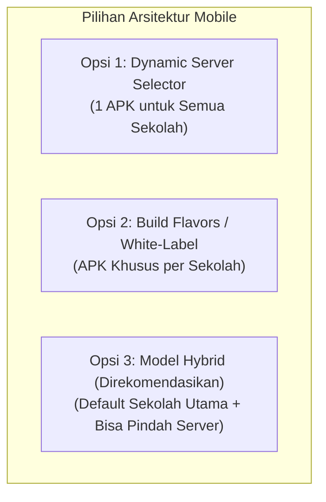

# 🏫 Strategi Multi-Sekolah & Konfigurasi Multi-Server

Dokumen ini menguraikan arsitektur dan strategi teknis pengelolaan aplikasi mobile Flutter ketika backend Laravel diterapkan di **berbagai sekolah berbeda dengan server dan domain masing-masing**.

---

> [!IMPORTANT]
> **Keputusan Desain Final (Disepakati)**:
> Sistem menggunakan **Model Eksklusif Injeksi Langsung (Beda Sekolah = Beda APK)**.
> Alamat server (`BASE_URL`) dan identitas sekolah langsung di-injek ke dalam APK saat proses kompilasi (`flutter build apk`). Siswa dan guru tidak perlu memasukkan URL atau memilih server; aplikasi langsung terbuka dengan identitas dan server sekolah yang bersangkutan.

---

## 📌 Tantangan Arsitektur

Backend Laravel Smart School ERP ini bersifat **Multi-Instance**:
- Setiap sekolah memiliki server atau sub-domain tersendiri, misalnya:
  - SMPN 1 Sampang &rarr; `https://smpn1sampang.sch.id`
  - SMPN 2 Bangkalan &rarr; `https://smpn2bangkalan.sch.id`
  - Staging / Demo &rarr; `https://coba.haflaitsolution.my.id`
  - Pengujian Lokal &rarr; `http://192.168.1.10:8001`

Jika aplikasi mobile di-*hardcode* ke satu alamat IP atau satu domain saja, maka setiap ada sekolah baru pengembang harus mengedit kode sumber dan mengompilasi ulang APK.

---

## 💡 3 Pilihan Strategi Implementasi



---

### 1️⃣ Opsi 1: Dynamic Server Selector (1 APK Universal)
Aplikasi hanya di-*build* 1 kali dan dapat dipakai oleh sekolah mana saja.

- **Cara Kerja**:
  1. Saat pertama kali aplikasi dibuka di HP siswa/guru, muncul layar selamat datang:
     - *"Pilih atau Masukkan Kode Sekolah Anda"* (misal ketik `smpn1sampang` atau masukkan domain).
     - Atau cukup **Scan Barcode Kartu Pelajar** (URL server otomatis terbaca dari QR kartu).
  2. Aplikasi memanggil `GET https://[domain-sekolah]/api/v1/school-info`.
  3. Jika domain valid, server mengembalikan nama sekolah dan logo resmi.
  4. URL server disimpan permanen di perangkat pengguna via `SharedPreferences`.
  5. Pengguna diarahkan ke layar login.
- **Kelebihan**:
  - **Super Hemat Waktu & Biaya**: Cukup 1 kali upload ke Google Play Store.
  - Sekolah baru yang bergabung tidak memerlukan rilis APK baru.
- **Kekurangan**:
  - Siswa/guru harus memasukkan kode/domain sekolah satu kali di awal.

---

### 2️⃣ Opsi 2: Build Flavors / White-Labeling (APK Khusus per Sekolah)
Setiap sekolah mendapatkan file APK independen dengan nama, logo, dan server bawaan.

- **Cara Kerja**:
  Menggunakan parameter kompilasi Flutter `--dart-define`:
  ```bash
  # Build untuk SMPN 1 Sampang
  flutter build apk --release \
    --dart-define=APP_NAME="Portal SMPN 1 Sampang" \
    --dart-define=BASE_URL="https://smpn1sampang.sch.id/api/v1" \
    --dart-define=SCHOOL_CODE="SMPN1SMPG"

  # Build untuk SMPN 2 Bangkalan
  flutter build apk --release \
    --dart-define=APP_NAME="Portal SMPN 2 Bangkalan" \
    --dart-define=BASE_URL="https://smpn2bangkalan.sch.id/api/v1" \
    --dart-define=SCHOOL_CODE="SMPN2BKL"
  ```
- **Kelebihan**:
  - Nama aplikasi dan ikon di HP langsung mencerminkan nama sekolah tertentu.
  - Pengguna tidak perlu mengetik alamat server sama sekali (langsung ke layar login).
- **Kekurangan**:
  - Jika mengelola 20 sekolah, harus menjalankan 20 kali proses build APK.

---

### 3️⃣ Opsi 3: Model Hybrid (Rekomendasi Utama)
Menggabungkan kenyamanan Opsi 2 dengan fleksibilitas Opsi 1:

1. **Default Preset**:
   Aplikasi secara bawaan diset langsung mengarah ke server sekolah utama (misal: **SMPN 1 Sampang**). Pengguna mayoritas tidak perlu mengisi konfigurasi apa pun dan langsung melihat layar login SMPN 1 Sampang.
2. **Tombol Pengaturan Server (Ganti Server Sekolah)**:
   Di pojok kanan atas layar login terdapat tombol ikon gear / server kecil (atau bisa diakses dengan mengetuk logo sekolah 5 kali):
   - Memungkinkan pengguna/guru mengganti alamat server ke server sekolah lain atau server lokal pengujian (`http://192.168.x.x:8001`).
3. **Penyimpanan Lokal**:
   Alamat server aktif disimpan di `SharedPreferences` dengan fallback ke nilai default:
   ```dart
   final activeBaseUrl = prefs.getString('server_url') ?? AppConfig.defaultBaseUrl;
   ```

---

## 🛠️ Implementasi Kode pada Flutter

File konfigurasi pusat diletakkan di `lib/core/config/app_config.dart`:

```dart
class AppConfig {
  // Nilai bawaan jika pengguna tidak mengganti server
  static const String defaultBaseUrl = String.fromEnvironment(
    'BASE_URL',
    defaultValue: 'https://coba.haflaitsolution.my.id/api/v1',
  );

  static const String defaultAppName = String.fromEnvironment(
    'APP_NAME',
    defaultValue: 'Portal SMPN 1 Sampang',
  );

  // Kunci penyimpanan lokal
  static const String keyServerUrl = 'custom_server_base_url';
  static const String keySchoolInfo = 'cached_school_info';
}
```

Dengan struktur ini:
- Anda bisa langsung *build* APK khusus sekolah dengan flag `--dart-define=BASE_URL=...` kapan pun dibutuhkan.
- Aplikasi juga tetap memiliki kemampuan berganti server tanpa harus di-reinstall!

